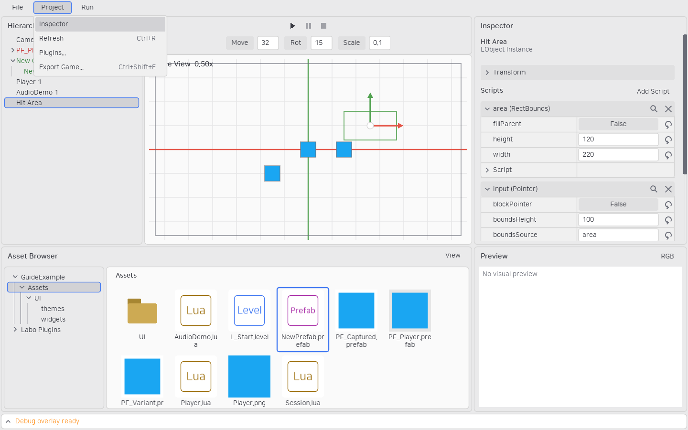
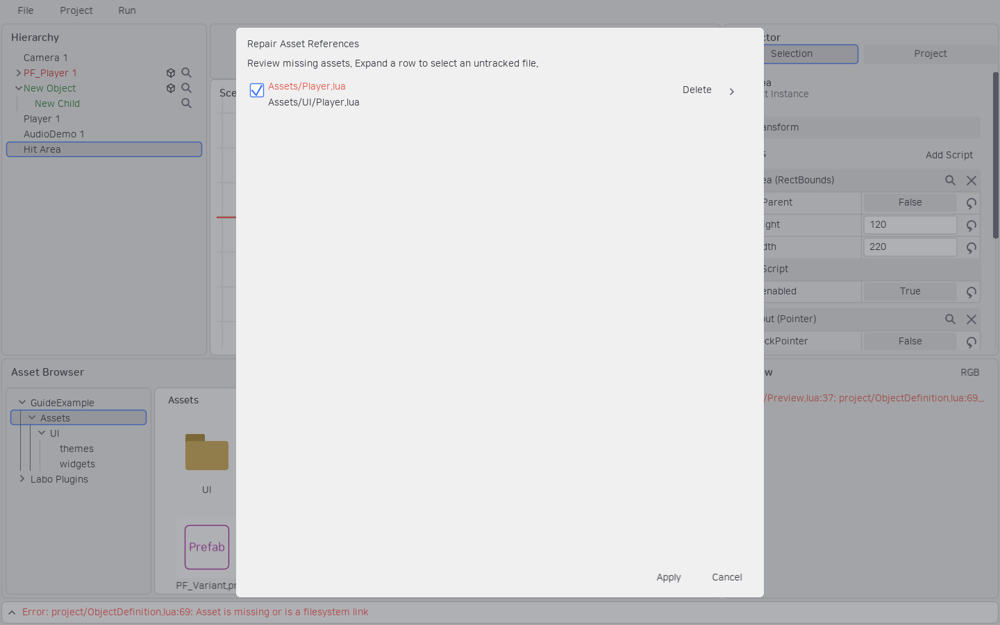
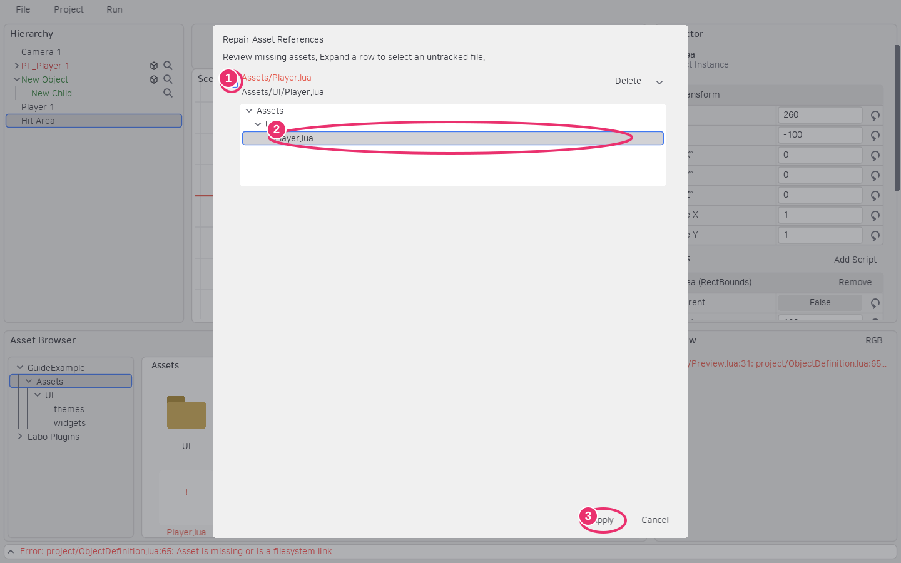

# 에셋 목록과 참조 복구

게임에 사용할 에셋은 `Assets`에 둡니다. 빌드 스크립트는 `Tools`, 배포·제작 안내는 `Docs`에 둘 수 있습니다. 에셋 ID·Lua 종류·최근 확인한 내용 해시는 프로젝트 루트의 `assets.json` 한 파일로 관리합니다. 각 플러그인도 같은 이름의 파일을 사용합니다.

```text
MyGame/
├─ assets.json
├─ Assets/
└─ Plugins/MyPlugin/
   ├─ plugin.json       # 플러그인 설정·의존성·공개 스크립트 경로
   ├─ assets.json       # 이 플러그인의 에셋 메타데이터
   └─ Assets/
```

`assets.json`은 Git에 포함합니다. 기존 프로젝트를 열면 `.meta`의 ID를 유지한 채 중앙 목록으로 이전하며, 목록 저장에 성공한 뒤 기존 `.meta`를 제거합니다. Labo 플러그인도 별도 `assets.json`을 사용합니다. `plugin.json`에서 ID를 중복 관리하지 않습니다. 내부 플러그인 경로와 기존 Prefab·레벨의 ID 참조는 유지됩니다.

## 프로젝트 갱신

상단 **Project → Refresh** 또는 **Ctrl+R**로 파일 목록과 관련 화면·캐시를 갱신합니다. 에셋 브라우저에는 View 버튼만 남습니다. 미저장 문서와 저장된 문서의 Undo 기록은 유지합니다. Play 중에는 먼저 Stop합니다.



파일 생성·이동·이름 변경·삭제는 에디터나 CLI로 수행하면 ID와 중앙 목록을 함께 갱신합니다. 외부에서 새 파일을 추가했을 때 끊어진 등록이 없다면 Refresh가 새 ID를 발급합니다. 끊어진 등록이 있으면 같은 소유 범위의 미등록 파일은 복구 후보로 보존하며 임의로 새 ID를 발급하지 않습니다.

파일이 사라져도 기존 등록 경로는 예약되어 있습니다. 해당 위치의 새 파일 생성·복사·임포트·이동은 거부됩니다. 먼저 복구 창에서 기존 ID를 새 위치에 연결하거나, 참조되지 않는 등록을 명시적으로 삭제합니다. 폴더에 끊어진 자손 등록이 남아 있는 경우도 같습니다. Windows의 경로 대소문자 차이는 같은 등록으로 취급합니다.

## 끊어진 등록 복구

1. 외부에서 파일을 옮긴 뒤 Refresh합니다.
2. 등록된 경로에 파일이 없으면 **Repair Asset References** 창이 열립니다. 자동으로 복구하지 않습니다.
3. 왼쪽 체크박스로 적용할 항목을 고릅니다. 같은 범위·확장자의 미등록 파일 중 내용 해시가 유일하게 일치한 후보만 기본 선택합니다.
4. 오른쪽 화살표로 행을 펼쳐 미등록 파일 트리에서 대상을 직접 선택할 수 있습니다. 파일을 옮기면서 내용을 수정했거나 후보가 여러 개면 수동 선택합니다.
5. **Apply**를 누르면 기존 ID를 유지하고 경로를 변경합니다. 적용 직전 파일·목록의 변경과 대상 중복을 다시 검사합니다.





Cancel은 등록을 바꾸지 않습니다. 에셋 브라우저에서 끊어진 등록은 원래 위치에 빨간 `!`와 빨간 이름으로 남습니다. 해당 파일을 더블클릭하면 같은 복구 창에서 그 항목을 펼칩니다. 존재하지 않는 상위 폴더도 필요한 경우 트리에 표시합니다. 여러 ID가 같은 후보를 요구하면 기본 선택하지 않습니다.

각 행의 **Delete**는 실제 후보 파일을 삭제하는 것이 아니라 사라진 에셋의 등록 제거를 선택합니다. **Apply**할 때 수행하며, Prefab·레벨·Lua·기본 레벨·현재 미저장 레벨에서 사용하는 ID는 사용처를 안내하고 제거를 거부합니다. **Undo**는 해당 행의 삭제 선택을 취소합니다. Labo 에셋은 편집할 수 없으므로 에디터 설치 파일을 복원해야 합니다.

현재 열어 둔 레벨·미저장 Prefab·플러그인이 공개한 스크립트의 등록도 보호합니다. 복구는 ID 참조를 유지하며 Lua 소스의 `require("폴더.모듈")` 같은 경로 문자열을 자동으로 다시 쓰지는 않습니다. 이런 직접 경로가 있다면 코드도 수정합니다.

## AI·CLI

- `project.refresh`: 갱신하고 복구 계획 조회.
- `project.repair-plan`: 끊어진 등록·수동 후보·추천 대상·계획 revision 조회.
- `project.repair`: 검토한 revision과 선택한 changes를 전달하여 적용.

```json
{
  "command": "project.repair",
  "project": "D:/Games/MyGame",
  "revision": "계획에서 받은 revision",
  "changes": [
    {"id": "기존 에셋 ID", "target": "Assets/Characters/Enemy.lua"},
    {"id": "사용하지 않는 사라진 에셋 ID", "delete": true}
  ]
}
```

## 에셋 ID 복사

1. 에셋 브라우저에서 파일을 우클릭합니다.
2. **Copy ID**를 누르면 에셋 UUID가 클립보드에 복사됩니다.


①은 ID 복사 항목입니다. 프로젝트 파일과 읽기 전용 플러그인 파일 모두 사용할 수 있습니다. 폴더·링크·미등록 파일에는 제공하지 않습니다. Inspector 스크립트 헤더의 Copy ID는 해당 부착의 UUID이고, 에셋 브라우저의 Copy ID는 원본 파일의 UUID입니다. 상속의 `extends`에는 원본 파일 ID를 사용합니다.

같은 폴더의 파일명 중복은 허용하지 않지만 다른 폴더의 동명 스크립트는 허용합니다. 새 상속 코드는 사용자·플러그인 모두 부모 에셋 ID를 기록하므로 이름 변경·이동에도 참조를 유지합니다.

## 오디오 에셋

WAV·OGG·MP3·FLAC 파일을 에셋 브라우저에 임포트할 수 있습니다. Script 프로퍼티를 `{type = "audio", default = false}`로 선언하면 Inspector에서 오디오 파일을 선택할 수 있습니다. 드롭다운 또는 스포이드로 선택하고, 돋보기로 원본을 찾습니다. 선택 시 확장자와 실제 디코딩 가능 여부를 확인합니다. 프로젝트·활성 플러그인의 오디오가 같은 에셋 ID·이동·Export 계약을 사용합니다.

오디오는 LÖVE가 직접 재생합니다. `world:getAssetData(id)`로 읽은 FileData를 `love.audio.newSource`에 넘기며, 재생·중첩·볼륨·반복·일시정지·탐색은 게임 코드에서 처리합니다. 에디터 Pause가 네이티브 Source를 자동으로 일시정지하지는 않습니다. 에디터 미리보기는 Script의 load를 호출하지 않으므로 소리를 재생하지 않습니다.


①의 드롭다운으로 파일을 선택하거나 스포이드로 에셋을 고릅니다. 돋보기는 지정한 원본 파일을 찾습니다.

## 스크립트 코드 열기

Lua 에셋을 더블클릭하거나 Inspector 부착 스크립트 헤더를 우클릭해 **Open Code**를 선택합니다. 기존 원본 찾기는 에셋 브라우저 위치를 찾고, Open Code는 외부 편집기로 파일을 엽니다.


VS Code는 사용자·시스템 설치 경로와 PATH에서 자동 탐색하며 `--reuse-window`로 마지막 활성 창을 재사용합니다. 창이 없으면 VS Code가 시작됩니다. 여러 창 중 해당 프로젝트 창을 정확히 지정하는 기능은 아닙니다. 기본 설치에서는 IDE 설정이 필요 없습니다.

자동 탐색이 실패하거나 다른 편집기를 사용하려면 에디터 공통 설정에 다음을 지정합니다. 소스 실행은 src/editor/settings.json, 배포 실행은 실행 파일 옆 settings.json입니다. 기존 version·theme 설정과 함께 둡니다.

```json
{
    "version": 1,
    "theme": "atom-one-light",
    "codeEditor": {
        "executable": "C:/Tools/Editor/Editor.exe",
        "arguments": ["{file}"]
    }
}
```

arguments는 문자열 배열입니다. `{file}`은 전체 경로로 치환하고, 없으면 파일을 마지막 인자로 추가합니다. 셸 명령·배치 파일은 실행 파일 설정으로 받지 않습니다. 실행 실패는 에디터에 오류로 표시됩니다.

제공 플러그인 소스는 원본 캐시 대신 .labo/CodePreview 아래의 읽기 전용 사본을 엽니다. 이 사본을 수정해도 게임 기능을 변경하는 방식이 아닙니다. 프로젝트·사용자 플러그인 소스는 실제 파일을 엽니다. 파일 열기를 지원하며 특정 함수·줄로 이동하는 기능은 포함하지 않습니다.

## 에셋 다중 선택

파일 영역의 빈 곳에서 드래그하면 겹치는 에셋을 선택합니다. Ctrl+클릭은 추가·해제, Shift+클릭은 범위 선택, Ctrl+A는 전체 선택입니다. 선택 항목을 폴더로 드래그하거나 우클릭 Move로 함께 이동합니다. Delete는 확인창을 열며 다중 이동·삭제는 한 번에 Undo/Redo합니다. Rename은 단일 선택에서 사용합니다.
