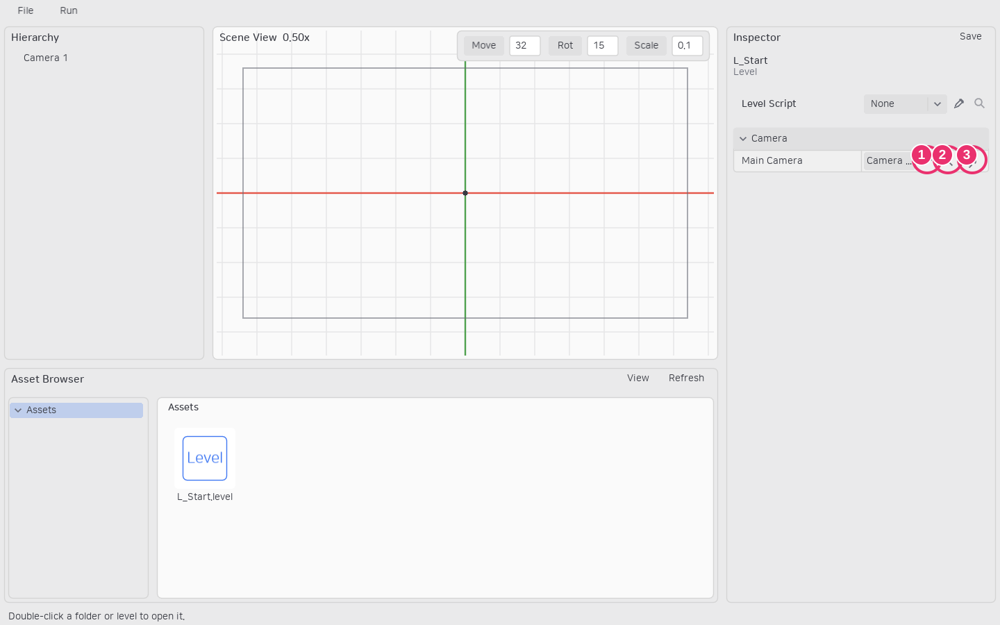

# 카메라와 화면 UI


Camera·Sprite·Pointer·RectBounds·Canvas를 사용하려면 먼저 [플러그인](plugins.md)을 활성화합니다. 새 프로젝트에서는 모두 꺼져 있습니다.

## Main Camera

빈 곳을 클릭해 레벨 Details를 열고 Camera 그룹의 Main Camera 스포이드를 누릅니다. Camera 스크립트가 부착된 인스턴스를 고르고, 여러 개면 부착 ID를 선택합니다. 레벨에는 `{authoringId, script}`를 저장합니다.



찾기는 해당 인스턴스를 프레이밍하고 리셋은 Auto로 돌아갑니다. 지정 카메라가 없으면 첫 번째 카메라, 카메라가 전혀 없으면 원점·배율 1을 사용합니다. 별도 enabled는 없습니다. `world:setActiveCamera(camera)`로 런타임 전환합니다.

## 카메라 크기와 방향

카메라 인스턴스의 Camera 프로퍼티 그룹을 펼칩니다. viewWidth/viewHeight는 실제 출력 픽셀 수가 아니라 기준 월드 범위입니다. 기본 1280×720, zoom=1에서 1920×1080에 출력하면 월드 1단위는 화면 1.5픽셀입니다. zoom이 커지면 보이는 범위는 줄어듭니다. 비율이 다르면 범위를 유지하고 여백을 둡니다.


①은 Scene View의 카메라 가시 영역, ②는 크기·zoom 설정입니다. 위치는 부모 Transform을 합성하지만 방향은 조상과 자신의 Z 회전만 합산합니다. X/Y 기울기와 스케일은 카메라 방향·확대율에 반영하지 않습니다.

## Canvas와 영역

Canvas 스크립트가 붙은 LObject는 화면 좌표계를 시작합니다. 화면 중심은 (0,0), 오른쪽·아래는 양수이며 1단위는 1픽셀입니다. matchViewport가 켜지면 출력 크기, 꺼지면 width/height를 사용합니다. Canvas 위 조상과 카메라 이동은 UI에 적용하지 않습니다.

```text
Hud LObject [Canvas]
└─ Panel LObject [RectBounds]
   └─ Button LObject [Sprite, Pointer]

대괄호: 오브젝트가 소유하는 부착 스크립트
Pointer.boundsSource → 같은 Button의 Sprite 부착 ID
```

RectBounds는 게임에서 그림을 그리지 않는 영역입니다. 편집 화면에서는 경계를 표시하고 PIE에서는 숨깁니다. 그림에는 Sprite, 클릭에는 Pointer 또는 사용자 hitTest를 부착합니다. fillParent는 가장 가까운 부모 오브젝트의 영역을 사용합니다. 정확히 채우려면 자손 Transform을 기본값으로 둡니다. 앵커·자동 레이아웃·자손 클리핑은 제공하지 않습니다.

## 표시와 입력 순서

sortingOrder가 클수록 앞에 표시합니다. inputPriority가 큰 Pointer가 먼저 입력을 받고 기본 0에서는 참조 렌더러의 표시 순서를 따릅니다. Canvas는 월드보다 앞에 표시되고 우선 입력을 받습니다.

onPointerDown/up/move에서 true를 반환하거나 blockPointer가 켜지면 뒤로 전달하지 않습니다. 소비한 down 이후 영역 밖 move/up도 캡처 대상으로 전달합니다. 여러 버튼의 캡처는 각각 해제합니다. 포커스 상실·Play 종료·입력 오류도 캡처를 정리합니다. 사용자 스크립트도 선택적인 getLocalBounds/hitTest와 포인터 콜백을 직접 구현할 수 있습니다.
