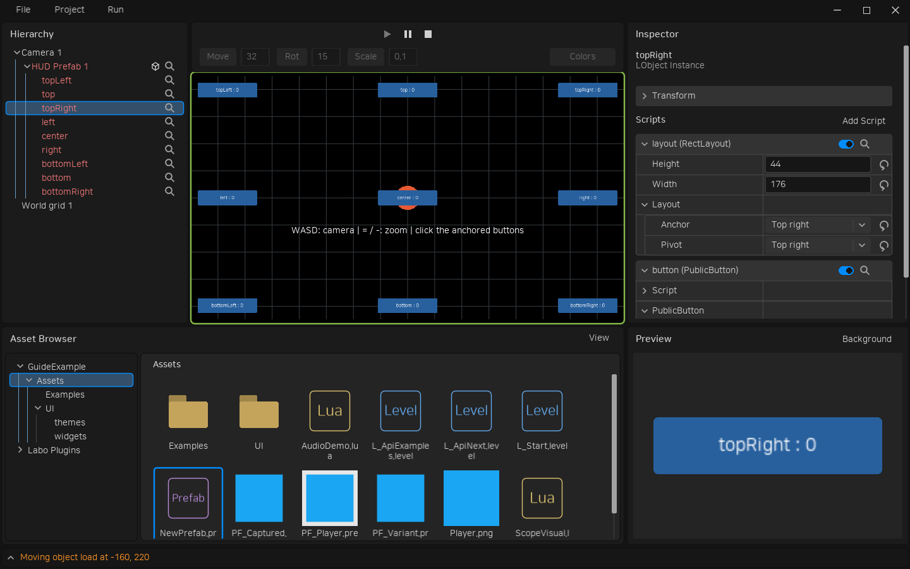
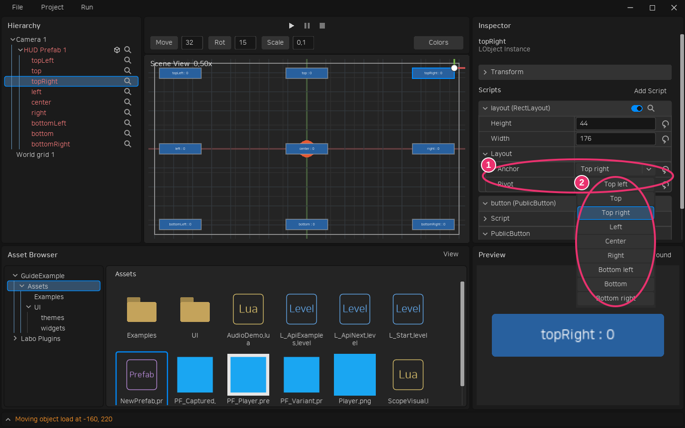
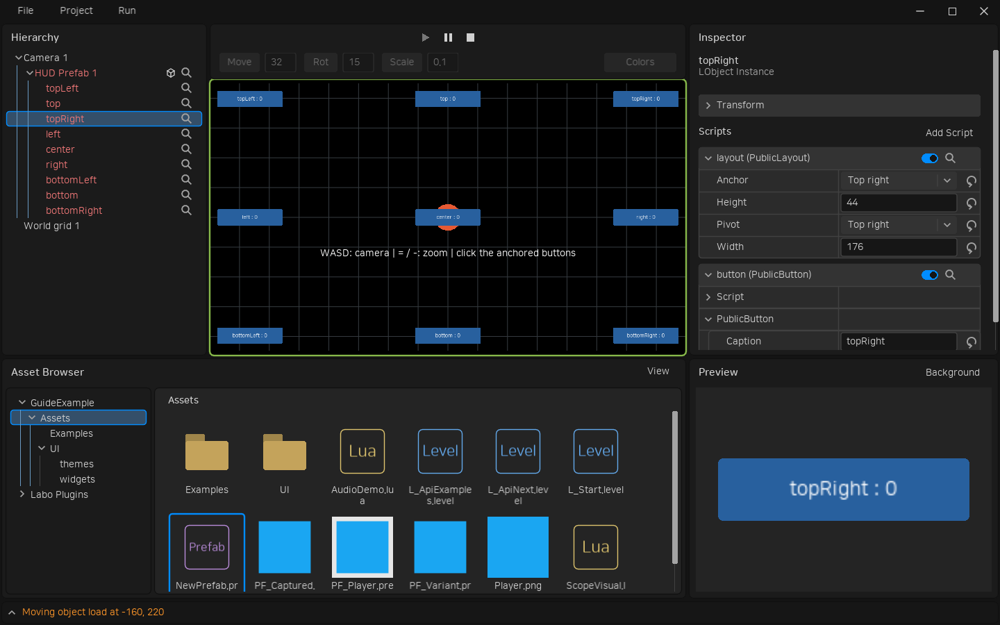

# 카메라·HUD·렌더링

Camera·View·Canvas·RectLayout은 LaboEssentials의 편의 스크립트입니다. Core는 이 타입을 구분하지 않습니다. 플러그인 없이도 같은 공개 API로 카메라·UI를 직접 만들 수 있습니다.

## Camera와 View

1. Camera 오브젝트에 Camera와 View 스크립트를 부착합니다.
2. View의 Camera source 스포이드로 Camera 부착을 지정합니다.
3. Camera의 View width·View height·Zoom을 설정합니다. 1280×720, Zoom 2는 월드 640×360을 표시합니다.
4. Play를 실행합니다. View가 없으면 게임 장면을 그리지 않습니다.


카메라는 자동 선택하지 않습니다. View 스크립트는 소스의 일반 getProjection 메서드를 사용합니다. 다른 구현의 스크립트도 이 메서드로 투영을 제공하면 연결할 수 있습니다.

## 카메라 아래 HUD Prefab

```text
Camera object [Camera, View]
└ HUD Prefab [Canvas]
  ├ Panel [RectLayout, Sprite]
  ├ Button [RectLayout, Pointer 또는 사용자 입력 스크립트]
  └ Label [RectLayout, Text]
```

Canvas는 별도 화면 좌표계를 만들지 않습니다. 부모 카메라의 표시 영역에 맞게 일반 Transform을 계산합니다. Camera source를 비워 두면 부모 계층에서 투영 제공 스크립트를 찾습니다. Prefab 내부에 외부 카메라 참조를 저장할 필요 없이 카메라 아래에 배치할 수 있습니다. 명시적 Camera source로 다른 소스를 선택할 수도 있습니다.

Match camera를 켜면 Canvas의 Width·Height를 기준 해상도로 사용하고 카메라 표시 영역에 맞는 균일 배율을 계산합니다. 종횡비가 다르면 논리 영역을 확장합니다. **같은 출력 크기에서 카메라 줌을 바꿔도 버튼 크기와 간격은 유지**됩니다. 창·View 영역의 크기를 바꾸면 기준 해상도에 맞춰 UI도 확대·축소됩니다. Match camera를 끄면 일반 고정 크기 월드 사각형입니다.

HUD 전체를 Prefab으로 저장하고 다른 Prefab으로 교체할 수 있습니다. 게임 코드에서는 기존 spawnLObject·attachTo·removeLObject를 사용합니다. 별도 UI World나 필수 UI View는 없습니다. 제공 View 스크립트는 다른 카메라에 연결된 HUD를 자신의 출력에서 제외합니다. 직접 View를 만들 때는 filter로 같은 정책을 구현합니다.



## Anchor와 Pivot

UI 오브젝트에 RectLayout을 부착합니다. **Anchor는 부모 사각형에서 위치를 잡는 기준**, **Pivot은 자기 사각형의 원점**입니다. 이동·회전·스케일도 이 원점을 기준으로 적용합니다.

| 왼쪽 | 가운데 | 오른쪽 |
|---|---|---|
| Top left | Top | Top right |
| Left | Center | Right |
| Bottom left | Bottom | Bottom right |

Inspector의 Anchor·Pivot 목록에서 9개 위치를 선택합니다. 코드·CLI 값은 topLeft, top, topRight, left, center, right, bottomLeft, bottom, bottomRight입니다.



① 부모 기준 Anchor와 자기 원점 Pivot입니다. ② 목록에서 위치를 선택합니다.

예를 들어 Anchor=Top right, Pivot=Top right, Transform X=-20/Y=20이면 부모 오른쪽 위에서 왼쪽으로 20, 아래로 20만큼 들어옵니다. Width·Height는 자기 사각형 크기입니다. Sprite·Text·Pointer는 같은 오브젝트의 대표 사각형을 사용할 수 있습니다.

저장된 Transform에는 이 오프셋을 보존합니다. 배치는 조회 시 계산하므로 update 순서를 조정하지 않아도 됩니다. Scene에서 이동 핸들을 드래그하면 유효 위치를 다시 앵커 오프셋으로 변환합니다. 에디터·Play·Preview·입력 판정이 같은 변환을 사용합니다. CLI의 `instance list`·`instance reparent`·`instance reorder`도 같은 배치 계산과 역변환을 사용하므로 부모를 바꿔도 월드 위치를 보존합니다.

## 플러그인 없는 공개 API

| API | 역할 |
|---|---|
| Rendering.createView(world, {projection, ...}) | 투영 데이터·제공 함수로 자동 출력 등록 |
| Rendering.normalizeProjection(data) | 투영 검증·복사. transform 생략 시 원점 변환 적용, nil은 그대로 반환 |
| view:setProjection(dataOrFunction) | 투영 교체. 제공 함수가 nil이면 출력·입력 중단 |
| Transform.bindLocal(object, {owner, resolve, unresolve}) | 저장 Transform → 유효 로컬 변환과 편집 역변환 등록 |
| Transform.relative(parent, world) / affine(transform) | 부모 기준 affine 변환 계산·검증 |
| Bounds.bind(script, provider, {primary=true}) | 스크립트 영역·객체 대표 사각형 등록 |
| Bounds.of(object, context) / parent(object, context) | 객체·가장 가까운 부모 대표 사각형 조회 |
| Input.registerRegion(world, options) | 명시적인 입력 영역·콜백 등록 |
| Rendering.withScreen(context, fn) | draw 안의 특정 구간을 화면 픽셀 좌표로 그리기 |

```lua
local Engine = require("Engine")
local CustomCamera = {}
function CustomCamera:load(world)
    self.view = Engine.Rendering.createView(world, {
        owner = self,
        projection = function()
            return {width = 1280, height = 720,
                transform = self.owner:getWorldTransform()}
        end,
    })
end
function CustomCamera:unload() self.view:release() end
return CustomCamera
```

투영의 width·height는 보이는 월드 크기이고 transform은 중심·방향·배율을 나타냅니다. 역변환 가능한 affine 행렬도 받습니다. Core가 Camera 스크립트나 전용 표식을 요구하지 않습니다. projection 자체를 생략하면 원점·배율 1 출력이고, 등록한 제공 함수가 nil을 반환하면 해당 View가 비활성입니다.

Transform·Bounds 등록은 configure에서 수행합니다. 제공 함수 안에서 현재 프로퍼티·부모·참조를 읽습니다. configure 시점에는 다른 부착과 참조가 아직 준비되지 않았을 수 있습니다. 입력·게임 자원은 load에서 등록합니다. 바인딩·입력 영역은 소유 Script 제거·종료 시 자동 정리되고 반환 핸들의 release로 먼저 해제할 수도 있습니다. enabled=false는 해당 등록 효과를 중단합니다. 편집 위치 조작을 지원하려면 unresolve를 제공합니다.

Bounds.parent는 사각형의 로컬 x·y·폭·높이와 그 영역을 제공한 조상 오브젝트를 다섯 번째 값으로 반환합니다. 중간에 일반 그룹 오브젝트가 있으면 RectLayout은 앵커 점을 실제 부모 좌표로 변환합니다.

## Pointer와 직접 입력 등록

Pointer를 쓰면 같은 오브젝트의 대표 사각형을 기본 영역으로 사용합니다. Bounds source에는 같은 오브젝트의 다른 영역 스크립트 ID·이름을 지정할 수 있습니다. Input priority가 클수록 먼저 받고, 기본 우선순위에서는 참조 영역의 Draw order와 표시 순서를 따릅니다. OnPointer 콜백은 Pointer 편의 스크립트의 계약이며 Core가 자동 검색하지 않습니다.

플러그인 없이 입력을 받으려면 직접 등록합니다.

```lua
local Engine = require("Engine")
local Button = {properties = {clicks = {type = "number", default = 0}}}
-- 같은 오브젝트의 RectLayout이 제공한 사각형을 클릭 영역으로 사용한다.
function Button:configure()
    Engine.Bounds.bind(self, function(context)
        return Engine.Bounds.of(self.owner, context)
    end)
end
function Button:load(world)
    self.region = Engine.Input.registerRegion(world, {
        owner = self,
        hitTest = function(context, x, y)
            return self:hitTest(context, x, y)
        end,
        onDown = function(event)
            self.clicks = self.clicks + 1
            return true
        end,
    })
end
return Button
```

hitTest는 월드 x/y를 받고 hit, localX, localY를 반환합니다. 영역은 Bounds.bind 또는 일반 getLocalBounds로 제공합니다. onDown/onUp/onMove가 true를 반환하면 소비하며 누름을 캡처합니다. 캡처 뒤 영역 밖 move/up도 같은 영역에 전달하고 event.inside로 안쪽 여부를 확인합니다.

선택적 order·priority는 숫자 또는 제공 함수이고, block은 boolean 또는 제공 함수입니다. 기본 order는 owner.drawOrder입니다. filterSource는 View 필터에 사용할 Script를 반환하는 함수이며 기본은 owner입니다. 이벤트에는 worldX/Y, localX/Y, screenX/Y, dx/dy, button, inside, world, view, projection, viewport가 들어옵니다. screenX/Y는 게임 영역 왼쪽 위 기준 픽셀이고 dx/dy는 월드 좌표 변화량입니다.

## RenderTarget과 미니맵

```lua
local Rendering = require("Engine.Rendering")
function GameRendering:load(world)
    self.mapTarget = Rendering.createTarget(world, {width = 512, height = 512})
    self.mapView = Rendering.createView(world, {
        projection = function() return self.mapCamera:getProjection() end,
        target = self.mapTarget, order = -10, input = false, owner = self,
        filter = function(script) return script ~= self end,
    })
    self.mainView = Rendering.createView(world, {
        projection = function() return self.mainCamera:getProjection() end,
        owner = self,
    })
end
function GameRendering:draw(context)
    if context.view ~= self.mainView then return end
    context:withScreen(function()
        love.graphics.setColor(1, 1, 1, 1)
        love.graphics.setBlendMode("alpha", "premultiplied")
        love.graphics.draw(self.mapTarget:getTexture(), context.viewport.width - 276, 20, 0, 0.5, 0.5)
    end)
end
```

mainCamera·mapCamera는 사용자 스크립트의 일반 참조 프로퍼티입니다. 생산 View의 order를 작게 둡니다. 현재 쓰고 있는 타깃을 getTexture로 읽으면 오류입니다. 타깃 해상도·월드 가시 범위·화면 표시 크기는 서로 독립적입니다. 종료 때 View·Target을 release하거나 World 종료의 자동 정리를 사용합니다.

생성 옵션은 projection·target·viewport·order·enabled·input·filter·clearColor·owner입니다. View viewport는 타깃 내 픽셀 사각형이고 카메라 비율은 레터박스로 유지합니다. clearColor는 0~1 RGBA이고 기본은 불투명 검정, false는 기존 내용을 유지합니다. filter(script)는 렌더링·Pointer 입력에 함께 적용됩니다. owner 비활성·제거, projection 제공 함수의 nil, 타깃 해제로 비활성이 되면 캡처를 취소합니다.

View:setTarget/setViewport/setOrder/setEnabled, Target:getTexture/resize/release도 사용할 수 있습니다. update는 World당 한 번, draw는 포함된 View마다 실행합니다. 화면 출력만 직접 입력을 받고 텍스처 미니맵의 클릭 재투영은 사용자 코드가 결정합니다.

## 예제와 이전 데이터 전환

- Assets/Examples/L_AnchoredHud.level: Camera·View·Canvas·RectLayout과 재사용 가능한 HUD Prefab.
- Assets/Examples/L_PublicApiHud.level: 제공 스크립트를 쓰지 않는 API 전용 카메라·배치·버튼.
- Assets/Examples/L_Multiview.level: 별도 타깃 미니맵.



```powershell
love src --cli project examples-ui --project D:/Games/MyGame
# 플러그인을 활성화하지 않고 API 전용 예제만 생성
love src --cli project examples-ui --project D:/Games/EmptyGame --public-only
love src --cli project migrate-rendering --project D:/Games/MyGame --dry-run
love src --cli project migrate-rendering --project D:/Games/MyGame
```

마이그레이션은 mainCamera를 명시적 View로 바꾸고 기존 Canvas의 카메라 연결·matchViewport → matchCamera, 제공 View의 이전 좌표계 플래그를 정리합니다. 기존의 명시적인 Canvas 카메라 참조와 이미 연결된 계층은 보존합니다. 변환 후 재실행하면 추가 변경이 없습니다. GUI 문서를 저장한 뒤 실행하고 dry-run의 파일 목록을 먼저 확인합니다.

사용자 Lua의 drawScreen은 draw 안의 withScreen 호출로, createView의 camera 옵션은 projection 제공 함수로 바꿉니다. includeWorld/includeScreen은 filter로 전환합니다. 사용자 코드의 변환은 자동으로 수행하지 않으므로 저장 데이터 마이그레이션 전에 Lua를 먼저 갱신합니다. 미변환 mainCamera는 Play·Export 시 변환 명령 안내 오류를 표시합니다.
