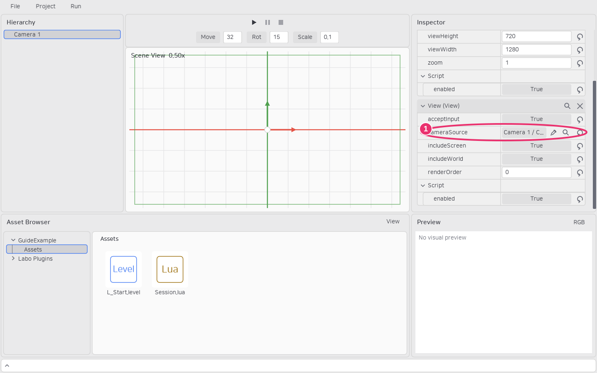
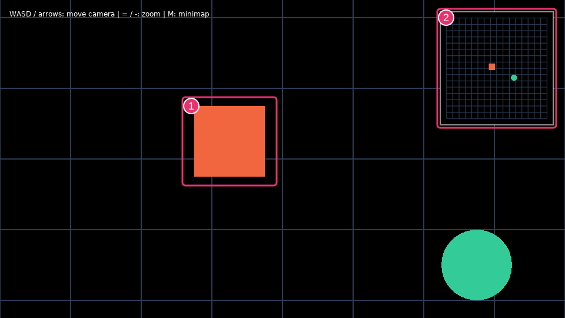
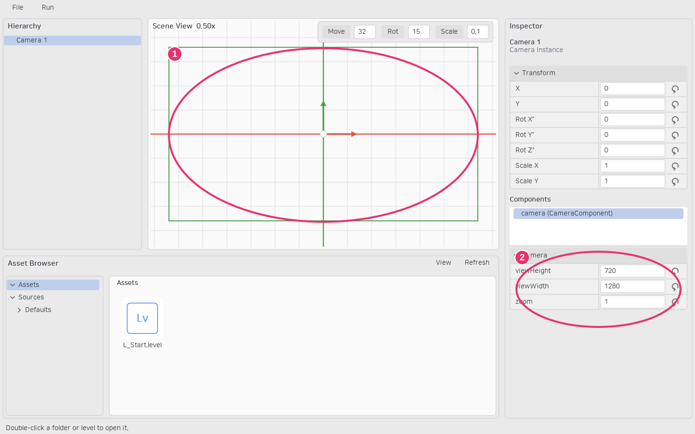

# 카메라와 화면 UI


Camera·View·Sprite·Pointer·RectBounds·Canvas를 사용하려면 먼저 [플러그인](plugins.md)을 활성화합니다. 새 프로젝트에서는 모두 꺼져 있습니다.

## Camera와 View로 화면 구성

레벨에는 내장 Main Camera 설정이 없으며 새 레벨은 카메라를 자동 생성하지 않습니다. Camera 오브젝트만 배치하면 게임 화면에는 아직 출력되지 않습니다.

1. LaboEssentials를 활성화하고 Camera 스크립트를 오브젝트에 부착합니다.
2. 같은 오브젝트 또는 레벨에 View 스크립트를 부착합니다.
3. View의 **Camera source** (`cameraSource`) 스포이드로 사용할 Camera 부착을 지정합니다. 여러 스크립트 중 Camera를 선택합니다.
4. ▶로 실행합니다. View가 출력을 등록하고 엔진이 매 프레임 그립니다. 카메라 이동·줌은 다음 렌더링에 반영됩니다.

View의 renderOrder는 출력 순서이며 작은 값부터 그립니다. includeWorld는 월드 그리기, includeScreen은 Canvas·drawScreen을 포함합니다. acceptInput은 해당 화면 View의 Pointer 입력을 허용합니다. View 스크립트 헤더에서 돋보기 왼쪽 활성 토글을 끄면 출력도 멈춥니다.



① Camera source의 스포이드로 Camera 부착을 지정합니다.

레벨 Inspector에는 일반 Script 부착만 표시합니다. 기존 mainCamera 저장값은 명시적인 활성 View가 없는 과거 레벨에서 호환 View로 해석하며 파일 저장 시 보존합니다. 호환 View는 선택된 카메라가 제거되거나 비활성화되면 남은 카메라로 자동 대체하고, 모두 없으면 원점·배율 1로 출력합니다. 새 코드는 아래 렌더링 API를 사용합니다.

## 렌더 타깃과 미니맵

`require("Engine.Rendering")` 또는 `require("Engine").Rendering`으로 공용 API에 접근합니다. 별도의 render 콜백은 없습니다.

```lua
local Rendering = require("Engine.Rendering")

function GameRendering:load(world)
    self.mapTarget = Rendering.createTarget(world, {width = 512, height = 512})
    self.mapView = Rendering.createView(world, {
        camera = self.mapCamera, target = self.mapTarget,
        order = -10, includeScreen = false, input = false, owner = self
    })
    self.mainView = Rendering.createView(world, {
        camera = self.mainCamera, target = Rendering.screen, owner = self
    })
end

function GameRendering:drawScreen(context)
    love.graphics.setColor(1, 1, 1, 1)
    love.graphics.setBlendMode("alpha", "premultiplied")
    love.graphics.draw(self.mapTarget:getTexture(), context.viewport.width - 276, 20, 0, 0.5, 0.5)
end
```

mainCamera·mapCamera는 이 스크립트에 선언하는 `type="script", default=false` 참조 프로퍼티입니다. 월드 4000×4000을 512×512 텍스처에 그리고 화면에는 256×256으로 표시할 수 있습니다. 타깃 해상도·월드 가시 범위·표시 크기는 서로 독립적입니다.



① 메인 Camera가 게임 화면에 직접 출력합니다. ② 지도 Camera는 별도 텍스처에 먼저 그리고 HUD가 그 결과를 표시합니다. 테스트 프로젝트의 **Assets/Examples/L_Multiview.level**에서 WASD/방향키로 메인 카메라 이동, `=`/`-`로 줌, M으로 미니맵 출력을 확인합니다.

| API | 동작 |
|---|---|
| Rendering.createView(world, options) | View를 생성·등록하고 자동 렌더링 시작 |
| Rendering.createTarget(world, {width, height}) | 텍스처 타깃 생성. GPU 텍스처는 처음 사용할 때 생성 |
| Rendering.views(world) | 활성 View의 정렬된 목록 복사본 |
| view:setCamera(camera) / setTarget(target) | 같은 World의 카메라·타깃으로 변경 |
| view:setViewport(rect) | 타깃 안의 x/y/width/height 픽셀 영역. nil이면 전체 |
| view:setOrder(number) / setEnabled(boolean) | 출력 순서·활성 상태 변경 |
| target:getTexture() / resize(width, height) | 그리기에 사용할 텍스처 조회·픽셀 크기 변경 |
| view:release() / target:release() | 즉시 해제. World 종료 시 남은 자원도 자동 해제 |

생성 옵션은 camera·target·viewport·order·enabled·includeWorld·includeScreen·input·filter·clearColor·owner입니다. filter(script)는 true를 반환한 스크립트만 포함하고 렌더링·Pointer 입력에 함께 적용됩니다. clearColor는 0~1 RGBA 네 값이며 기본은 불투명 검정, false는 기존 내용을 유지합니다. 같은 order에서는 등록 순서로 그립니다. 생산 View를 먼저 배치하고 같은 작업에서 현재 쓰는 타깃을 getTexture로 읽지 않습니다. 타깃을 해제하면 이를 참조하는 View는 출력되지 않습니다.

owner를 지정하면 소유 스크립트의 비활성·제거 시 출력을 중단합니다. 비활성화로 중단된 View의 Pointer 캡처는 취소하며 재활성화해도 이전 누름을 이어받지 않습니다. 일반 View의 카메라가 제거되면 해당 출력만 중단하고, 제공 View 스크립트도 변경되지 않은 제거 참조 때문에 Runtime을 중단하지 않습니다. 다른 유효한 카메라를 지정하면 출력을 재개합니다. owner를 생략하면 명시적인 release 또는 World 종료까지 유지합니다. 카메라를 생략하면 원점·배율 1의 출력을 명시적으로 만듭니다. View가 없으면 게임 장면을 그리지 않습니다. 편집 화면과 에셋 미리보기는 별도의 표시 경로입니다.

게임 update는 한 번, draw·drawScreen은 포함된 View마다 실행됩니다. draw에서 게임 상태를 갱신하지 않습니다. context.view·camera·target·viewport는 이번 출력의 환경입니다. 화면 View의 Pointer 입력은 표시 역순으로 처리하고 캡처·좌표 변환은 View마다 독립적입니다. 이벤트의 view·camera·viewport로 출력을 확인할 수 있습니다. 텍스처에는 직접 입력이 전달되지 않으며, 미니맵 클릭은 표시 UI에서 별도로 좌표를 변환해야 합니다. 일반 LÖVE 화면 이벤트·resize와 디버그 오버레이는 대표 화면 View를 기준으로 합니다.

## 카메라 크기와 방향

카메라 인스턴스의 Camera 프로퍼티 그룹을 펼칩니다. viewWidth/viewHeight는 실제 출력 픽셀 수가 아니라 기준 월드 범위입니다. 기본 1280×720, zoom=1에서 1920×1080에 출력하면 월드 1단위는 화면 1.5픽셀입니다. zoom이 커지면 보이는 범위는 줄어듭니다. 1920×1080 기준 zoom=2는 960×540, zoom=0.5는 3840×2160을 보여 주며 실제 출력 해상도는 바꾸지 않습니다. 비율이 다르면 범위를 유지하고 여백을 둡니다.



①은 Scene View의 카메라 가시 영역, ②는 크기·zoom 설정입니다. 위치는 부모 Transform을 합성하지만 방향은 조상과 자신의 Z 회전만 합산합니다. X/Y 기울기와 스케일은 카메라 방향·확대율에 반영하지 않습니다.

## Canvas와 영역

Canvas 스크립트가 붙은 LObject는 화면 좌표계를 시작합니다. 화면 중심은 (0,0), 오른쪽·아래는 양수이며 1단위는 1픽셀입니다. matchViewport가 켜지면 출력 크기, 꺼지면 width/height를 사용합니다. Canvas 위 조상과 카메라 이동은 UI에 적용하지 않습니다.

```text
Hud LObject [Canvas]
└─ Panel LObject [RectBounds]
   └─ Button LObject [Sprite, Pointer]

대괄호: 오브젝트가 소유하는 부착 스크립트
Pointer.boundsSource → 같은 Button의 Sprite 부착 ID
```

RectBounds는 게임에서 그림을 그리지 않는 영역입니다. 편집 화면에서는 경계를 표시하고 PIE에서는 숨깁니다. 그림에는 Sprite, 클릭에는 Pointer 또는 사용자 hitTest를 부착합니다. fillParent는 가장 가까운 부모 오브젝트의 영역을 사용합니다. 정확히 채우려면 자손 Transform을 기본값으로 둡니다. 앵커·자동 레이아웃·자손 클리핑은 제공하지 않습니다.

## 표시와 입력 순서

drawOrder가 클수록 앞에 표시합니다. inputPriority가 큰 Pointer가 먼저 입력을 받고 기본 0에서는 참조 렌더러의 표시 순서를 따릅니다. Canvas는 월드보다 앞에 표시되고 우선 입력을 받습니다.

onPointerDown/up/move에서 true를 반환하거나 blockPointer가 켜지면 뒤로 전달하지 않습니다. 소비한 down 이후 영역 밖 move/up도 캡처 대상으로 전달합니다. 여러 버튼의 캡처는 각각 해제합니다. 포커스 상실·Play 종료·입력 오류도 캡처를 정리합니다. 사용자 스크립트도 선택적인 getLocalBounds/hitTest와 포인터 콜백을 직접 구현할 수 있습니다.

이전 Sprite·Text에 저장된 sortingOrder는 drawOrder로 읽습니다. 새 코드와 CLI에서는 drawOrder를 사용합니다.
