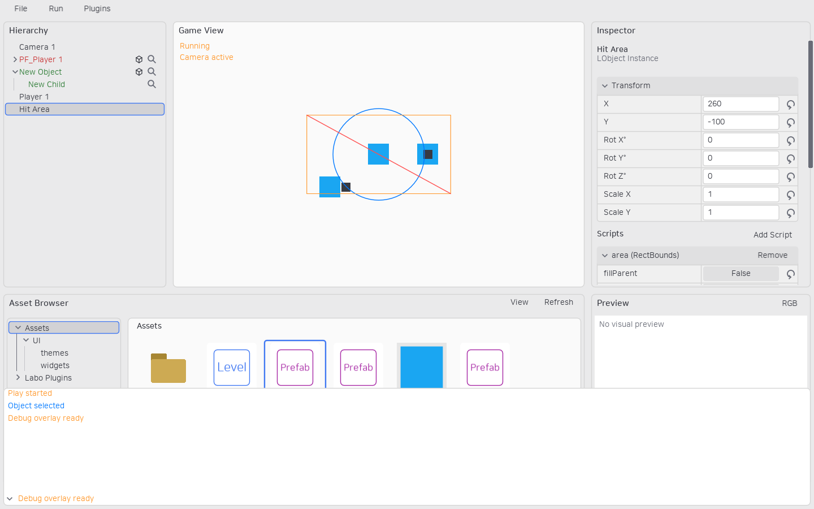
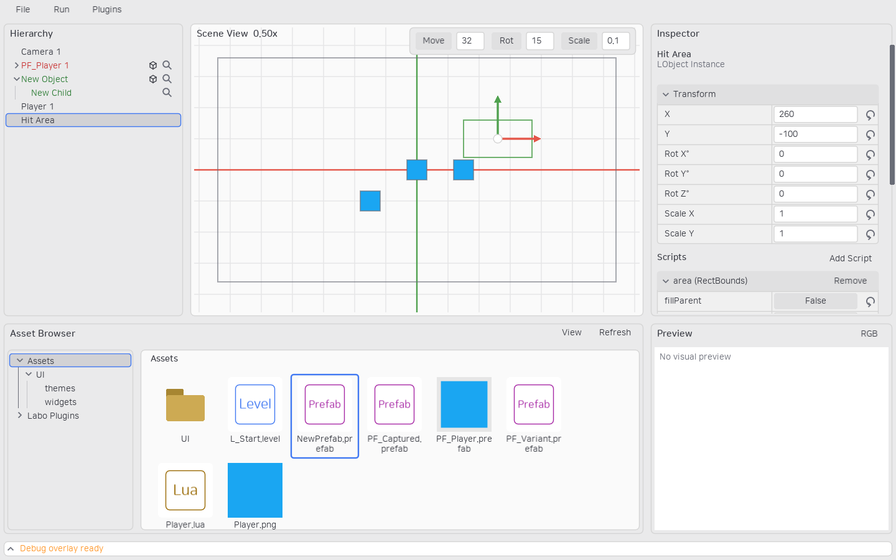
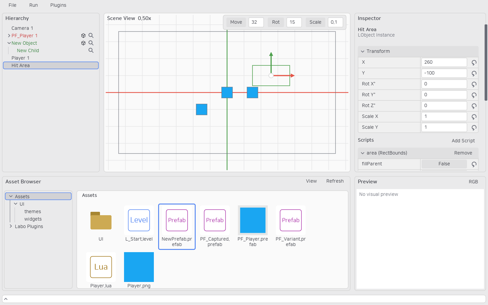

# 에디터 로그와 디버그 표시

흰색 하단바에는 최신 로그 한 줄이 계속 표시됩니다. 화살표 또는 **백틱(`)** 으로 펼치면 최근 1,000개를 스크롤할 수 있습니다. 내역은 에셋 브라우저·Inspector 위에 겹쳐 표시하며 기존 패널의 위치와 크기는 바뀌지 않습니다. 오류도 빨간 로그로 기록합니다. 팝업·텍스트 편집 중에는 백틱이 해당 입력에 전달됩니다.

접힌 하단바 높이는 36px이며 펼치기·접기 버튼과 최신 로그 한 줄은 항상 같은 하단 위치에 남습니다. 펼친 기록은 그 위쪽에 표시합니다.





## 게임 실행 중 출력

스크립트의 `self.owner.world.debug`, 레벨 스크립트의 `world.debug`를 사용합니다.

```lua
function Example.beginPlay(self)
    local debug = self.owner.world.debug
    debug:log("Started", {color = {255, 150, 40}})
    debug:screenLog("Ready", {key = "state", lifespan = 3})
    debug:line(0, 0, 100, 100, {color = {0, 120, 255}, lifespan = 2})
end
```

`log(text, options)`는 하단 기록, `screenLog(text, options)`는 Game View 좌상단 표시입니다. 화면 로그는 최신 것이 위에 오며 같은 `key`를 지정하면 기존 항목을 교체해 맨 위로 이동합니다. key는 문자열 또는 숫자입니다.

색은 RGB 0–255 배열이며 기본 주황색입니다. 화면 로그·도형의 `lifespan` 기본값은 3초, 0이면 한 표시 프레임만 유지합니다. Stop하면 화면 로그·도형을 지우고 하단 기록은 유지합니다.

| 도형 API | 인자 |
|---|---|
| point | x, y, radius, options; radius는 화면 픽셀, 기본 3 |
| line | x1, y1, x2, y2, options |
| circle | x, y, radius, options |
| rect | x, y, width, height, options |
| polygon | {x1, y1, x2, y2, x3, y3, ...}, options |

위치와 점을 제외한 크기는 월드 단위이며 카메라 이동·회전·배율을 따릅니다. 디버그 도형은 게임 렌더링 위에 표시합니다. 옵션은 화면 로그와 동일하게 color·lifespan을 지원합니다.

배포 게임에는 기록·렌더링 구현을 포함하지 않습니다. 같은 메서드 호출은 오류 없이 `false`를 반환하며 아무것도 표시하지 않습니다. 인자를 만드는 Lua 코드는 실행됩니다.

## 편집 중 표시

```lua
function Example.drawEditor(self, context)
    local transform = self.owner:getWorldTransform()
    context:circle(transform.x, transform.y, 100, {
        color = context.selected and {0, 120, 255} or {140, 140, 140}
    })
end
```

`drawEditor`는 Scene View에서만 호출합니다. `context`에는 위 도형 메서드와 `selected`, 테마 RGBA 배열 `color`가 있습니다. 매번 계산하므로 도형의 lifespan은 편집 표시에서 사용하지 않습니다. 게임 초기화가 실행되지 않으므로 `beginPlay`에서만 만든 값에 의존하지 마세요. Camera 플러그인의 카메라 범위도 이 방법으로 표시합니다.

LaboEssentials의 Camera·RectBounds·Canvas·Sprite·Pointer는 편집 화면에서 경계를 표시합니다. Pointer는 boundsSource로 지정한 스크립트의 실제 영역을 사용합니다. 이미지가 없는 Sprite나 크기가 0인 영역은 표시하지 않습니다. **PIE의 Game View와 배포 게임에는 이 경계를 표시하지 않습니다.** Play에서 직접 호출한 일시적인 디버그 도형은 별도로 표시됩니다.



사용자 스크립트도 `drawEditor`에서 `context:bounds(self)`로 getBounds 영역을 표시할 수 있습니다. Sprite의 이미지 조회를 위한 `context:image(reference)`도 제공됩니다.

## CLI 검증

```powershell
Labo-cli.exe --cli level simulate --project D:/Games/MyGame --level Assets/L_Start.level --frames 60 --debug
```

반환값의 `debug.history`, `debug.screens`, `debug.shapes`에서 실행 결과를 확인합니다. 각 시뮬레이션 프레임을 표시 프레임으로 간주해 수명을 처리하며 실제 렌더링·draw·drawEditor는 실행하지 않습니다. 옵션이 없으면 배포와 같은 no-op 동작입니다.
