# 에디터 화면과 선택

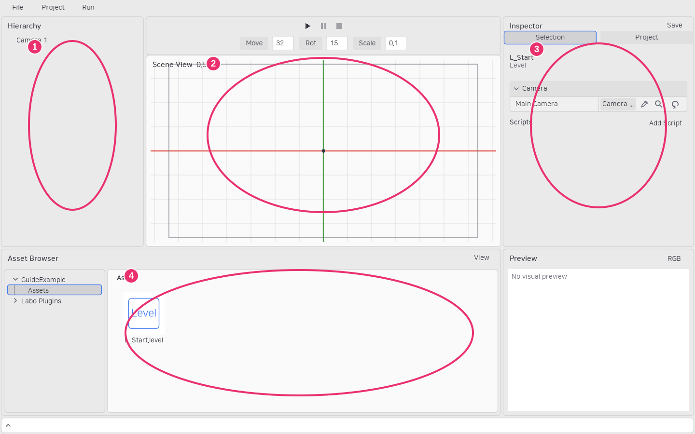

| 영역 | 역할 |
|---|---|
| Hierarchy | 레벨의 오브젝트 계층, 다중 선택·부모 변경 |
| Scene View | 배치·변환·카메라 범위 확인 |
| Inspector | 선택한 에셋·인스턴스·현재 레벨의 설정 |
| Asset Browser | Assets 폴더와 파일 탐색·생성·이동 |

외부 파일·폴더를 Asset Browser에 드롭하면 복사·등록 후 해당 폴더의 목록을 즉시 갱신하고 새 에셋을 표시합니다.

**Project** 메뉴에서 Refresh·Plugins·Export를 실행합니다. Open Build Script는 프로젝트 빌드 파일을 열고 Last Build는 마지막 빌드 결과를 표시합니다. [Lua 빌드와 게임 CLI](game-cli.md)를 참고하세요. [에셋 관리와 복구](assets.md)를 참고하세요. 폴더뷰에는 프로젝트 이름 아래 Assets가 있으며 Lua·이미지·Prefab을 같은 기능 폴더에 둘 수 있습니다.

## 창 이동과 제어

Windows에서는 기본 제목 표시줄 대신 메뉴바 오른쪽에 창 제어 버튼을 표시합니다. Project Browser에서도 같은 버튼을 사용합니다.

Windows 11의 일반 창은 시스템 둥근 모서리를 사용합니다. 최대화하거나 화면 가장자리에 스냅하면 운영체제 정책에 따라 사각 모서리로 표시됩니다. 해당 기능을 지원하지 않는 Windows 환경에서는 기존 모서리를 유지합니다.

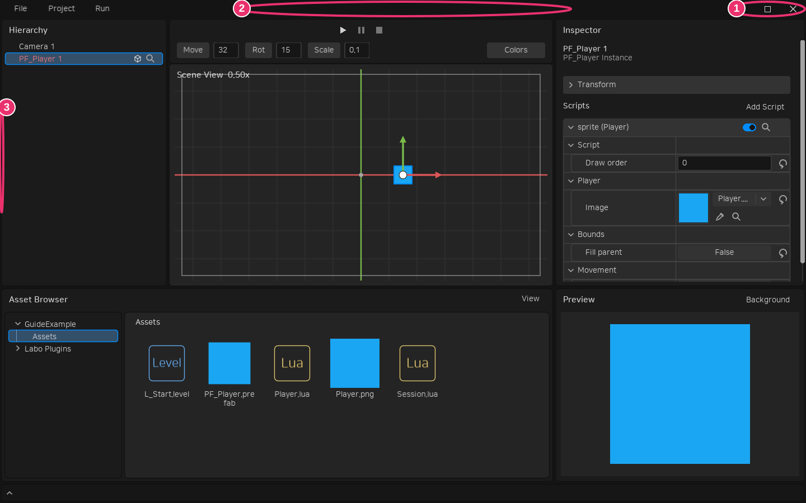

1. 오른쪽의 **최소화·최대화/복원·닫기** 버튼으로 창을 제어합니다. 다이얼로그나 팝업이 열려 있어도 사용할 수 있으며, 최소화·최대화는 열린 팝업을 유지합니다. 최대화는 실제 창 외곽까지 작업 표시줄을 제외한 작업 영역에 맞춥니다. 최대화한 창을 최소화했다가 복원해도 같은 영역을 유지합니다.
2. 메뉴바의 빈 공간을 드래그하면 창을 이동합니다. 빈 공간을 더블 클릭하면 최대화와 복원을 전환합니다. 메뉴와 창 제어 버튼은 이동 영역에서 제외됩니다.
3. 일반 창에서는 가장자리와 모서리를 드래그해 크기를 조절합니다. 최대화한 상태에서는 먼저 복원합니다.

기본 창 장식 제거를 지원하지 않는 환경에서는 운영체제의 기본 제목 표시줄을 사용합니다.

## 테마

기본 테마는 UE 에디터 화면을 참고한 어두운 회색 바탕과 파란 강조색을 사용합니다. 패널·뷰포트·입력칸은 밝기가 다른 회색으로 구분하고, 선택은 청회색, 포커스는 밝은 파란색으로 표시합니다. 실행은 녹색, 일시 정지는 황색, 오류는 붉은색으로 구별합니다.

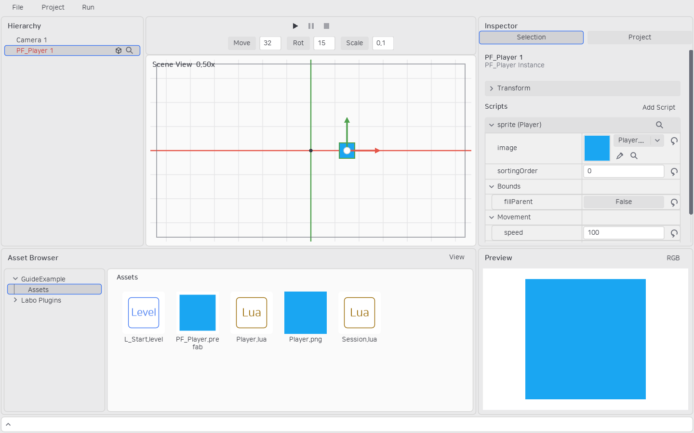

소스로 실행할 때는 `src/editor/settings.json`, Windows 배포판에서는 실행 파일 옆 `settings.json`의 `theme`을 설정하고 에디터를 다시 시작합니다.

```json
{"version": 1, "theme": "default"}
```

밝은 테마는 `"theme": "atom-one-light"`로 선택합니다. 기존 배포판의 사용자 설정은 패키징해도 유지되므로 밝은 테마를 사용 중이면 직접 `default`로 변경해야 합니다. 테마 설정은 에디터 전체에 적용됩니다.

## 실행 상태

뷰포트 위 **Viewport Toolbar**에는 ▶ Play·⏸ Pause·■ Stop과 Move·Rot·Scale 스냅 컨트롤, **Colors** 버튼이 있습니다. 제목 없이 다른 패널과 같은 라운드 외곽선으로 표시합니다. 가로 폭은 씬뷰와 같고 상단은 계층·Inspector 패널과 정렬됩니다. 스냅은 왼쪽, 실행 버튼은 중앙, Colors는 오른쪽에 배치하며 좁은 폭에서는 줄을 나눠 겹침을 막습니다. 뷰포트는 툴바 아래에서 기존 패널 간격을 유지합니다.

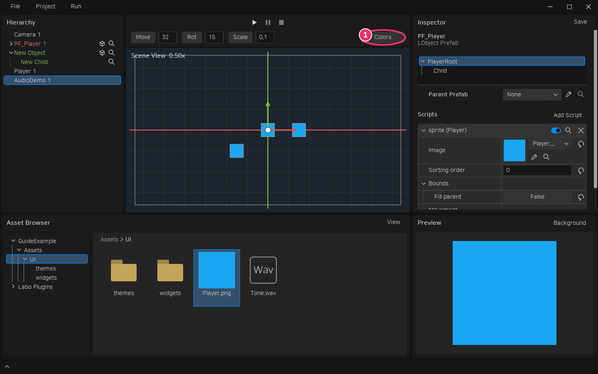

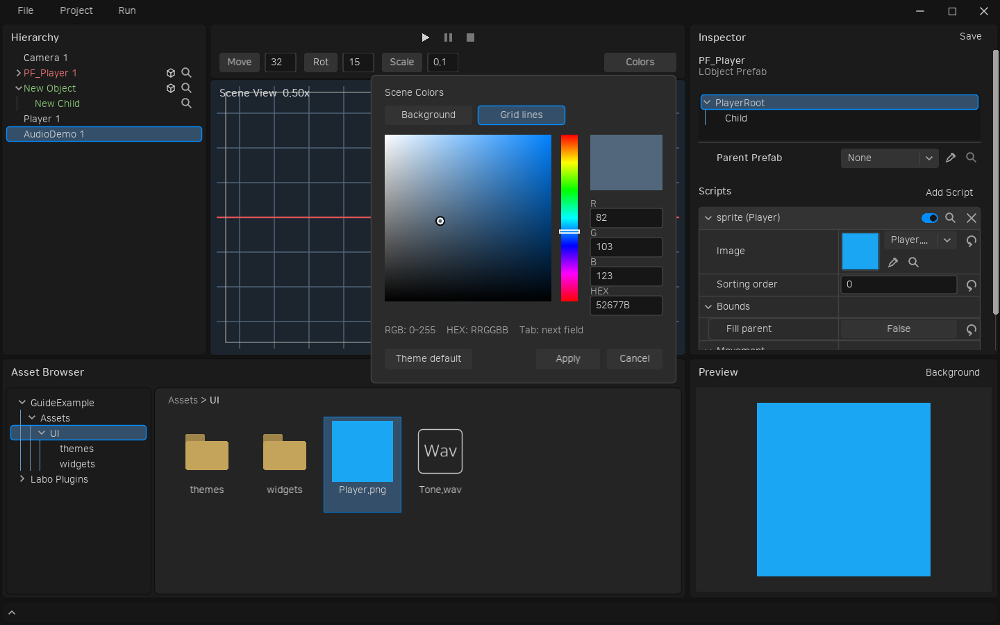

**Colors**는 편집 모드의 Scene View 배경과 그리드 선 색을 바꿉니다. 팝오버의 **Background**·**Grid lines** 탭에서 각각 조절합니다. Preview와 같은 [색상 선택기](preview.md)에서 팔레트·RGB·6자리 HEX를 사용하며, 변경하는 동안 실제 뷰포트에도 바로 표시됩니다. **Apply**는 두 탭의 설정을 함께 확정하고, **Cancel**·Esc·바깥 클릭은 두 색 모두 원래대로 돌립니다. Theme default는 선택한 탭을 현재 테마의 기본색으로 되돌립니다. 두 설정은 현재 에디터 세션 동안 유지하며 레벨 저장값이나 Play 화면에는 영향을 주지 않습니다. 실행·일시 정지 중에는 Colors 버튼을 사용할 수 없습니다.

편집은 Play만, 실행은 Pause·Stop, 일시정지는 Play(재개)·Stop만 활성화됩니다. 실행 중 스냅은 비활성 상태로 표시됩니다. Pause는 Update·게임 입력을 멈추고 렌더링·에디터 UI를 유지합니다. Play는 같은 Runtime World를 재개하고 Stop은 편집 모드로 돌아갑니다.

제품 소스의 `src/editor/Ui.lua`에서 `Ui.METRICS.viewportToolbarGap`을 바꾸면 툴바와 뷰포트 외곽선 사이의 실제 간격(px)을 조절할 수 있습니다. 현재 설정은 `0`으로 두 외곽선이 붙습니다. `12`이면 다른 패널의 기본 간격과 같습니다.

PIE 실행 중에는 Scene View 제목을 숨기고 뷰포트 패널 내부 전체를 게임 화면으로 사용합니다. 실행 화면은 카메라의 `viewWidth:viewHeight` 비율을 유지합니다. 남는 영역에는 검은 레터박스가 생깁니다. Canvas와 화면 공간 UI도 실제 게임 영역 안에 표시되며 여백에서는 새 클릭이 발생하지 않습니다. 기존 드래그 캡처는 여백에서 놓아도 종료됩니다. 카메라가 없으면 전체 게임 영역을 사용합니다.

패널 사이의 공통 간격은 `src/editor/Ui.lua`의 `Ui.METRICS.panelGap`에서 조절합니다. 기본값은 4px입니다. 툴바·뷰포트 사이의 내부 간격은 같은 파일의 `viewportToolbarGap`이며 기본 0px입니다.

빈 LObject는 실행 화면에 표시되지 않습니다. Sprite·Text 또는 사용자 스크립트의 `draw`가 있는 오브젝트만 렌더링합니다. 편집용 위치·영역 표시는 Scene View에서 확인합니다.

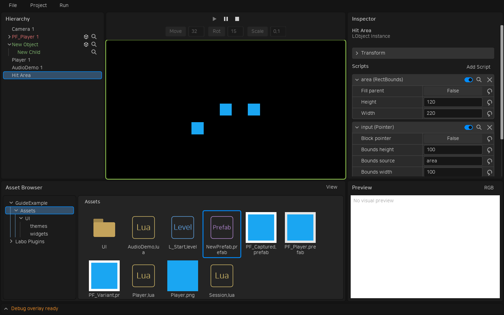

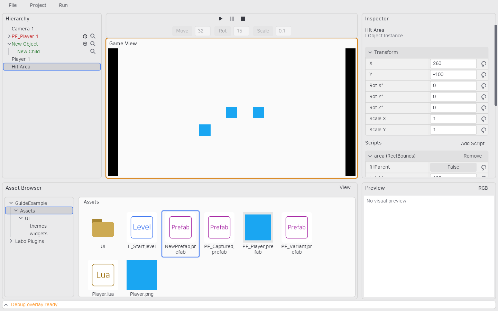

테두리 색은 테마의 `playRunning`·`playPaused`에서 변경합니다. Run 메뉴도 동일하게 동작합니다.

## 선택과 참조 지정

인스턴스를 선택하면 해당 인스턴스 Inspector가 열립니다. 에셋을 선택하면 해당 에셋 정보가 열립니다. **뷰포트나 Hierarchy의 빈 곳을 클릭하면 오브젝트 선택을 해제하고 Project Inspector를 표시합니다.** 레벨 에셋을 선택하면 해당 레벨의 일반 Script 부착과 프로퍼티를 편집합니다.

Inspector의 이미지·생성 템플릿·Parent Prefab·스크립트 참조는 **스포이드**로 지정합니다. 스포이드 중에는 십자 커서가 표시되고 후보를 클릭해도 Inspector 대상은 바뀌지 않습니다. Esc 또는 우클릭으로 취소합니다. 찾기 버튼은 에셋을 잠시 강조하거나 인스턴스를 뷰포트에서 프레이밍합니다.

일반 에셋 드래그는 파일 이동이나 인스턴스 배치에 사용합니다. Inspector 필드에는 에셋을 드롭하지 않습니다. 계층 우클릭의 **New Object**는 빈 LObject를 바로 추가합니다. 오브젝트 위에서 실행하면 자손으로, 레벨 계층의 빈 곳에서는 독립 오브젝트로 추가합니다. Inspector 계층의 빈 곳에서는 루트 아래에 추가합니다. Rename 등 대상이 필요한 메뉴는 빈 곳의 메뉴에 나타나지 않습니다.

자기 자신 위에 드롭하면 변경 없이 취소합니다. 실제 순환 부착은 거부하고 오류는 하단 로그에만 기록합니다. Hierarchy·Inspector 아래의 별도 오류 문구는 없습니다. 삽입선은 대상 깊이만큼 들여쓰기합니다. 가지 마지막 경계 위쪽은 마지막 자손 위치, 아래쪽은 가지 밖 다음 항목으로 구분합니다.

독립 루트 묶음은 현재 트리 순서대로 R→G→B→Y→C→M 색을 배정합니다. 같은 원본을 여러 번 배치해도 독립 묶음이면 별도 색을 사용합니다. 한 루트 묶음 안에서는 같은 원본끼리 색을 공유하고, 다른 원본에는 다음 색을 배정합니다. 자손을 독립 루트로 옮기거나 순서를 바꾸면 색을 다시 계산합니다. 직접 추가한 빈 자손은 기본 글자색을 유지합니다. Inspector에서 부모 Prefab이 없는 오리지널 루트와 직접 작성한 자손도 기본색입니다. 오른쪽 상자 아이콘은 묶음의 루트를 표시하고 돋보기는 원본 에셋을 잠시 강조합니다.


상자 아이콘은 이름의 들여쓰기를 바꾸지 않도록 행 오른쪽, 돋보기 왼쪽에 표시합니다. 제목의 PF_Variant는 에셋 이름이고 계층의 PlayerRoot는 오브젝트 이름입니다.

계층선은 Prefab 소속과 무관하게 모든 자손 행의 윗변부터 아랫변까지 수직으로 이어지며 가로선은 표시하지 않습니다. 트리·목록 행과 에셋 셀의 배경은 사이 여백 없이 맞닿습니다. 오른쪽 상자 아이콘은 접힌 상태에서도 유지합니다.

행을 선택하면 해당 행과 조상들이 가진 계층선을 전체 구간에서 강조합니다. 다른 가지의 하위 선은 기본 표시를 유지합니다. 레벨의 다중 선택은 각 선택 경로를 함께 강조합니다. 테마의 `treeLineHighlight` 색과 `src/editor/Ui.lua`의 `treeLineHighlightWidth`로 강조 색·두께를 조절합니다.

Atom Light에서는 호버한 항목의 배경이 조금 어두워지고, 선택한 항목은 더 어두운 배경과 파란 외곽선으로 표시합니다. 트리뷰의 호버·선택 박스는 좌우 여백이 있는 라운드 박스이며 행 사이 간격은 없습니다. 폴더·오브젝트 트리, 에셋 카드·목록, Inspector 프로퍼티와 버튼·입력 필드·체크박스·스크롤바에도 호버 효과를 제공합니다.

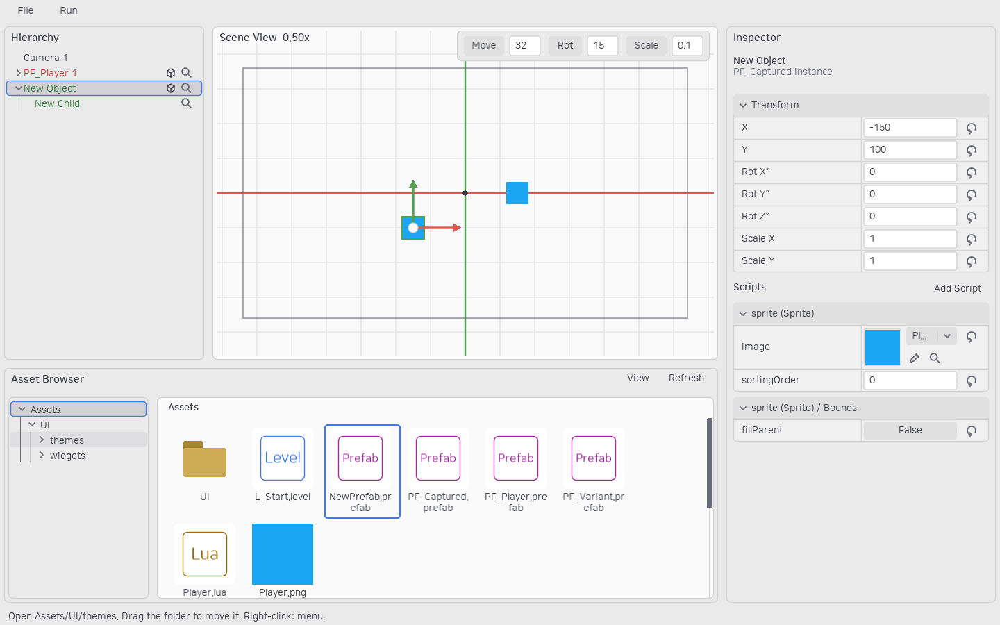

에셋 브라우저 폴더뷰는 하위 폴더가 있는 행에만 펼치기·접기 화살표를 표시합니다. 파일만 있거나 비어 있는 폴더는 화살표 없이 선택·탐색합니다.

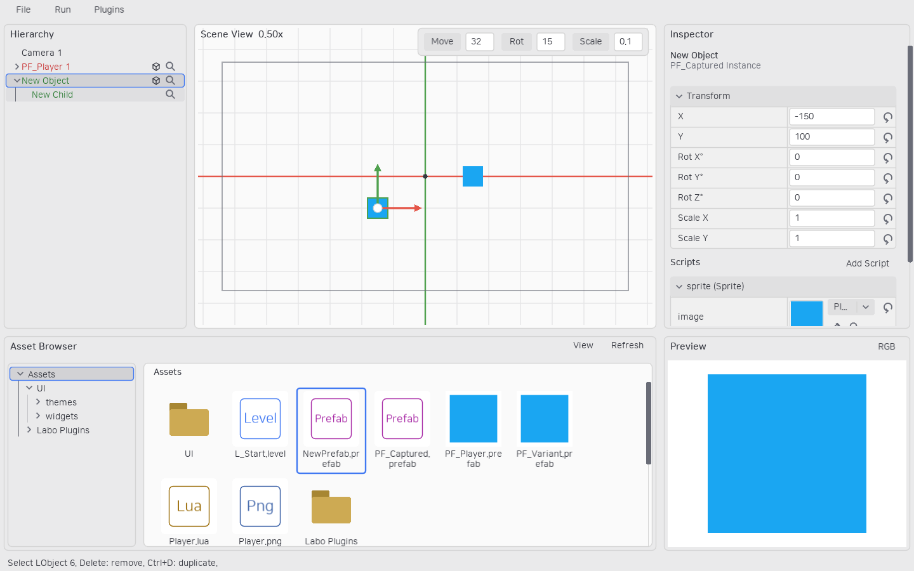

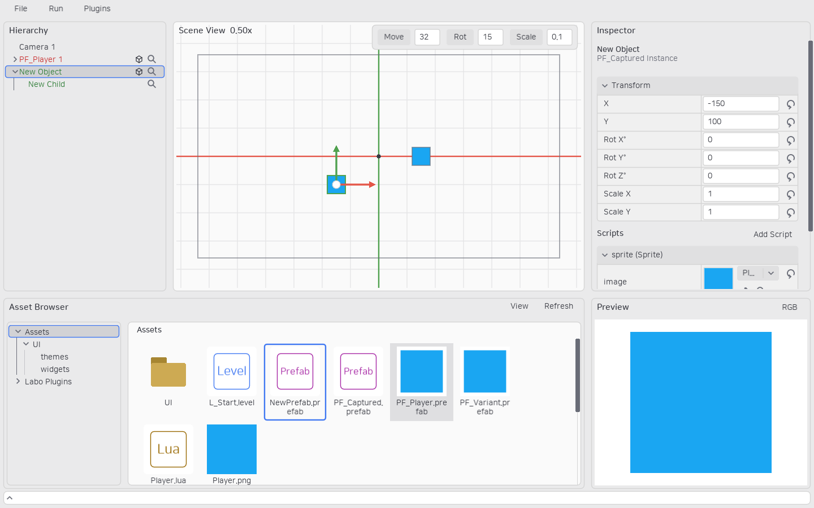

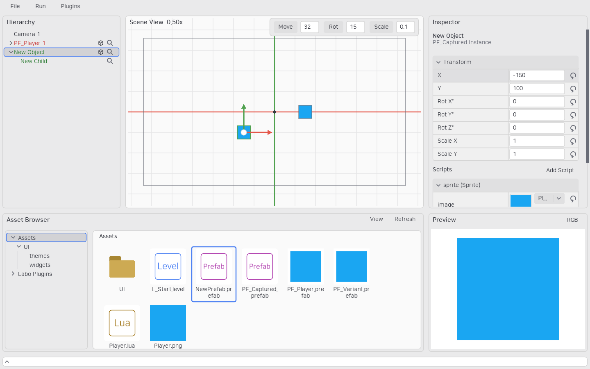

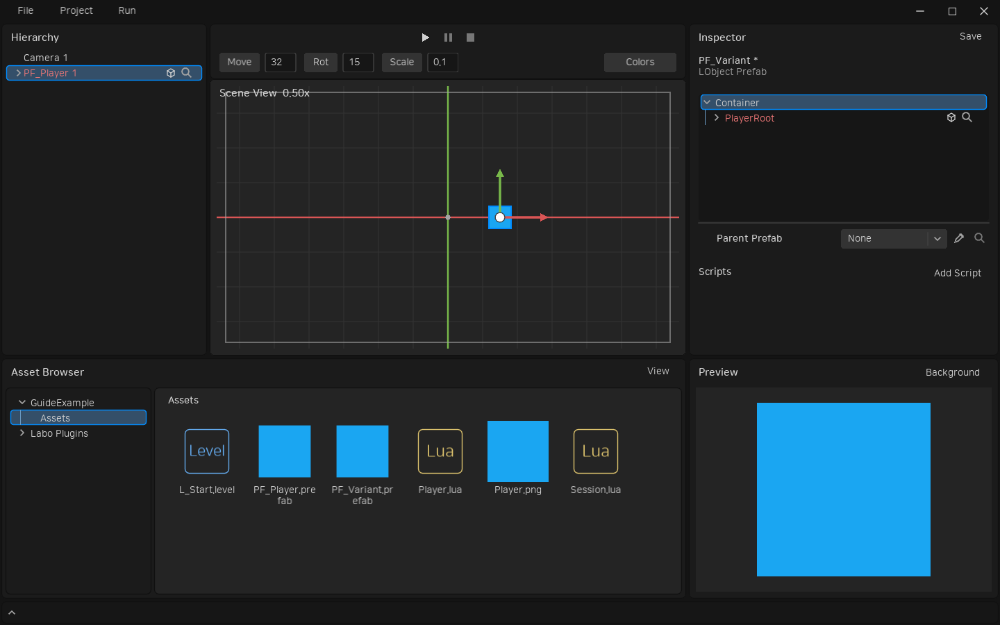

## 생성과 이름 변경

Windows 파일 탐색기에서 파일·폴더를 에셋 브라우저로 드롭하면 해당 폴더로 **복사**합니다. 폴더 트리에서는 가리킨 폴더, 파일 영역에서는 열린 폴더 또는 가리킨 하위 폴더가 대상입니다. 원본은 유지하고 같은 이름은 덮어쓰지 않습니다. 임포트에는 새 에셋 ID를 발급하며 기존 `.meta` 파일은 가져오지 않습니다. User 플러그인에도 임포트할 수 있고 Labo 플러그인은 읽기 전용입니다. 임포트는 Undo/Redo할 수 있습니다.

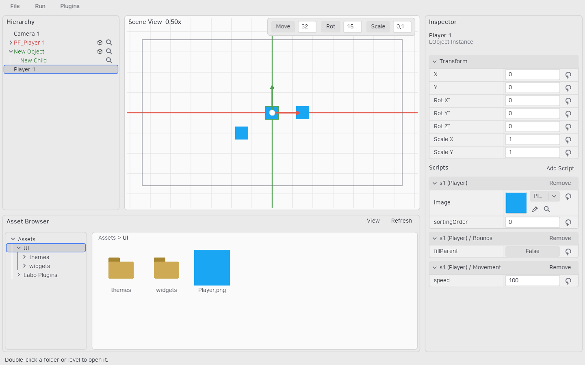

에셋 브라우저의 **New → Prefab**은 빈 루트를 가진 파일을 즉시 만들고 이름을 해당 파일 자리에서 편집합니다. 파일·폴더와 계층의 Rename도 새 창 없이 해당 항목에서 편집합니다. Enter 또는 바깥 클릭으로 확정하고 Esc로 취소합니다. 생성 직후 Esc를 누르면 기본 이름의 파일은 남습니다. 파일 확장자와 에셋 ID는 유지됩니다. Prefab Inspector 계층의 Rename은 루트를 포함하여 오브젝트 이름만 바꿉니다. Prefab 파일 이름은 에셋 브라우저에서 별도로 변경합니다. 이름이 없는 기존 루트는 LObject로 표시하며, 새 루트로 교체해도 각 오브젝트의 이름은 유지합니다.

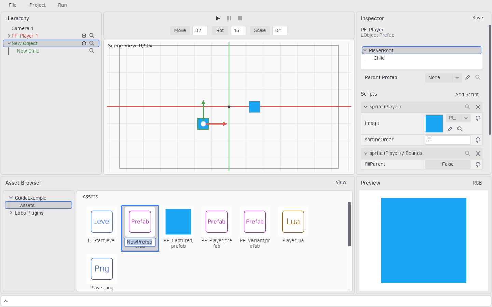

에셋 아이콘은 줄임말 대신 Level·Lua·Prefab 등 확장자를 한 줄로 표시합니다. 파일과 레벨 Hierarchy에서 F2로 이름 변경을 시작할 수도 있습니다.

한글 조합 중 Enter나 바깥 클릭으로 확정해도 마지막 조합 글자를 포함합니다. Esc는 조합과 이름 변경을 취소하며, 지연된 OS 확정 입력이 다음 편집 필드에 들어가지 않게 처리합니다.

백스페이스와 방향키를 누르고 있으면 반복합니다. 파일명 편집은 한 줄에 가두지 않고 이름 길이에 맞춰 여러 줄로 펼칩니다.

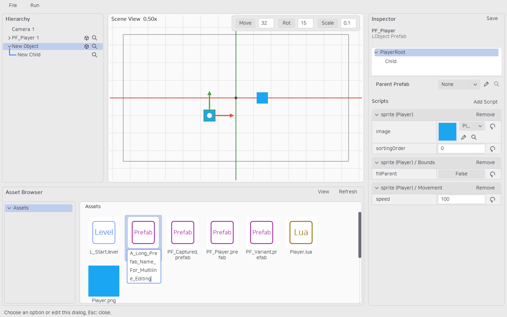

## 계층 드래그와 스크립트 추가

레벨 Hierarchy의 **Create Prefab...**은 선택한 오브젝트와 자손을 에셋으로 저장하고, 그 계층 전체를 새 Prefab의 인스턴스로 연결합니다. 오브젝트 ID·이름·Transform과 바깥에서 들어오는 참조는 유지합니다. 에셋에 저장한 스크립트와 값은 인스턴스에 중복 재정의로 남기지 않으므로 이후 원본 변경을 받습니다. 생성과 연결은 한 번의 Undo/Redo로 되돌립니다. 레벨 변경은 아직 미저장 상태이므로 레벨도 저장합니다. 상속 자손 하나를 바꾸려면 해당 원본의 배치 루트를 선택해야 합니다.

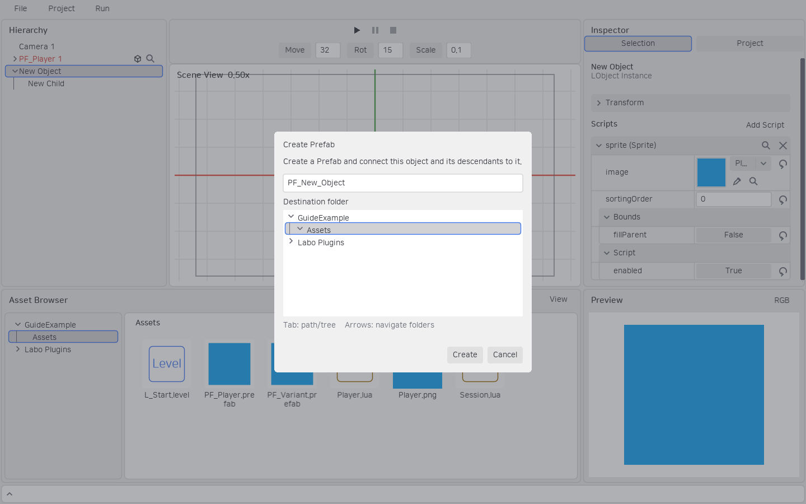

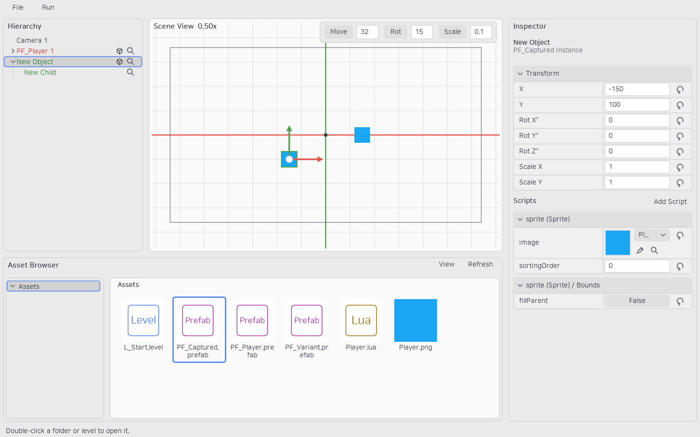

두 계층에서 행 중앙에 드롭하면 자식으로 부착하며 현재 부모에 다시 드롭하면 디태치합니다. 레벨에서는 독립 오브젝트가 되고 Prefab 내부에서는 루트 아래로 이동합니다. 행 사이의 삽입선에 드롭하면 형제 순서를 바꿉니다. 직접 추가한 자손을 Inspector의 루트 위 삽입선으로 옮기면 새 루트가 됩니다. 기존 루트에 Parent Prefab이 있어도 가능하며, 기존 루트는 원본 연결·이름·상속 자손을 유지한 채 새 루트의 자식으로 남습니다.

원본 Prefab에서 생성한 자손의 부모·순서·삭제와 상속된 스크립트의 제거·정렬은 금지합니다. 원본을 참조하는 오브젝트 전체를 다른 로컬 오브젝트 아래에 두는 것은 가능하지만 상속된 구성 내부는 바꾸지 않습니다. 값 재정의, 새 자손과 로컬 스크립트 추가는 가능합니다. 직접 추가한 항목만 이동·정렬·제거하며 상속 항목 사이에 끼워 넣지 않습니다.

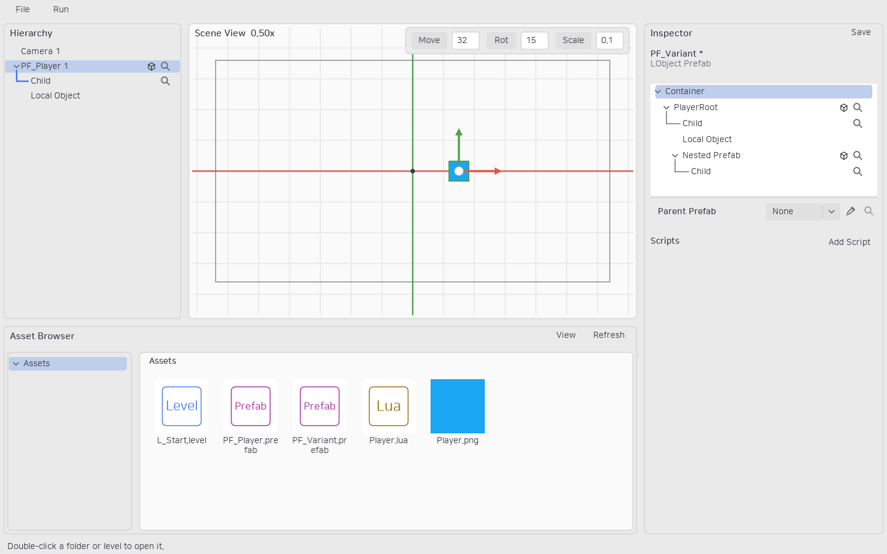

Container는 새 루트이고 PlayerRoot는 PF_Player를 원본으로 사용하는 기존 루트입니다. Child는 계속 원본의 상속 자손입니다. 새 루트의 Parent Prefab은 기존 루트에서 넘겨받지 않습니다.

Add Script를 누르면 버튼 자리에 검색 입력·스포이드·취소 기호가 표시됩니다. 이름을 입력해 검색한 뒤 클릭 또는 Enter로 부착합니다. 스포이드는 에셋 브라우저의 Lua 스크립트를 선택합니다. 인스턴스에서도 사용할 수 있으며 추가한 스크립트는 해당 레벨에만 저장합니다.

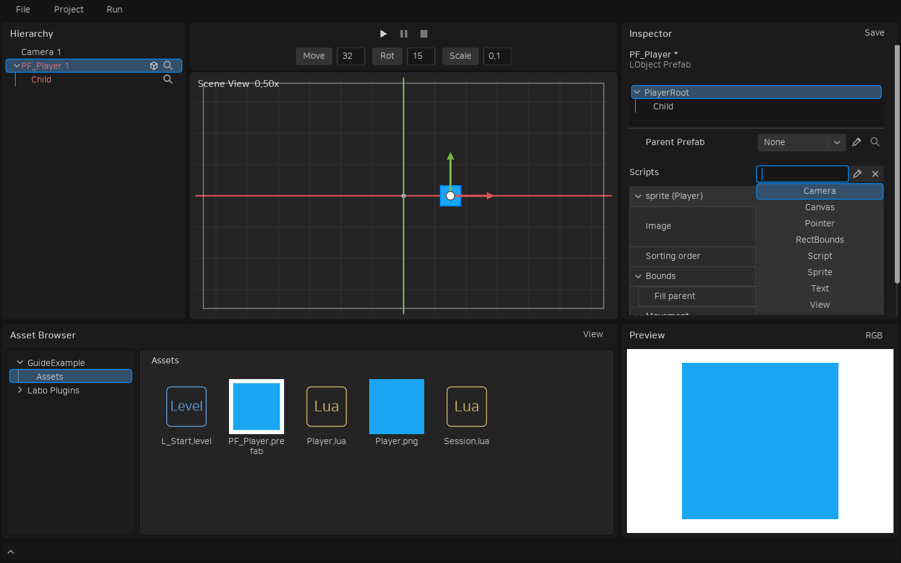

## Inspector와 스크롤

Prefab Inspector에는 오브젝트 계층, Parent Prefab, 선택 오브젝트의 Transform과 부착 스크립트 프로퍼티 그룹이 표시됩니다. 루트 Transform은 숨깁니다. 인스턴스는 부모 원본과 상속한 구성을 바꿀 수 없으며 로컬 스크립트를 추가·제거·정렬할 수 있습니다. 각 프로퍼티 그룹의 화살표로 내용을 접고 펼칩니다.

Inspector 제목과 Save는 고정되며 아래 내용 전체가 스크롤됩니다. 내부 오브젝트 계층은 자체 스크롤을 우선 사용합니다. 모두 보이거나 해당 방향의 끝이면 휠이 Inspector 전체 스크롤로 이어집니다. 내부 계층은 3행 높이로 시작하며 하단 손잡이로 크기를 조절합니다.

숫자 필드는 클릭해 입력하거나 좌우 드래그로 증감합니다. 드래그 중에는 커서와 입력 caret이 숨겨지고 테두리가 강조됩니다. 문자열은 커서 이동·문자 선택·선택 영역 대체 입력을 지원합니다.

## 주요 단축키

| 단축키 | 동작 |
|---|---|
| W / E / R | 이동 / 회전 / 스케일 기즈모 |
| F | 선택 프레이밍 |
| Ctrl+D | 선택 복제 |
| Delete | 선택 삭제 |
| Ctrl+Z / Ctrl+Shift+Z | Undo / Redo |
| Ctrl+S | 현재 문서 저장 |
| Ctrl+Shift+S | 변경 문서 목록에서 체크한 대상 저장 |
| F5 | 편집: Play / 실행: Stop / 일시정지: Resume |
| Ctrl+R | Project Refresh |

Move·Rot·Scale 버튼은 각 스냅을 켜고 끕니다. 숫자는 각각 독립적으로 저장됩니다. 스냅은 드래그 시작 값 기준으로 적용되므로 이동값 20에서 단위 100이면 120 또는 -80으로 이동합니다. 텍스트 편집 중에는 뷰포트 단축키를 처리하지 않습니다.
