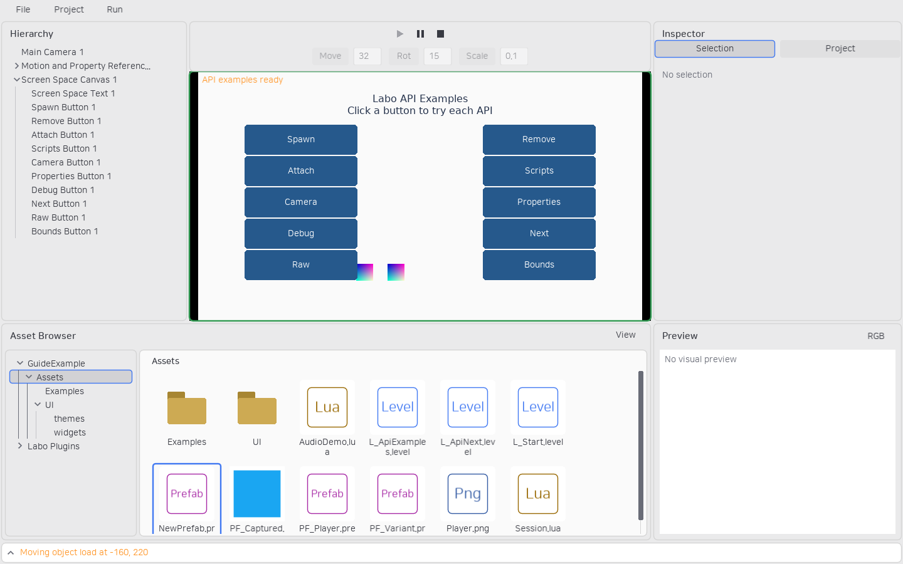

# 직접 검수하는 API 예제

## 범위별 Script와 고정 업데이트 예제

`tests/TestProject`의 **Assets/Examples/L_ScriptScopes.level**을 열고 ▶로 실행합니다. Game View에 포커스를 두고 **N**을 누르면 L_ScriptScopesNext와 오갑니다.

- Project 탭의 `scopeSession`: token과 frames는 전환에도 유지되고 visits는 레벨을 열 때마다 증가합니다.
- 레벨 에셋의 `scopeLevel`: fixed steps는 새 레벨에서 0부터 시작합니다. Level Script가 시간을 누적해 Object의 일반 fixedUpdate를 직접 호출합니다.
- `FixedActor`: update를 선언하지 않습니다. 움직이는 원은 draw, 하단의 고정 문구는 Object의 drawScreen입니다.
- Level의 원·선은 월드 좌표, 위쪽의 Project·Level 문구는 게임 영역 왼쪽 위 기준 화면 좌표입니다.

Lua 소스는 모두 Assets/Examples의 ScopeSession.lua·ScopeLevel.lua·FixedActor.lua입니다. 다른 프로젝트에는 저장소에서 `python scripts/createScopeExamples.py D:/Games/MyGame`으로 추가할 수 있습니다. 동명 예제를 덮어쓰지 않으며 기존 프로젝트 Script는 유지하고 scopeSession을 추가합니다.

## 기존 API 예제

저장소의 `tests/TestProject`를 열고 **Assets/L_ApiExamples.level**을 엽니다. 기본 제공 스크립트는 LaboEssentials, 예제 Lua·Prefab·이미지는 프로젝트의 **Assets/Examples**에 있습니다. 테스트 프로젝트에는 검수에 필요한 예제 에셋만 남겨 두었습니다.

Scene View 위의 ▶로 실행합니다. 화면의 두 열 버튼은 Canvas 아래에 있어 카메라를 확대해도 위치를 유지합니다.



| 버튼·오브젝트 | 확인하는 동작 |
|---|---|
| Motion and Property References | load·update, number·boolean·string·object·script 프로퍼티, getWorldPosition/getWorldTransform |
| Inherited Transform Child | 부모의 이동·Z 회전이 자손 Sprite에 합성됨 |
| Spawn | Prefab 템플릿 참조와 spawnLObject로 Sprite·Motion 오브젝트 생성 |
| Raw | World.addLObject와 load로 빈 오브젝트 생성. 렌더링 스크립트가 없어 보이지 않음 |
| Bounds | Bounds.hitTest/getBounds, CoordinateSpace, Viewport의 월드·화면 좌표 변환 |
| Remove | 마지막으로 생성한 오브젝트 제거 |
| Attach | 생성한 오브젝트를 움직이는 부모에 부착·분리 |
| Scripts | 생성한 오브젝트의 Motion.enabled를 켜고 끔. 먼저 Spawn |
| Properties | 이름·ID·클래스 조회와 복수 조회를 확인하고 프로퍼티·활성 상태 및 Transform.point 결과 기록 |
| Camera | getActiveCamera/setActiveCamera와 zoom 변경. 화면 좌표 버튼은 이동하지 않음 |
| Debug | point·line·circle·rect·polygon, screenLog·log·marker |
| Next / Back | openLevel로 L_ApiNext·L_ApiExamples 사이 전환 |
| 모든 버튼 | Pointer 상속, down/up/move, blockPointer, inputPriority, sortingOrder, 영역 판정 |
| Screen Space Text | Text 스크립트의 줄바꿈·정렬·크기, Canvas 기반 화면 공간 텍스트 |
| 편집 화면 | Camera·RectBounds·Canvas·Sprite·Pointer의 drawEditor 영역 표시 |
| LevelDemo.lua | 레벨 load/update와 world.properties, 레벨 전환 시 새 초기화 |

Spawn을 누른 뒤 Attach·Scripts·Remove를 순서대로 확인합니다. 화면 바깥으로 드래그해서 놓아도 Pointer capture가 up 이벤트를 전달합니다. ⏸로 멈추면 Update·게임 입력·일시적 디버그 표시 수명이 멈추고, ▶는 같은 Runtime World를 이어서 실행합니다. ■는 편집 모드로 복귀합니다.

소스는 `Assets/Examples/Motion.lua`, `Actions.lua`에서 확인합니다. **Assets/Examples/PF_Spawned.prefab**을 수정하면 이후 Spawn의 기본값을 바꿀 수 있습니다. 레벨 인스턴스의 프로퍼티와 로컬 스크립트도 Inspector에서 편집할 수 있습니다.

다른 프로젝트에는 다음 명령으로 같은 예제를 생성할 수 있습니다. Assets/Examples나 예제 레벨이 이미 있으면 덮어쓰지 않습니다. 예제 생성은 LaboEssentials만 활성화하며 별도 예제 플러그인을 만들지 않습니다.

```powershell
Labo-cli.exe --cli project examples --project D:/Games/MyGame
```

새 게임 기능을 개발할 때는 관련 예제 오브젝트·레벨과 검수 방법도 함께 갱신합니다.

`Text`는 일반 게임 텍스트 렌더링 스크립트입니다. `text`, `fontSize`, `width`, `align`(`left`·`center`·`right`), RGBA 색과 `sortingOrder`를 Inspector에서 설정합니다. LObject의 이동·회전·스케일을 따르며 Canvas 아래에 두면 화면 공간에 표시됩니다. `screenLog`는 일시적인 디버그 메시지용 API입니다. 기본 LÖVE 폰트를 사용하므로 별도 글꼴 리소스 선택은 제공하지 않습니다.

`Text`는 일반 게임 텍스트 렌더링 스크립트입니다. `text`, `fontSize`, `width`, `align`(`left`·`center`·`right`), RGBA 색과 `sortingOrder`를 Inspector에서 설정합니다. LObject의 이동·회전·스케일을 따르며 Canvas 아래에 두면 화면 공간에 표시됩니다. `screenLog`는 일시적인 디버그 메시지용 API입니다. 기본 LÖVE 폰트를 사용하므로 별도 글꼴 리소스 선택은 제공하지 않습니다.

`Text`는 일반 게임 텍스트 렌더링 스크립트입니다. `text`, `fontSize`, `width`, `align`(`left`·`center`·`right`), RGBA 색과 `sortingOrder`를 Inspector에서 설정합니다. LObject의 이동·회전·스케일을 따르며 Canvas 아래에 두면 화면 공간에 표시됩니다. `screenLog`는 일시적인 디버그 메시지용 API입니다. 기본 LÖVE 폰트를 사용하므로 별도 글꼴 리소스 선택은 제공하지 않습니다.

`Text`는 일반 게임 텍스트 렌더링 스크립트입니다. `text`, `fontSize`, `width`, `align`(`left`·`center`·`right`), RGBA 색과 `sortingOrder`를 Inspector에서 설정합니다. LObject의 이동·회전·스케일을 따르며 Canvas 아래에 두면 화면 공간에 표시됩니다. `screenLog`는 일시적인 디버그 메시지용 API입니다. 기본 LÖVE 폰트를 사용하므로 별도 글꼴 리소스 선택은 제공하지 않습니다.

## LÖVE 이벤트 예제

테스트 프로젝트에서 **Assets/Examples/L_InputEvents.level**을 열고 ▶로 실행합니다. `InputEvents 1` 오브젝트에 `InputEvents.lua`가 부착되어 있습니다.

- 왼쪽·오른쪽 방향키: 사각형을 이동합니다.
- 문자 입력: 입력한 내용을 화면에 표시합니다.
- 클릭·휠: 이벤트 이름·횟수·게임 화면 기준 좌표를 표시합니다.
- 게임 화면 안에서 누른 뒤 밖에서 놓기: 해제 콜백이 전달됩니다.
- Pause: 입력이 멈춥니다. Resume 후 같은 상태에서 계속합니다.
- 다른 패널을 클릭하면 키 입력은 게임에 전달되지 않습니다. 게임 화면을 클릭해 포커스를 돌려줍니다.

이 예제는 Pointer를 사용하지 않고 일반 LÖVE 이벤트 콜백과 `love.graphics`로 구현합니다. `L_InputEvents.level`을 Export하면 같은 코드를 독립 게임에서 확인할 수 있습니다. 이 추가 검수 레벨은 저장소 테스트 프로젝트에 제공하며 `project.examples`가 생성하는 기존 API 예제와는 별개입니다.

## 오디오와 종료 콜백 예제

테스트 프로젝트에서 **Assets/Examples/L_AudioLifecycle.level**을 열고 ▶로 실행합니다. `AudioLifecycle.lua`의 `sound` 프로퍼티는 함께 제공한 `Tone.wav`의 ID를 참조합니다.

- Space: 직접 만든 LÖVE Source로 짧은 음을 재생합니다.
- Delete: 오브젝트를 제거하고 그 Script의 unload에서 Source를 정리합니다.
- N: 같은 레벨로 전환하며 이전 오브젝트를 정리하고 새 오브젝트를 초기화합니다.
- Stop: 남은 오브젝트를 정리합니다. 에디터 로그에서 `AudioLifecycle unloaded`를 확인합니다.

Inspector의 sound 필드로 다른 오디오 에셋을 선택할 수 있습니다. 이 예제는 프로젝트 전용 코드이며 새 재생 플러그인·오디오 매니저는 추가하지 않습니다. CLI의 `level.simulate --debug`에서도 종료 로그를 확인할 수 있습니다. CLI는 audio 모듈이 꺼져 있으므로 예제는 파일만 읽고 재생하지 않습니다.
