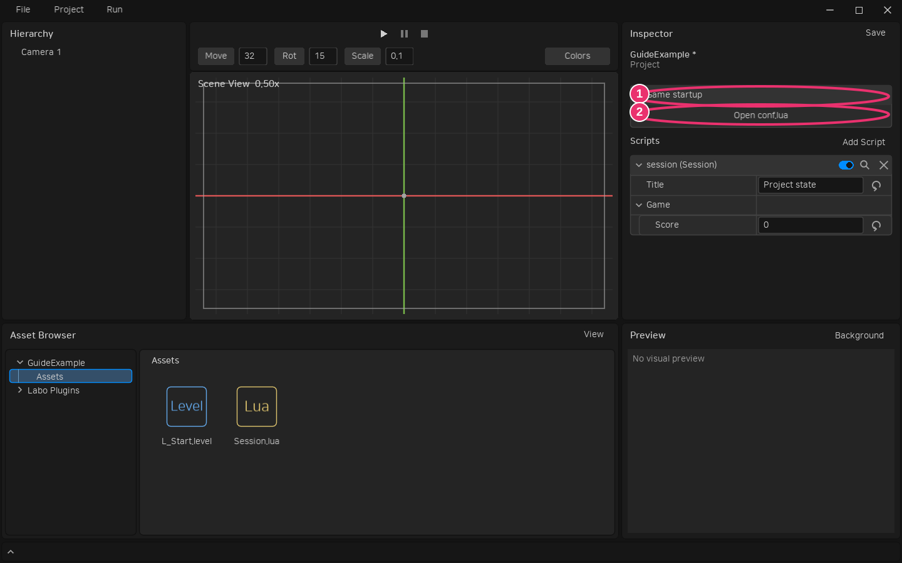

# 저장과 게임 Export

## 문서 저장

Inspector 편집은 저장 전에도 초안과 편집 화면·Play에 적용됩니다. Prefab의 Save 또는 Ctrl+S로 현재 문서를 저장합니다. 인스턴스 override는 레벨에 저장됩니다.

Ctrl+Shift+S 또는 **File → Save All**은 변경된 레벨·Prefab 목록을 표시합니다. 기본으로 모두 체크되어 있으며 저장할 대상만 선택해 확인합니다. 취소하면 초안을 유지합니다. 아직 저장 경로가 없는 레벨은 경로 지정이 필요합니다.

Undo/Redo는 프로퍼티·Transform·계층과 에디터에서 실행한 에셋 생성·삭제·이동·이름 변경을 다룹니다. CLI나 외부 편집기의 변경은 GUI Undo에 포함되지 않습니다.

## 독립 실행 게임

**Project → Export Game**에서 플랫폼 Windows를 확인하고 출력 폴더와 실행 파일 이름을 지정하면 `Tools/Build.lua`를 실행합니다. 기본 스크립트는 게임을 패키징하고, 프로젝트에서 CLI·문서 복사를 추가할 수 있습니다. [빌드 API와 게임 CLI](game-cli.md)를 참고하세요. 엔진의 core/project/runtime과 프로젝트 소스·에셋이 포함되고 에디터 UI와 테스트는 포함하지 않습니다. 현재 레벨과 Prefab 초안을 패키징에 사용하므로 Export는 원본 문서를 저장하는 작업과 구분됩니다. 재현 가능한 빌드를 남기려면 먼저 Save All로 원하는 문서를 저장합니다.

```powershell
./build/windows/Labo-cli.exe --cli export --project D:/Games/MyGame --level Assets/L_Start.level --platform windows --output D:/Games/MyGame/Build/Windows/MyGame.exe
D:/Games/MyGame/Build/Windows/MyGame.exe
```

CLI Export는 디스크에 저장된 프로젝트를 읽습니다. GUI의 미저장 초안을 다른 프로세스의 CLI가 읽을 수는 없으므로 저장을 먼저 완료하세요. 출력은 Assets 바깥에 둡니다.

Windows 게임은 생성한 EXE와 같은 폴더의 DLL·license-love.txt를 함께 배포합니다. 사용자는 LÖVE나 Labo를 설치할 필요가 없습니다. EXE만 떼어 배포하지 않습니다. 기존 `.love` 아카이브가 필요하면 출력 확장자를 .love로 지정하며 이 경우에는 LÖVE 런타임으로 실행합니다. Windows 에디터 자체 배포와 게임 Export는 서로 다른 작업입니다. 상세 패키지 검증은 [CLI와 Export](cli-and-export.md), [패키징](packaging.md)에 있습니다.

Export의 저장 폴더는 프로젝트의 안정적인 UUID로 구분합니다. 이름·폴더 이동·재배포에서도 같은 값을 유지합니다. 예전 공용 저장 폴더는 자동 이전하지 않습니다. [게임 저장 예제와 ID 분리 명령](game-state.md)을 참고합니다.

게임 패키지는 core·project·runtime·공개 Engine 모듈, 프로젝트 Assets와 ID/경로 매니페스트를 포함합니다. 에디터 UI·테스트·에디터 사용자 설정은 제외합니다. 등록된 프로젝트 에셋 전체를 포함하며 의존 에셋만 추리는 최적화는 하지 않습니다. 게임 Host는 시작·업데이트·렌더링 오류를 잡아 오류 화면을 표시하지만 운영체제·드라이버 오류까지 복구하지는 않습니다. 게임 CLI EXE는 [빌드 스크립트](game-cli.md)의 packageCli로 별도 생성합니다.

## 게임 시작 설정 파일

새 프로젝트는 루트에 `conf.lua`를 제공합니다. 기존 프로젝트는 Export나 설정 파일 열기 때 없는 기본 파일만 만듭니다. **Project → Inspector → Game startup → Open conf.lua**로 현재 코드 편집기에서 엽니다. 파일 변경은 외부 편집기에서 저장한 뒤 다시 Export합니다. Inspector의 프로젝트 Save·Undo와는 별도의 파일입니다.



① Game startup의 ② Open conf.lua 버튼으로 설정 파일을 엽니다. 일반 Script 부착·프로퍼티 설정과 구분합니다.

```lua
function love.conf(config)
    config.window.title = "My Game"
    config.window.width = 1920
    config.window.height = 1080
    config.window.vsync = 1
    config.window.resizable = true
    -- config.window.fullscreen = true
    -- config.window.icon = "Assets/Icon.png"
end
```

LÖVE가 전달한 기본 설정 테이블을 수정합니다. config는 매개변수 이름이며 t 등으로 바꿔도 됩니다. 파일은 일반 Lua이고 게임에서 모듈·창 생성 전에 실행합니다. Export는 문법만 검사하며 코드를 실행하지 않습니다. 실행 시 오류는 LÖVE 초기화 오류로 보고됩니다. 게임 Host에 필요한 모듈을 끄면 해당 기능은 실행할 수 없습니다.

`config.window.icon`은 프로젝트·활성 플러그인의 에셋 경로나 에셋 ID를 지원합니다. 게임 창 아이콘 설정이며 Windows 탐색기에 보이는 EXE 파일 자체의 아이콘은 변경하지 않습니다. 저장 폴더 충돌을 막기 위해 config.identity는 프로젝트 UUID 값을 유지해야 하며 변경하면 시작 오류를 냅니다. 별도 게임으로 분리할 때는 project.reset-save-identity를 사용합니다.

Editor Play는 에디터 창·환경을 유지하며 이 파일을 실행하지 않습니다. 게임 CLI도 창 없는 전용 설정을 사용합니다. 시작 설정을 직접 확인하려면 Export한 EXE를 실행합니다.

```powershell
Labo-cli.exe --cli config open --project D:/Games/MyGame --dry-run
```

`config.open`은 누락된 기본 파일을 만들고 코드 편집기로 엽니다. --dry-run은 파일 경로와 편집기 실행 계획을 반환합니다.
