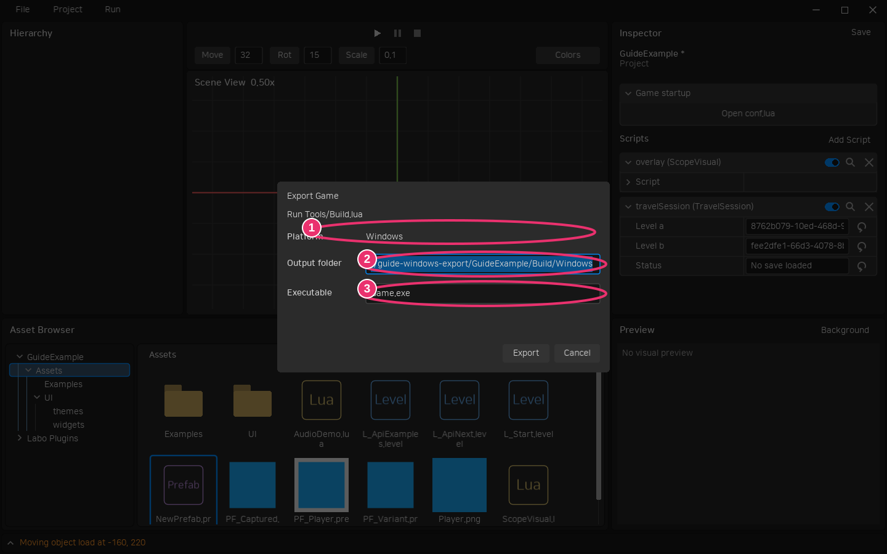
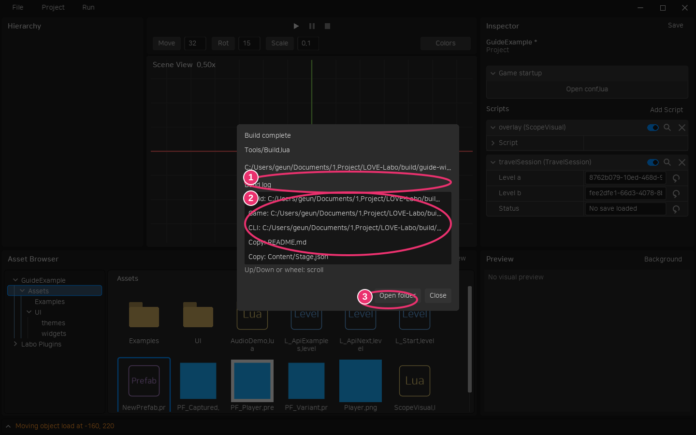
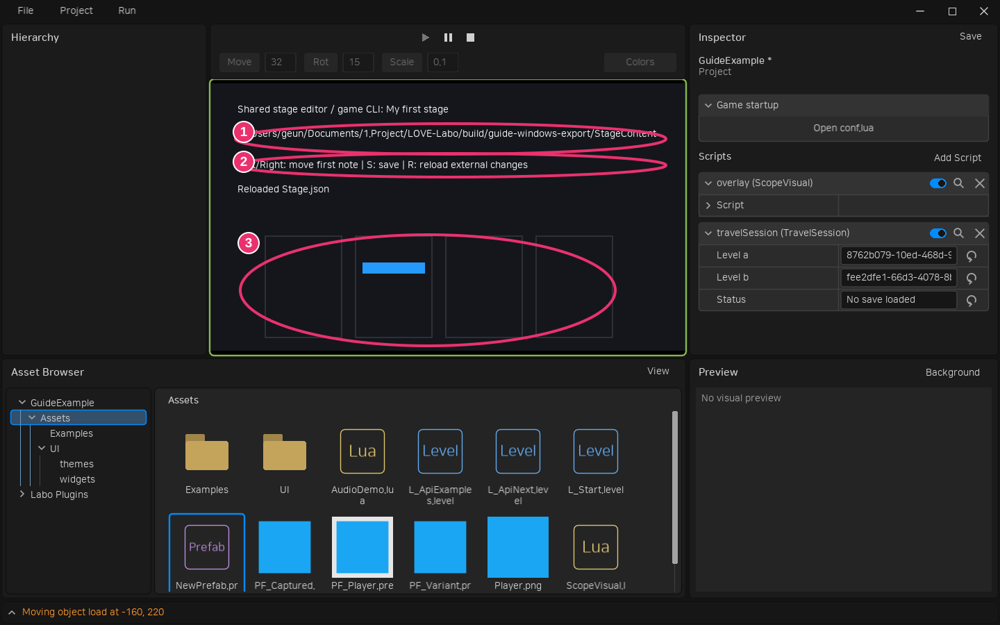

# Lua 빌드와 게임 전용 CLI

Export는 프로젝트의 **Tools/Build.lua**를 실행합니다. 새 프로젝트에 기본 파일을 제공하며, 기존 프로젝트는 Export 또는 Open Build Script를 처음 사용할 때 누락된 파일만 생성합니다. 경로 설정이나 Python 설치는 필요하지 않습니다. 기본 Export는 Windows 게임 EXE·런타임 DLL·라이선스를 만듭니다. .love 아카이브 출력도 유지합니다.

## 에디터에서 빌드하기

Project → **Open Build Script**로 현재 설정된 VS Code 창에서 빌드 파일을 엽니다. 코드 편집기 탐색·설정은 [스크립트 가이드](objects.md)를 따릅니다. Project → **Export Game** 또는 Ctrl+Shift+E에서 플랫폼 Windows를 확인하고 출력 폴더·실행 파일 이름을 입력합니다. 아래 화면의 ①은 플랫폼, ②는 출력 폴더, ③은 실행 파일 이름입니다. 현재 레벨·Prefab 초안을 사용하며 자동 저장하지 않습니다.



완료 또는 실패 시 로그를 표시합니다. ①은 출력 폴더, ②는 스크롤 가능한 로그, ③은 **Open folder**입니다. 긴 로그는 마우스를 올려 전체 내용을 확인합니다. **Project → Last Build**로 현재 세션의 마지막 결과를 다시 엽니다. Lua 오류도 같은 창에서 확인합니다. 실행은 동기식이며 긴 빌드 중에는 에디터 입력이 대기합니다.



## 빌드 스크립트 API

```lua
return function(builder)
    builder:log("배포 시작")
    builder:packageGame() -- Export에서 선택한 파일 이름
    builder:packageCli("Game-cli.exe", {entry = "Assets/Tools/GameCli.lua"})
    builder:copy("Docs/ContentGuide.md", "README.md")
end
```

| API | 역할 |
| --- | --- |
| `packageGame(name?)` | 선택한 현재 레벨과 에셋으로 Windows `.exe` 또는 `.love` 생성. 생략 시 선택한 이름 |
| `packageCli(name, {entry})` | 일반 Lua 명령 모듈을 실행하는 Windows 콘솔 EXE, DLL, LÖVE 라이선스 생성 |
| `copy(source, destination)` | 프로젝트 루트 기준 파일 하나를 배포 폴더에 복사. 필요한 하위 폴더 생성 |
| `log(message)` | 결과 창과 CLI 결과의 logs 배열에 기록 |
| `platform` | 현재 지원 플랫폼인 `"windows"`. 다른 플랫폼 요청은 오류 |
| `output`, `outputDirectory`, `projectDirectory` | 선택한 게임 경로, 배포 폴더, 프로젝트 폴더의 절대 경로 |

명시한 출력 이름·복사 목적지는 선택한 게임 출력 파일의 부모 폴더 기준 상대 경로입니다. `..`·절대 경로·링크 경유 출력과 프로젝트 Assets·Tools·Docs·Plugins·.labo·설정 파일 덮어쓰기는 거부합니다. 경로의 대소문자를 바꿔도 보호하며 `export.package`에도 같은 프로젝트 소스 보호를 적용합니다. 각 작업은 결과 `{output, bytes, ...}`를 반환합니다. 전체 빌드는 트랜잭션이 아니므로 중간 실패 전 생성된 파일은 남으며 로그에서 확인합니다. Lua 빌드 코드는 일반 프로젝트 코드와 같은 권한으로 실행되므로 별도의 보안 샌드박스가 아닙니다.

`Tools/Build.lua`에서 `require("Examples.StageModel")`처럼 기존 프로젝트 모듈 로더를 사용할 수 있습니다. 별도 셸 호출 없이 `.love`만 생성할 때는 **export.package** CLI를 사용합니다. 이 명령은 빌드 스크립트를 실행하지 않습니다.

CLI와 게임은 각자 에셋을 포함합니다. 초기 구현은 패키지 크기 최적화보다 독립 실행과 같은 모듈 계약을 우선합니다. 게임과 게임 CLI는 Windows용 EXE와 DLL·라이선스를 함께 배포하면 Labo·LÖVE·Python 설치 없이 실행합니다. 게임의 .love 출력을 선택했을 때만 별도 LÖVE로 실행합니다. 게임 초기 설정은 [프로젝트 conf.lua](export.md)를 사용하며 CLI에는 적용하지 않습니다.

## 게임 명령 정의

CLI 진입점은 Script를 상속하거나 오브젝트에 부착하지 않는 **일반 Lua 모듈**입니다. 창·오디오·World·게임 Script의 load/update를 시작하지 않습니다. 명령과 게임 내부 편집기는 같은 일반 콘텐츠 모델을 require하여 생성·검증·수정 규칙을 공유합니다.

```lua
local Model = require("Content.StageModel")
return {
    summary = "스테이지 제작 도구",
    commands = {
        inspect = {
            summary = "스테이지 조회 및 검증",
            parameters = {
                file = {type = "string", default = "Stage.json", description = "작업 폴더 기준 파일"},
            },
            run = function(context, args)
                local data, revision = context.workspace:readJson(args.file)
                Model.validate(data)
                return {data = data, revision = revision}
            end,
        },
    },
}
```

인자 형식은 `string`, `number`, `integer`, `boolean`, `object`, `array`입니다. `required=true`는 필수이며 `default`는 생략 시 사용합니다. 선언하지 않은 인자와 형식 오류는 실행 전에 거부합니다. `null`은 object·array를 포함한 모든 인자 형식에서 거부합니다. 일반 명령줄의 숫자·boolean·JSON 문자열은 선언한 형식으로 변환합니다. JSON 요청은 원래 JSON 자료형을 유지합니다. boolean은 `--enabled false`처럼 값을 지정합니다.

`help`와 `schema`는 전체 명령·설명·인자 스키마를 같은 JSON으로 반환하는 예약 명령입니다. 게임 명령은 소문자로 시작하며 영문자·숫자·점·하이픈을 사용합니다. 인자 이름은 소문자로 시작하며 영문자·숫자·하이픈을 사용합니다. `workspace`, `request`, `result`는 호스트 옵션이므로 명령 인자로 선언할 수 없습니다.

```powershell
./Game-cli.exe help
./Game-cli.exe inspect --workspace C:/Games/MyGame/Content --file Stage.json
./Game-cli.exe --request C:/Work/request.json --result C:/Work/result.json
```

```json
{"command":"inspect","workspace":"C:/Games/MyGame/Content","arguments":{"file":"Stage.json"}}
```

stdout은 `{version:1,ok:true,result:...}` 또는 `{version:1,ok:false,error:"..."}` JSON이며 종료 코드는 성공 0, 실패 1입니다. 핸들러는 JSON으로 표현할 수 있는 값을 반환하고 stdout에 별도의 print를 하지 않습니다. 호스트 옵션 `workspace`·`request`·`result`는 비어 있지 않은 경로 문자열이어야 합니다. 잘못된 옵션과 응답 파일 저장 오류도 실패 JSON·종료 코드 1을 반환합니다. 요청·응답 파일 경로는 절대 경로를 권장합니다.

## 공용 콘텐츠 작업 폴더

`require("project.Workspace")`는 Windows 외부 파일을 UTF-8 경로로 읽고 원자적으로 교체하는 범용 API입니다. `Workspace.new(absoluteFolder)`는 존재하는 일반 폴더를 열며, `Workspace.ensureDirectory(absoluteFolder)`로 먼저 만들 수 있습니다. `workspace.root`는 절대 경로, `workspace:path(relative)`는 검증된 실제 경로입니다. 모든 부모의 링크 여부를 확인합니다.

| API | 반환/동작 |
| --- | --- |
| `read(path)` / `readJson(path)` | 내용, SHA-256 revision. readJson은 JSON false도 그대로 반환 |
| `write(path, bytes, expected?)` / `writeJson(path, data, expected?)` | 새 revision. expected=false는 새 파일만, 문자열은 기존 revision 일치 필요 |
| `withLock(fn)` | `.labo-content.lock`을 배타 생성해 실행하고 성공·오류 후 정리. fn 반환값 반환 |
| `Workspace.revision(bytes)` | 바이트 내용의 SHA-256 |

게임 CLI에 `--workspace`를 주면 `context.workspace`를 제공하고 요청 전체를 자동으로 잠급니다. 핸들러에서 같은 잠금을 다시 얻지 않습니다. 게임 내부 편집기는 같은 Workspace를 만들고 읽기·수정·저장을 `withLock`으로 감쌉니다. 일반 `write` 자체는 잠금을 얻지 않습니다. `expected`를 생략하면 기존 파일을 교체합니다. 강제 종료로 남은 잠금은 프로세스가 실행 중이지 않은지 확인 후 수동 제거합니다.

GUI의 미저장 데이터와 파일은 자동 동기화되지 않습니다. CLI 저장 후 명시적 Reload로 다시 읽고, GUI 저장 시 마지막 revision을 전달합니다. 별도 IPC나 GUI Undo 통합은 제공하지 않습니다.

## 직접 검수할 예제

테스트 프로젝트의 **Assets/Examples/L_StageEditor.level**을 Play합니다. ①에 작업 폴더, ②에 조작 키, ③에 노트가 표시됩니다. 좌우 키는 첫 노트를 이동하고 S는 저장, R은 외부 파일을 다시 읽습니다. workspace 프로퍼티로 폴더를 지정할 수 있고, 생략하면 게임 저장 폴더 안의 예제 전용 폴더를 생성합니다. 배포 게임은 `./Game.exe --workspace C:/Work/Content`도 지원합니다.



CLI에서 화면에 나온 작업 폴더를 지정해 add를 실행한 뒤 게임에서 R을 누르면 새 노트가 나타납니다. GUI 수정 후 외부에서 CLI로 저장하고 S를 누르면 충돌 메시지가 나타나며, R은 미저장 변경을 버리고 파일을 다시 읽습니다.

```powershell
# 새 프로젝트에 같은 예제를 생성. 사용자 빌드 스크립트·동명 예제는 덮어쓰지 않음
Labo-cli.exe --cli project examples-cli --project C:/Games/MyGame
Labo-cli.exe --cli export --project C:/Games/MyGame --level Assets/Examples/L_StageEditor.level --platform windows --output C:/Games/MyGame/Build/Game.exe
C:/Games/MyGame/Build/Game-cli.exe add --workspace C:/Games/MyGame/Build/Content --beat 4 --lane 3
```

생성되는 `StageModel.lua`를 게임과 `StageCommands.lua`가 공유합니다. `StageEditor.lua`는 일반 레벨 부착 Script이며 전용 특수 처리가 없습니다. 예제 빌드는 README.md·Content/Stage.json도 복사합니다. 재Export는 배포 폴더의 초기 Stage.json을 교체하므로 제작 데이터는 별도 작업 폴더에서 관리합니다.

개발 중 패키징 전에 `game-cli --source ... --input <JSON 요청 파일>`로 같은 명령 호스트를 실행할 수 있습니다. 예제와 API는 게임별 편집 기능의 시작점이며 특정 채보 형식을 엔진에서 고정하지 않습니다.
