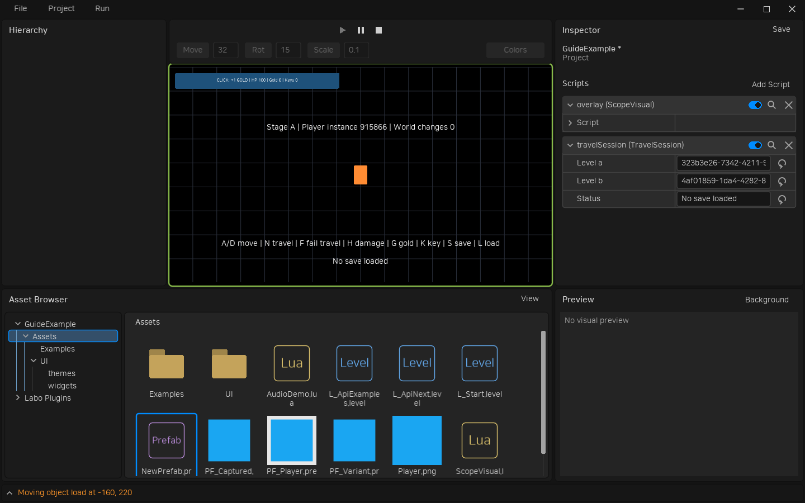
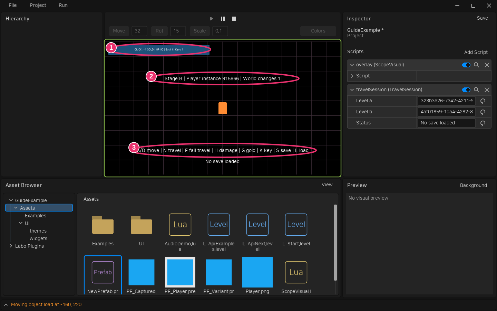

# 레벨 전환과 게임 저장

레벨을 넘어서 살아 있는 객체를 유지하는 일과 게임 종료 후 값을 복원하는 일은 별도로 구성합니다. 전자는 carry 옵션, 후자는 일반 Project Script와 LÖVE 파일 API를 사용합니다.

## 검수 예제 실행

테스트 프로젝트의 Assets/Examples/L_TravelA.level을 열고 Play를 누릅니다. TravelSession은 Project에 붙어 레벨을 넘어 유지되고, 각 레벨의 TravelStage는 새로 생성됩니다.

```text
World
└─ PF_Traveller [Traveller]
   └─ Camera [Camera]
      └─ HUD [Canvas]
         └─ Gold button [RectLayout, TravelHud]
Project ──포함──> TravelSession
Traveller ──소유──> View / TravelHud ──소유──> Input region
```



- A/D: 플레이어 이동. 자식 카메라가 함께 움직입니다.
- H: HP 10 감소, G: 골드 1 증가, K: 열쇠 1 증가.
- N: 다음 레벨로 같은 플레이어 계층을 이동합니다. ②의 Player instance 숫자가 유지됩니다.
- ①의 HUD 버튼 클릭: 골드 증가. 레벨 전환 후에도 입력을 받습니다.
- F: 일부러 새 레벨 초기화를 실패시켜 현재 레벨과 객체가 유지되는지 확인합니다.
- ③의 S: 현재 레벨·위치·HP·골드·열쇠를 슬롯 1에 저장합니다.
- L: 저장한 레벨을 열고 새 플레이어에 저장값을 적용합니다. Play 종료·재시작 후에도 사용할 수 있습니다.



다른 프로젝트에는 다음 명령으로 예제를 추가합니다. 동명 파일은 덮어쓰지 않으며 LaboEssentials를 활성화하고 Project에 travelSession을 부착합니다.

```powershell
love src --cli project examples-session --project D:/Games/MyGame
love src --cli level events --project D:/Games/MyGame --level Assets/Examples/L_TravelA.level --step-dt 0 --events-json '[{"name":"keypressed","args":["n","n",false]}]'
```

--step-dt를 지정하면 각 이벤트 뒤에 그 시간만큼 업데이트하고 대기 중인 레벨 전환을 적용합니다. 0도 한 프레임 경계를 처리합니다. 생략하면 기존처럼 이벤트만 전달합니다. 결과의 levelReference·levelScripts·instances에서 목적지와 유지된 플레이어를 확인합니다.

## 객체를 유지하는 전환 API

```lua
local accepted, err = self:getWorld():openLevel(nextLevel, {
    carry = {self.owner},
})
```

Engine.openLevel(world,nextLevel,options)도 같은 경로입니다. 옵션이 없으면 이전처럼 객체를 모두 교체합니다. carry에는 현재 World의 살아 있는 LObject를 지정합니다. 자손·스크립트·일반 Lua 상태는 같은 인스턴스로 유지되며 중복과 조상/자손 중복 선택은 한 번만 옮깁니다. 적용 경계에서 당시 계층을 옮기므로 요청 후 제거된 객체는 전환 오류가 됩니다.

선택 루트는 이전 부모에서 분리하고 월드 위치를 보존합니다. 로컬 회전·스케일은 유지하므로 부모의 회전·스케일까지 상쇄해야 한다면 루트 계층을 옮기거나 게임 코드에서 보정합니다. 새 시작 지점은 목적지 load에서 transform.x/y로 지정할 수 있습니다. 부모·앵커 의존 배치는 공개 역변환을 사용하며 읽기 전용 배치는 이동 오류를 낼 수 있습니다.

목적지 load에서 이미 이동한 객체를 world:getObjects()로 찾을 수 있습니다. runtimeId는 새 World에서 다시 배정하고 authoringId는 nil이 됩니다. 유지 여부는 같은 Lua 객체 참조로 판단합니다. 이전 레벨에 남은 객체를 자동으로 복사하거나 참조를 다시 연결하지 않습니다.

```lua
function Player:load(world)
    self.currentWorld = world
end
function Player:worldChanged(previousWorld, nextWorld)
    self.currentWorld = nextWorld
end
```

기존 Script는 enabled와 관계없이 worldChanged 수명 통지를 받고 load·unload를 다시 실행하지 않습니다. 월드 참조를 캐시하지 않으면 평소 self:getWorld()로 현재 소속을 조회해도 됩니다. 콜백이 오류를 내거나 false,error를 반환하면 전환이 실패합니다. 복구할 때는 인자를 뒤집어 다시 호출하므로 횟수 누적 같은 부작용에 주의합니다. 예제의 World changes는 이 통지 횟수입니다.

## 입력과 출력의 소유권

owner가 이동 Script인 View·Input region·RenderTarget은 같은 인스턴스로 옮깁니다. Project Script가 소유한 등록도 모든 전환에서 함께 이동합니다. 단독 렌더 타깃은 다음처럼 owner를 지정합니다.

```lua
self.target = require("Engine").Rendering.createTarget(world, {
    owner = self, width = 256, height = 256,
})
```

소유자 없는 타깃도 이동하는 View만 사용한다면 함께 옮깁니다. 이전 World에 남는 View와 타깃을 공유하거나 남는 Script가 타깃을 소유하면 오류입니다. owner가 없는 View는 이전 World와 함께 종료합니다. 입력 캡처는 이동·실패 시 취소하므로 버튼을 다시 눌러야 합니다.

후보 초기화가 성공하기 전에는 이동 객체의 제거·재부모화·스크립트 부착 변경과 기존 등록의 release를 허용하지 않습니다. 성공 후부터 일반 API를 사용할 수 있습니다. 새 World를 캐시한 사용자 코드에는 worldChanged에서 갱신한 참조를 사용합니다.

## 실패와 복구 범위

새 레벨 초기화가 실패하면 이전 World에서 계속 실행하고 levelTransitionError로 원인을 확인합니다. 엔진은 이동 객체의 소속·부모·루트 Transform·ID·기존 등록을 복구하고 후보에서 추가한 등록을 정리합니다. 일반 Lua 필드 변경·파일 쓰기·사용자 GPU 자원 해제까지 되돌리지는 않습니다. 통지 함수는 캐시 갱신 중심으로 작성합니다.

## 디스크 저장은 일반 게임 코드

TravelSession.lua는 일반 Project Script이고 SaveJson.lua는 예제에 포함한 직렬화 모듈입니다. 엔진의 자동 세이브 콜백이나 전체 객체 직렬화는 없습니다.

```lua
local bytes = assert(Json.encode({version = 1, level = levelId, player = playerValues}))
local ok, err = love.filesystem.write(saveFile, bytes)
```

실제 예제는 쓰기 전에 버전·레벨·숫자 범위를 검증하고 폴더를 생성합니다. 읽기는 누락·손상·지원하지 않는 버전을 상태 메시지로 보고하고 기존 플레이어를 유지합니다. 정상 파일이면 저장한 레벨을 일반 전환으로 열어 새 플레이어에 값을 적용합니다. 직접 write하므로 저장 도중 중단에 대비한 백업·슬롯 교대 정책은 게임 요구에 맞춰 추가합니다.

저장 경로는 현재 LÖVE 저장 폴더 아래 saves/<프로젝트 saveIdentity>/slot1.json입니다. Project Script의 self.owner.id·saveIdentity는 프로젝트의 안정적인 ID에서 제공됩니다. Editor Play에서는 에디터 저장 폴더 아래 프로젝트별 하위 폴더를 쓰며 Export에서는 해당 게임 전용 저장 폴더 아래에 씁니다. 두 실행 모드의 물리 저장 위치는 다릅니다. 전역 love.filesystem.setIdentity로 에디터 저장 폴더를 바꾸지 않습니다.

```powershell
love src --cli project info --project D:/Games/MyGame
# 복사한 프로젝트를 별도 게임으로 분리할 때만 새 저장 ID를 발급
love src --cli project reset-save-identity --project D:/Games/AnotherGame
```

프로젝트 이름·폴더 이동·재Export는 ID를 유지합니다. 프로젝트 파일을 통째로 복사하면 같은 ID를 유지하고 위 명령으로 분리할 수 있습니다. 에디터에서 열려 있던 프로젝트는 다시 열어 새 ID를 반영합니다. 기존 저장 파일과 에셋 ID는 삭제하거나 변경하지 않습니다. 예전 공용 labo-exported-game 폴더의 세이브는 자동 이전하지 않습니다.
