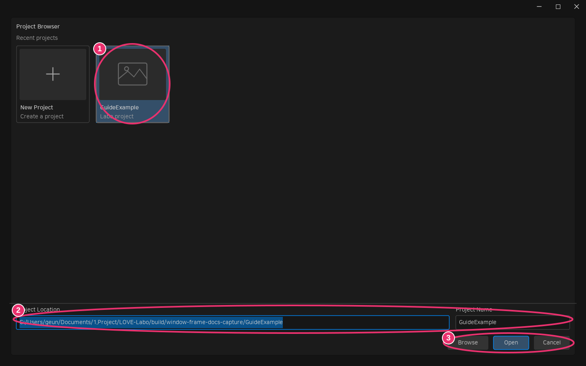
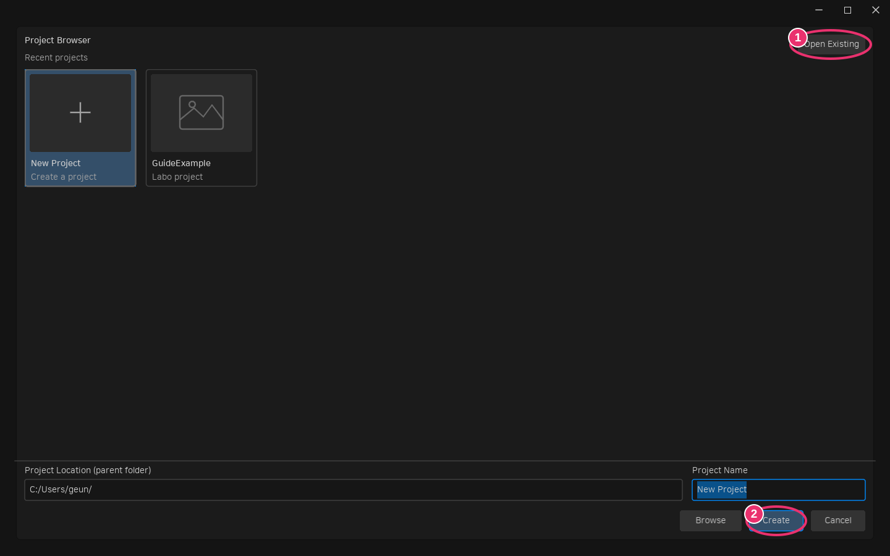

# 첫 프로젝트와 실행

Camera·Sprite·Pointer·RectBounds·Canvas를 사용하려면 먼저 [플러그인](plugins.md)을 활성화합니다. 새 프로젝트에서는 모두 꺼져 있습니다.

LÖVE Labo는 LÖVE 11.5 기반 2D 작업 환경입니다. 개발 실행은 `love src`, 배포본은 Labo.exe를 사용합니다.

1. **Project Browser**의 **New Project** 카드를 누르고 하단에서 이름과 부모 폴더를 지정한 뒤 **Create**를 누릅니다. **Browse**로 부모 폴더를 고를 수 있으며 기존 폴더는 덮어쓰지 않습니다.
2. 프로젝트에는 Assets, AGENTS.md, Docs/EngineGuide.md와 `.gitignore`를 만듭니다. `.gitignore`는 루트 `Build/`·`build/`, `.labo/` 캐시·진단, 임시 `asset-index.json`·`asset-move.json`과 운영체제 생성 파일을 제외합니다. 다른 폴더에 빌드를 출력하면 해당 경로를 직접 추가하세요. Assets, 프로젝트 설정과 `assets.json`의 에셋 ID는 저장소에 함께 보관합니다. 기존 프로젝트를 열 때는 `.gitignore`나 AI 안내를 생성·덮어쓰지 않습니다. 처음에는 아직 저장하지 않은 빈 레벨을 표시합니다.
3. File → New → Level로 레벨을 만듭니다. 빈 레벨이 생성됩니다. 화면 출력에는 Camera와 View 스크립트를 부착하고 View.cameraSource를 연결합니다. [카메라 설정](camera-ui.md)을 참고하세요.
4. File → New → Lua Class에서 Script를 부모로 골라 행동 코드를 작성합니다.
5. Prefab을 만들고 Add Script로 행동과 Sprite를 부착합니다. image 스포이드로 이미지를 지정합니다.
6. Prefab을 뷰포트 또는 Hierarchy에 배치하고 Run → Play 또는 F5로 실행합니다.

1. 최근 프로젝트 카드를 선택합니다. 성공적으로 연 프로젝트는 다음 실행에도 목록에 표시됩니다. 카드는 공통 대체 그림을 사용합니다.
2. 하단의 **Project Location**과 **Project Name**을 확인합니다. 기존 프로젝트의 이름은 표시만 하며, 경로는 입력하거나 붙여넣을 수 있습니다.
3. **Browse**로 기존 프로젝트 폴더를 지정한 뒤 **Open**으로 엽니다. 최근 카드를 더블클릭해도 열립니다. **Cancel**은 브라우저를 종료합니다. 목록이 길면 마우스 휠로 스크롤합니다.

경로가 이동·삭제된 프로젝트는 열기 오류가 표시됩니다. Browse로 현재 폴더를 지정해 다시 여세요. 최근 목록은 프로젝트 안이 아닌 LÖVE 사용자 설정의 `recent-projects.json`에 저장됩니다.

생성 화면에서 기존 프로젝트를 열려면 우측 상단의 **Open Existing**을 누른 뒤 **Browse → Open**을 사용합니다. 최근 프로젝트가 하나도 없어도 같은 방법으로 전환할 수 있습니다.

이미지의 1은 열기 모드로 돌아가는 **Open Existing**, 2는 새 프로젝트를 실제로 만드는 **Create**입니다. Browse·경로 입력·최근 카드 선택은 이름 표시를 위해 매니페스트만 읽습니다. 기존 프로젝트의 폴더 생성·에셋 목록 갱신·이전 Sources 이동은 **Open** 또는 최근 카드 더블클릭으로 실제 열기를 확인한 뒤 수행합니다. 그 전에 Cancel로 종료하면 선택한 프로젝트 파일을 변경하지 않습니다.

모든 에셋은 Assets 아래에 자유롭게 정리합니다. assets.json의 ID로 참조하므로 이동·이름 변경은 에디터나 CLI로 수행합니다. 이전 Sources 폴더는 충돌이 없을 때 Assets/Scripts로 옮겨집니다. 옛 컴포넌트 코드·Prefab은 수동 전환이 필요합니다.

예제는 tests/TestProject입니다. Sprite, 자손, object/script 참조와 런타임 생성, Project·Level 부착 및 고정 업데이트 예제를 포함합니다. 레벨 설정은 레벨 에셋을 선택하고, 프로젝트 설정은 빈 공간 선택 또는 Project → Inspector로 엽니다. [스크립트와 Prefab](objects.md), [Lua API](lua-api.md), [CLI](cli-and-export.md)를 이어서 확인하세요.
