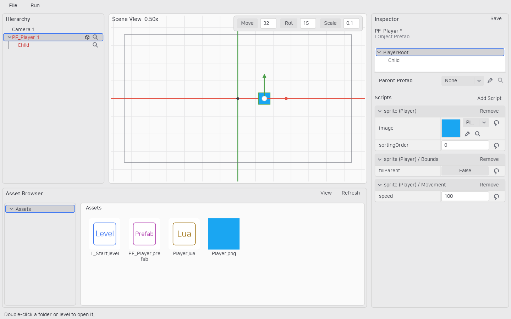
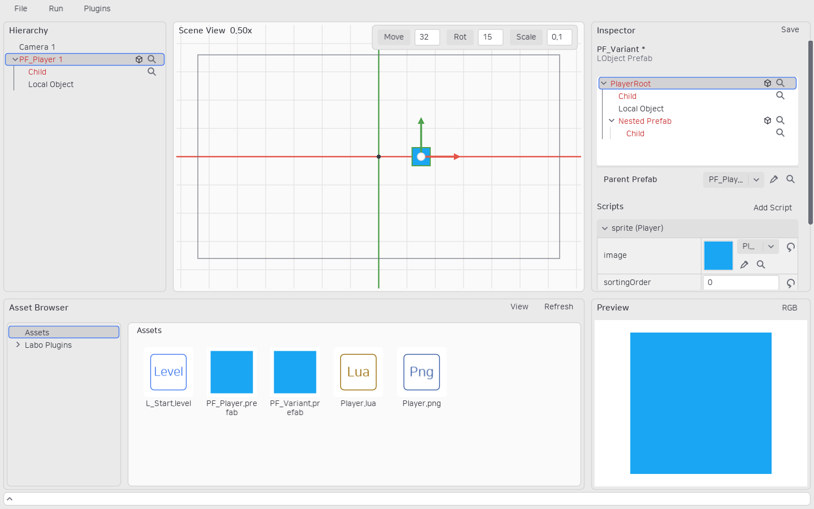

# 계층 Prefab

Prefab은 하나의 루트 LObject, 자손 LObject, 각 오브젝트의 부착 스크립트와 프로퍼티를 저장합니다. 컴포넌트 계층은 없습니다.

Inspector는 오브젝트 계층 → Parent Prefab → 자손 Transform → 부착 스크립트 그룹 순서입니다. 루트 Transform은 숨기며 배치 위치는 레벨 인스턴스에서 설정합니다. 내부 계층은 3행 높이로 시작하며 하단 손잡이로 조절하고 자체 스크롤 끝에서는 Inspector 전체 스크롤로 이어집니다.

Hierarchy에서 루트를 우클릭하여 Create Prefab...을 선택하면 자손·현재 유효 값·부착 스크립트·내부 참조를 캡처하고 현재 계층을 새 Prefab의 인스턴스로 연결합니다. 오브젝트 ID·이름·Transform과 외부에서 들어오는 참조는 유지합니다. 생성과 연결을 함께 Undo/Redo하며 레벨은 별도로 저장합니다. 상속된 자손만 선택한 경우 원본의 배치 루트를 선택하도록 안내합니다. Prefab 계층의 New Object는 빈 LObject를 추가합니다. 다른 Prefab을 자손으로 넣는 작업은 기존 CLI prefab.child.add로 지원합니다. 순환 참조는 삽입을 취소하고 초안을 보존합니다. 일반 에셋 선택이 Inspector를 바꾸므로 Inspector에 드래그하지 않습니다.

Prefab 소속은 글자색과 루트 오른쪽의 상자 아이콘으로 구분합니다. 독립 루트 묶음마다 현재 순서대로 RGBYCM 색을 배정하며 한 루트 묶음 안에서만 같은 원본의 색을 공유합니다. 다른 원본은 다음 색을 사용하고 이동·디태치·정렬 후 다시 계산합니다. 수직 계층선은 소속과 무관하게 모든 자손에 표시합니다. 중첩 원본은 별도 묶음을 시작하고, 직접 추가한 빈 오브젝트는 조상의 묶음에 포함하지 않습니다. Inspector에서 부모가 없는 오리지널 구성은 일반 행으로 표시하고, 부모로부터 상속한 구성만 묶습니다. 레벨에 배치한 구성은 해당 인스턴스의 원본 Prefab 기준으로 묶습니다. 행의 돋보기로 원본 에셋을 찾고 Rename으로 해당 행에서 이름을 수정합니다.

파생 Prefab은 부모의 계층·부착 구성을 상속합니다. 프로퍼티와 Transform 편집은 값만 재정의하고 원본을 고정하지 않습니다. Parent Prefab을 명시적으로 바꿀 때만 원본 참조를 기록합니다. None은 명시적 false로 저장하여 상속 유지와 구분합니다. 자손 제거는 안정적인 경로로 저장합니다.

독립 복제·캡처는 유효 상속값을 보존합니다. 계층 내부 object/script 참조는 복제 자손에 다시 연결하며 외부 참조는 유지합니다. 연결된 자손 ID를 보존하고 새 형제 ID는 충돌을 피합니다. 원본에서 제거한 자손은 런타임에도 남지 않습니다.

상속 구성 내부의 구조·순서·삭제와 상속된 스크립트의 제거·정렬은 금지합니다. 직접 추가한 자손만 부착·디태치·정렬하고 상속 항목 사이에는 끼워 넣지 않습니다. 로컬 자손을 루트 위로 옮기면 기존 루트가 새 루트의 자식이 됩니다. 기존 루트의 Parent Prefab과 상속 자손은 그대로 유지합니다. Prefab 에셋은 계층 컨테이너이며 Parent Prefab은 선택 오브젝트의 원본입니다. [ADR 0055](../adr/0055-prefab-container-and-sourced-object-roots.md)에 루트 교체 계약을 기록했습니다.

Prefab 형식 4의 scripts는 `{id, source, name}` 목록입니다. overrides.scripts는 부착 ID별 값, removedScripts는 상속 부착 제거, scriptOrder는 순서 재정의입니다. children의 각 노드도 같은 구성을 가집니다. bindings는 from/to 노드 경로와 property를 저장하며 스크립트 대상에는 toScript 부착 ID를 추가합니다.

`children`, `bindings`, `removedPaths`는 순서가 있는 목록입니다. 키가 붙은 JSON 객체로 바꾸면 해당 필드 경로를 포함한 오류로 거부하며, GUI·프로젝트 검증 CLI·Export에 같은 규칙을 적용합니다. 필드 생략과 빈 목록은 허용합니다. scripts의 이전 `label` 필드는 읽기 호환으로만 지원하며 새 데이터에는 `name`을 사용합니다.
