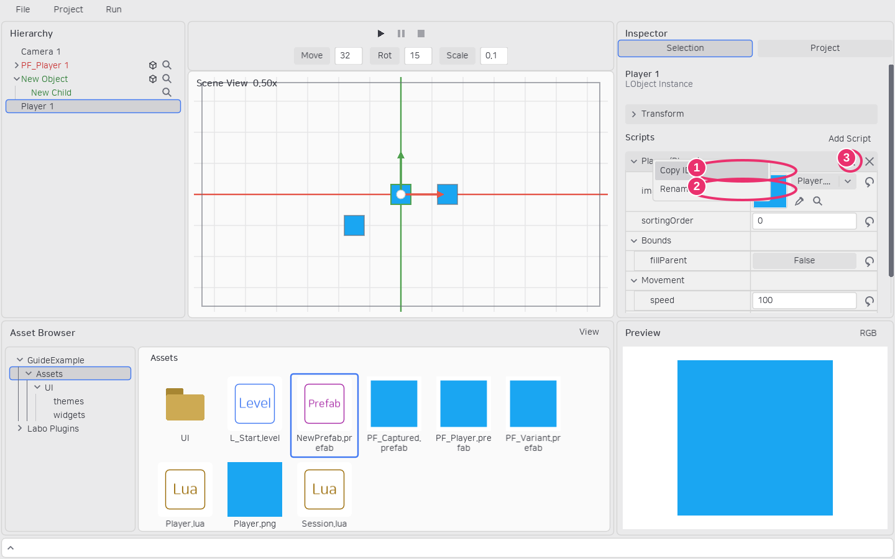

# Lua API와 생명주기


Camera·Sprite·Pointer·RectBounds·Canvas를 사용하려면 먼저 [플러그인](plugins.md)을 활성화합니다. 새 프로젝트에서는 모두 꺼져 있습니다.

Lua 파일은 스크립트 정의 테이블을 반환합니다. LObject를 상속하지 않습니다. `self`는 부착마다 생성되는 스크립트이고 `self.owner`는 Transform과 자손을 가진 LObject입니다. Lua 5.1/LuaJIT와 일반 LÖVE API를 사용할 수 있습니다.

```lua
local Movement = {
    properties = {
        speed = {type = "number", default = 100, group = "Movement"},
        title = {type = "string", default = "Player"},
        enabled = {type = "boolean", default = true},
        target = {type = "object", default = false},
        other = {type = "script", default = false},
        projectile = {type = "prefab", default = false},
    },
}
function Movement:load(world)
    self.elapsed = 0 -- 일반 필드는 Inspector에 노출되지 않는다.
end
function Movement:update(dt)
    if self.enabled then
        self.owner.transform.x = self.owner.transform.x + self.speed * dt
    end
end
return Movement
```

`load(world)`는 한 번 초기화합니다. `update(dt)`와 `draw(context)`는 선택 사항이며 실제 구현된 콜백만 실행 목록에 등록됩니다. 실행 중인 초기화 콜백에 재진입하지 않습니다. 공통 `enabled`는 기본 true이며 false이면 update·draw·포인터 입력을 건너뜁니다. load는 활성 상태와 관계없이 한 번 실행하며 다시 활성화해도 반복하지 않습니다. 비활성 카메라는 자동 선택에서 제외합니다. 부모 오브젝트에서 자손으로, 같은 오브젝트에서는 부착 순서로 실행합니다. Prefab의 스크립트 그룹 헤더 우클릭에서 순서를 바꿉니다.

이전 프로젝트의 `beginPlay` 선언과 직접 호출은 `load`로 바꿉니다. 호출 시점과 초기화 동작은 같습니다. 에셋을 읽거나 에디터 미리보기를 만들 때 호출하는 함수가 아닙니다.

활성화한 플러그인의 `extends = "Sprite"`를 사용하거나 다른 Lua 스크립트의 에셋 ID를 부모로 지정할 수 있습니다. `require("Engine")`은 LObject·Script·일반 API를 제공하며 Camera·Sprite·Pointer·RectBounds·Canvas는 해당 플러그인을 활성화해야 사용합니다. 프로젝트 내부 일반 모듈은 `require("Helpers.Math")`로 `Assets/Helpers/Math.lua`를 읽습니다.

| API | 역할 |
|---|---|
| self.owner.transform | 부모 기준 Transform |
| self.owner:getWorldTransform() | 합성된 월드 Transform |
| self.owner:getScriptByName(name) | 사용자 이름으로 조회 |
| self.owner:getScriptById(id) | 내부 부착 UUID로 조회 |
| self.owner:getScriptByClass(class) | 해당 클래스·파생 클래스의 첫 부착 조회 |
| self.owner:getScriptsByClass(class) | 해당 클래스·파생 클래스의 모든 부착을 순서대로 반환 |
| script.enabled = false / true | 실행 비활성화·활성화 |
| object:attachTo(parent) | 부모 변경, nil이면 독립 |
| world:spawnLObject(prefab, transform, overrides) | Prefab 계층 생성 |
| world:removeLObject(object) | 자손·입력 캡처까지 제거 |
| world:setActiveCamera(script) | 런타임 카메라 지정 |
| world:openLevel(reference) | 프레임 경계에서 레벨 전환 |
| world.debug | [에디터 로그·화면 로그·디버그 도형](debugging.md); 배포에서는 no-op |

편집 화면 표시에는 별도 `drawEditor(context)` 콜백을 사용합니다. 게임 draw와 분리되어 있으며 Camera 플러그인도 이를 사용합니다.

레벨 Lua 스크립트는 별도로 유지됩니다. 레벨을 상속한 오브젝트가 아니라 World 전체의 초기화·업데이트를 담당합니다. 예전 `build`, 루트 컴포넌트, LObject 클래스 생성 템플릿 API는 지원하지 않습니다.

스크립트 부착·제거는 Prefab 또는 레벨 인스턴스의 Inspector/CLI에서 합니다. 게임 코드에는 addScript/removeScript를 제공하지 않습니다. 조회 실패는 nil, 복수 조회 실패는 빈 목록입니다. 클래스 조회에는 로딩한 클래스 테이블을 전달합니다.

레벨 스크립트에서도 require로 가져온 클래스로 부착·Spawn된 스크립트를 조회할 수 있습니다. 앞선 draw가 다른 스크립트의 enabled를 false로 바꾸면 뒤의 스크립트는 같은 프레임부터 그리지 않습니다.

```lua
local Movement = require("Movement") -- Assets/Movement.lua
local movement = self.owner:getScriptByClass(Movement)
local all = self.owner:getScriptsByClass(Movement)
if movement then movement.enabled = false end
```

스크립트 이름은 같은 LObject 안에서 고유하며 ID와 별개입니다. 새 부착 ID는 UUID로 생성합니다. 그룹 헤더 우클릭의 **Rename**으로 이름을 바꾸고 **Copy ID**로 ID를 복사합니다. 이름을 바꿔도 저장된 스크립트 참조와 프로퍼티 재정의는 유지됩니다. 상속된 스크립트 이름은 재정의할 수 있지만 제거·재정렬은 할 수 없습니다.

그룹 헤더 오른쪽의 돋보기는 원본 에셋을 찾고 X는 로컬 부착을 제거합니다. 제거할 수 없는 상속 부착에는 X가 표시되지 않습니다. Add Script의 목록은 모든 Lua 파일 이름을 확장자 없이 표시합니다.



① Copy ID는 내부 식별자를 복사합니다. ② Rename은 사용자 이름을 편집합니다. ③ 돋보기와 X는 원본 찾기와 로컬 부착 제거입니다.
