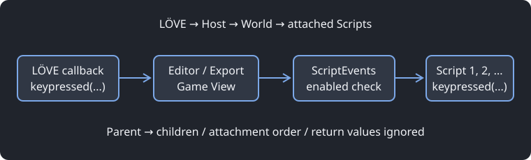
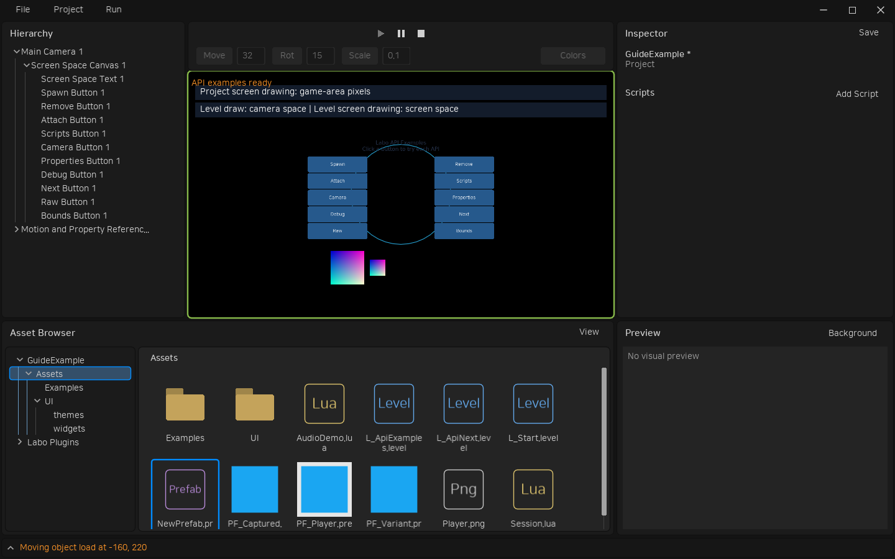

# Lua API와 생명주기


Camera·View·Sprite·Pointer·RectBounds·Canvas·RectLayout·Text를 사용하려면 먼저 [플러그인](plugins.md)을 활성화합니다. 새 프로젝트에서는 모두 꺼져 있습니다.

Lua 파일은 스크립트 정의 테이블을 반환합니다. LObject를 상속하지 않습니다. `self`는 부착마다 생성되는 스크립트이고 `self.owner`는 부착 대상입니다. Object에 부착하면 LObject, Level에 부착하면 실행 중인 World, Project에 부착하면 프로젝트 실행 호스트입니다. Lua 5.1/LuaJIT와 일반 LÖVE API를 사용할 수 있습니다.

```lua
local Movement = {
    properties = {
        speed = {type = "number", default = 100, group = "Movement"},
        title = {type = "string", default = "Player"},
        target = {type = "object", default = false},
        other = {type = "script", default = false},
        projectile = {type = "prefab", default = false},
    },
}
function Movement:load(world)
    self.elapsed = 0 -- 일반 필드는 Inspector에 노출되지 않는다.
end
function Movement:update(dt)
    if self.enabled then
        self.owner.transform.x = self.owner.transform.x + self.speed * dt
    end
end
return Movement
```

`load(world)`는 한 번 초기화합니다. `update(dt)`와 `draw(context)`는 선택 사항이며 실제 구현된 콜백만 실행 목록에 등록됩니다. 실행 중인 초기화 콜백에 재진입하지 않습니다. 공통 `enabled`는 별도로 선언하지 않아도 상속됩니다. Inspector에서는 프로퍼티 행 대신 각 스크립트 헤더의 돋보기 왼쪽 토글로 편집합니다. 런타임의 `self.enabled`와 CLI의 `부착이름.enabled`는 그대로 사용합니다. 기본값은 true이며 false이면 update·draw·등록한 입력을 건너뜁니다. load는 활성 상태와 관계없이 한 번 실행하며 다시 활성화해도 반복하지 않습니다. 화면 출력은 명시적으로 등록한 View를 사용합니다. 업데이트는 공통 `updateOrder`가 작은 순서로 실행하고, 동률이면 Project → Level → 부모 우선 Object → 부착 순서를 유지합니다. Prefab의 스크립트 그룹 헤더 우클릭에서 순서를 바꿉니다.

공통 `updateOrder`·`drawOrder`는 별도 선언 없이 기본 0으로 상속합니다. 음수는 먼저, 양수는 나중에 실행합니다. 두 설정은 독립적이며 런타임에도 변경할 수 있습니다. updateOrder 변경은 다음 프레임, drawOrder 변경은 다음 그리기 단계부터 반영합니다. 프레임 중 생성한 오브젝트·부착은 다음 프레임부터 업데이트합니다. load·unload·일반 이벤트 순서는 이 값에 영향을 받지 않습니다.

```lua
self.updateOrder = -100 -- 먼저 업데이트
self.drawOrder = 100    -- 같은 그리기 단계에서 나중에 그려 앞에 표시
```

모든 일반 draw를 drawOrder로 정렬합니다. Canvas·화면 출력에 대한 별도 정렬 단계는 없습니다. 동률은 Project → Level → 부모 우선 Object → 부착 순서를 유지합니다. View의 order는 View 간 출력 순서이므로 스크립트의 drawOrder와 별개입니다. Inspector에서는 해당 콜백이 있는 설정만 Script 그룹에 표시합니다.

이전 프로젝트의 `beginPlay` 선언과 직접 호출은 `load`로 바꿉니다. 호출 시점과 초기화 동작은 같습니다. 에셋을 읽거나 에디터 미리보기를 만들 때 호출하는 함수가 아닙니다.

사용자·플러그인 스크립트 모두 `extends = "부모 에셋 UUID"`로 상속합니다. 에셋 브라우저에서 부모 파일을 우클릭하고 **Copy ID**로 ID를 복사합니다. `extends`를 생략하면 기반 Script를 사용합니다. 과거 `extends = "Sprite"` 같은 공개 이름은 읽기 호환으로 유지하지만 새 생성 코드와 예제는 ID를 기록합니다. 서로 다른 폴더의 동명 스크립트도 ID로 구별하므로 전역 이름 중복 금지는 없습니다. `require("Engine")`은 LObject·Script·일반 API를 제공하며 Camera·Sprite·Pointer·RectBounds·Canvas는 해당 플러그인을 활성화해야 사용합니다. 프로젝트 내부 일반 모듈은 `require("Helpers.Math")`로 `Assets/Helpers/Math.lua`를 읽습니다.

| API | 역할 |
|---|---|
| self.owner.transform | 부모 기준 Transform |
| self.owner:getWorldTransform() | 합성된 월드 Transform |
| self.owner:getScriptByName(name) | 사용자 이름으로 조회 |
| self.owner:getScriptById(id) | 내부 부착 UUID로 조회 |
| self.owner:getScriptByClass(class) | 해당 클래스·파생 클래스의 첫 부착 조회 |
| self.owner:getScriptsByClass(class) | 해당 클래스·파생 클래스의 모든 부착을 순서대로 반환 |
| script.enabled = false / true | 실행 비활성화·활성화 |
| object:attachTo(parent) | 부모 변경, nil이면 독립 |
| world:spawnLObject(prefab, transform, overrides) | Prefab 계층 생성 |
| world:removeLObject(object) | 자손·입력 캡처까지 제거 |
| Rendering.createView(world, options) | 카메라·타깃을 연결해 자동 출력 등록. [렌더링 API](camera-ui.md) |
| world:openLevel(reference) | 프레임 경계에서 레벨 전환 |
| world.debug | [에디터 로그·화면 로그·디버그 도형](debugging.md); 배포에서는 no-op |

편집 화면 표시에는 별도 `drawEditor(context)` 콜백을 사용합니다. 게임 draw와 분리되어 있으며 Camera 플러그인도 이를 사용합니다.

레벨 Lua 스크립트는 별도로 유지됩니다. 레벨을 상속한 오브젝트가 아니라 World 전체의 초기화·업데이트를 담당합니다. 예전 `build`, 루트 컴포넌트, LObject 클래스 생성 템플릿 API는 지원하지 않습니다.

스크립트 부착·제거는 Prefab 또는 레벨 인스턴스의 Inspector/CLI에서 합니다. 게임 코드에는 addScript/removeScript를 제공하지 않습니다. 조회 실패는 nil, 복수 조회 실패는 빈 목록입니다. 클래스 조회에는 로딩한 클래스 테이블을 전달합니다.

레벨 스크립트에서도 require로 가져온 클래스로 부착·Spawn된 스크립트를 조회할 수 있습니다. 앞선 draw가 다른 스크립트의 enabled를 false로 바꾸면 뒤의 스크립트는 같은 프레임부터 그리지 않습니다.

```lua
local Movement = require("Movement") -- Assets/Movement.lua
local movement = self.owner:getScriptByClass(Movement)
local all = self.owner:getScriptsByClass(Movement)
if movement then movement.enabled = false end
```

스크립트 이름은 같은 LObject 안에서 고유하며 ID와 별개입니다. 새 부착 ID는 UUID로 생성합니다. 그룹 헤더 우클릭의 **Rename**으로 이름을 바꾸고 **Copy ID**로 ID를 복사합니다. 이름을 바꿔도 저장된 스크립트 참조와 프로퍼티 재정의는 유지됩니다. 상속된 스크립트 이름은 재정의할 수 있지만 제거·재정렬은 할 수 없습니다.

그룹 헤더 오른쪽의 돋보기는 원본 에셋을 찾고 X는 로컬 부착을 제거합니다. 제거할 수 없는 상속 부착에는 X가 표시되지 않습니다. Add Script의 목록은 모든 Lua 파일 이름을 확장자 없이 표시합니다.


① Copy ID는 내부 식별자를 복사합니다. ② Rename은 사용자 이름을 편집합니다. ③ 돋보기와 X는 원본 찾기와 로컬 부착 제거입니다.

<a id="script-events"></a>

## LÖVE 이벤트 콜백

부착 Script에 다음 콜백을 구현합니다. 전역 `love.keypressed` 등을 직접 덮어쓰지 않습니다. 기본 제공 플러그인 없이도 사용할 수 있습니다.



| 종류 | Script 콜백과 인자 |
|---|---|
| 키보드 | `keypressed(key, scancode, isrepeat)`, `keyreleased(key, scancode)` |
| 문자 | `textinput(text)`, `textedited(text, start, length)` |
| 마우스 | `mousepressed(x, y, button, istouch, presses)`, `mousereleased(x, y, button, istouch, presses)` |
| 이동·휠 | `mousemoved(x, y, dx, dy, istouch)`, `wheelmoved(x, y)` |
| 터치 | `touchpressed(id, x, y, dx, dy, pressure)`, `touchreleased(...)`, `touchmoved(...)` — 세 콜백의 인자는 동일 |
| 조이스틱 | `joystickpressed(joystick, button)`, `joystickreleased(joystick, button)`, `joystickaxis(joystick, axis, value)`, `joystickhat(joystick, hat, direction)` |
| 게임패드 | `gamepadpressed(joystick, button)`, `gamepadreleased(joystick, button)`, `gamepadaxis(joystick, axis, value)` |
| 장치 연결 | `joystickadded(joystick)`, `joystickremoved(joystick)` |
| 창 상태 | `focus(focused)`, `mousefocus(focused)`, `visible(visible)` |
| 게임 영역 크기 | `resize(width, height)` |

```lua
local Player = {}
function Player:keypressed(key, scancode, isrepeat)
    if key == "right" then
        self.owner.transform.x = self.owner.transform.x + 20
    end
end
function Player:mousepressed(x, y, button, istouch, presses)
    self.clickX, self.clickY = x, y
end
return Player
```

부모부터 자손, 같은 객체에서는 부착 순서로 활성 Script에 전달합니다. 반환값은 무시하므로 `return true`로 다른 Script의 입력을 막지 않습니다. 메뉴 상태에 따른 처리 여부는 게임 코드에서 결정합니다. 이벤트 도중 비활성화·제거된 대상은 건너뛰고 새로 Spawn한 대상은 다음 이벤트부터 받습니다. 콜백 예외는 런타임 오류로 표시합니다. 콜백 이름을 프로퍼티 이름으로 사용할 수 없습니다.

`x/y`는 레터박스를 제외한 실제 게임 화면 왼쪽 위 기준의 픽셀 좌표입니다. `dx/dy`는 그대로 전달합니다. 월드 좌표가 필요하면 실제 게임 영역 크기로 만든 `Engine.Viewport`의 `screenToWorld(x, y)`를 사용합니다. 영역 밖에서 시작한 입력은 전달하지 않으며, 안에서 시작한 입력의 이동·해제는 밖에서도 받습니다. 기존 Pointer의 `onPointerDown/Up/Move`는 별도의 영역 판정 기능이며 일반 마우스 이벤트 다음에 처리됩니다. 두 방식을 함께 구현하면 각각 호출됩니다.

Editor에서는 Game View가 포커스를 가진 경우 키보드·문자·컨트롤러 입력을 전달합니다. 실행 시 Game View에 포커스를 주며 다른 패널을 클릭한 뒤에는 게임 화면을 클릭해 돌아옵니다. 팝업·스포이드·Pause 중에는 입력을 전달하지 않습니다. F5·저장 등 에디터 단축키가 우선하며 Export에는 이 제한이 없습니다. 휠은 커서가 실제 게임 영역 안에 있을 때 전달합니다.

`focus/mousefocus/visible`은 호스트 창 상태입니다. `resize`는 게임 영역의 실제 크기이며 최초 실행과 레벨 전환 때 새 World의 첫 `update` 전에 전달됩니다. 이후 Editor에서는 레이아웃 변경, Export에서는 창 크기 변경을 반영합니다. Pause 중 생긴 영역 변경은 재개 시 다음 `update` 전에 반영됩니다. 논리 해상도·월드 크기와 다릅니다.

`quit`, 파일·폴더 드롭, `threaderror`, `lowmemory`, `displayrotated`, `run/conf/errorhandler`는 Script 이벤트로 제공하지 않습니다. 레벨 Lua 스크립트는 기존 `load/update`를 유지합니다. [이벤트 예제](examples.md#script-events)와 [CLI 검증](../cli-and-export.md#script-events)을 참고합니다.

## Project·Level·Object의 공용 Script

빈 공간 선택 또는 **Project → Inspector**로 프로젝트 설정을 열어 프로젝트에, 레벨 에셋을 선택해 레벨에 Script를 부착합니다. 같은 Lua 정의를 어느 범위에서든 사용할 수 있습니다. `self.owner.transform`처럼 Object 전용 정보를 사용하는 코드는 해당 범위를 전제로 작성해야 합니다.

| 범위 | 생성·정리 | 접근 |
|---|---|---|
| Project | Play 시작·Stop. 레벨 전환에도 유지 | `self:getProject()` |
| Level | 각 World 생성·종료 | `self:getWorld()` |
| Object | 객체 생성·제거 | Object Script의 `self.owner` |

`self:getWorld()`는 Project Script에서도 현재 실행 중인 World를 반환합니다. 레벨 전환 후에는 새 World입니다. Play가 끝난 프로젝트 호스트의 현재 World는 nil입니다. World의 `getObjects()`는 현재 객체 목록의 복사본을 반환합니다.

세 대상 모두 `getScriptById`, `getScriptByName`, `getScriptByClass`, `getScriptsByClass`, `getScriptOrder`를 제공합니다. 지정한 대상의 부착만 조회합니다.

```lua
local session = self:getProject():getScriptByName("scopeSession")
local levelLogic = self:getWorld():getScriptByName("scopeLevel")
local objects = self:getWorld():getObjects()
```

load는 Project → Level → Object 순서, update는 updateOrder 순서로 Labo가 호출합니다. 같은 대상에서는 부착 순서, Object끼리는 기존 부모·자손 순서입니다. Project·Level도 같은 일반 입력 이벤트와 Input.registerRegion API를 사용할 수 있습니다. 영역 판정은 등록한 hitTest에서 수행하며 Project·Level의 공간 원점은 월드 원점입니다. unload는 Object → Level → Project 순서이며 각 대상 안에서는 부착 역순입니다. 기존 별도 Level Lua의 load/update는 호환 경로로 유지하고 새 부착은 일반 Script로 작성합니다.

고정 업데이트를 직접 구현하려면 Object Script에는 update를 정의하지 않고 `fixedUpdate(dt)` 같은 일반 메서드를 작성합니다. Level Script의 update에서 시간을 누적하고 대상을 조회해 호출합니다. 활성 상태·우선순위·따라잡기 횟수는 그 코드가 관리합니다. [직접 실행할 예제](examples.md#script-scopes)를 제공합니다.

## configure와 배치·영역 바인딩

configure()는 각 부착 생성 때 한 번 호출하며 에디터·미리보기에서도 실행합니다. 게임 load/update와 별개입니다. 부모·다른 스크립트·참조가 아직 연결되지 않았을 수 있으므로 조회는 등록한 제공 함수 안에서 수행합니다. 게임 동작과 입력·GPU 자원은 load에서 시작합니다.

```lua
local Engine = require("Engine")
local Shape = {}
function Shape:configure()
    Engine.Bounds.bind(self, function(context)
        return -50, -20, 100, 40
    end, {primary = true})
end
function Shape:draw(context)
    local x, y, width, height = self:getBounds(context)
    love.graphics.rectangle("fill", x, y, width, height)
end
return Shape
```

Bounds.bind는 Script 영역을 등록하고 primary=true이면 같은 오브젝트의 대표 사각형으로도 제공합니다. Bounds.of(object,context)·Bounds.parent(object,context)로 조회합니다. 직접 getLocalBounds(context)를 구현하는 일반 스크립트도 사용할 수 있습니다. fillParent의 의미나 다른 제공 스크립트의 타입을 Core가 추론하지 않습니다.

Transform.bindLocal(object,{owner=self,resolve=fn,unresolve=fn})는 authored Transform과 context를 받아 유효 로컬 변환을 계산합니다. 반환값은 x/y와 회전·스케일 또는 a/b/c/d affine 기저를 갖습니다. 저장된 object.transform은 유지하며 getWorldTransform(context)은 부모의 유효 변환을 합성합니다. unresolve(effective,context)는 위치 편집을 authored 오프셋으로 변환합니다. 제공자를 해제하려면 반환 핸들의 release를 호출합니다. Script 제거·종료 때는 자동 정리합니다.

문자열 프로퍼티의 options 배열은 공통 Inspector 선택 목록입니다. 기본값과 재정의는 목록 안의 값이어야 하며 CLI·런타임 할당에도 같은 검증을 적용합니다.

```lua
properties = {
    align = {type = "string", default = "left", options = {"left", "center", "right"}},
}
```

## 월드 그리기와 명시적인 화면 좌표

```lua
function MyScript:draw(context)
    love.graphics.circle("line", 0, 0, 50)
    context:withScreen(function()
        love.graphics.print("Screen HUD", 20, 20)
    end)
end
```

Object의 draw에는 유효 오브젝트 Transform과 View 투영을 적용합니다. Project·Level의 draw는 월드 원점에서 시작합니다. 모든 범위를 공통 drawOrder로 정렬하고 별도의 화면 콜백 단계는 없습니다. drawScreen은 제거되었으며 선언하면 전환 안내 오류를 표시합니다.

context는 Renderer가 전달한 그리기 환경입니다. context.view·projection·target은 이번 출력, context.viewport는 출력 영역·좌표 변환을 제공합니다. context:image(reference)로 이미지를 가져옵니다. context:withScreen(fn)은 Rendering.withScreen(context,fn)의 편의 메서드이며 게임 영역 왼쪽 위 (0,0) 기준의 픽셀 좌표를 적용합니다. 카메라·오브젝트 변환을 잠시 해제하고 오류가 나도 그래픽 상태를 복구합니다. 에셋·Scene 미리보기에서는 이 화면 구간을 실행하지 않습니다.

여러 View에 포함된 draw는 출력마다 실행하며 update는 World당 한 번입니다. 다른 Script의 draw를 직접 호출하면 그 대상의 Transform 준비 과정은 생략됩니다. UI를 배치·선택·입력 가능한 객체로 만들려면 [Canvas·RectLayout과 공개 입력 API](camera-ui.md)를 사용합니다.



## 오디오와 자원 정리

```lua
local Sound = {properties = {clip = {type = "audio", default = false}}}
function Sound:load(world)
    if self.clip then
        local data = assert(world:getAssetData(self.clip))
        self.audioSource = love.audio.newSource(data, "static")
        data:release()
    end
end
function Sound:keypressed(key)
    if key == "space" and self.audioSource then self.audioSource:play() end
end
function Sound:unload()
    if self.audioSource then
        self.audioSource:stop()
        self.audioSource:release()
        self.audioSource = nil
    end
    -- 종료 중에도 self.owner로 원래 오브젝트에 접근할 수 있다.
end
return Sound
```

`world:getAssetData(reference)`는 프로젝트·플러그인 에셋을 LÖVE FileData로 읽습니다. ID 또는 에셋 경로를 받아 실패 시 `nil, error`를 반환합니다. 반환한 FileData는 게임 코드가 소유하며 더 이상 필요하지 않으면 `release()`합니다. 재생 Source를 만드는 방식은 [LÖVE 공식 newSource 문서](https://love2d.org/wiki/love.audio.newSource)를 따릅니다. ID와 부착의 내부 필드인 `self.source` 대신 `self.audioSource` 같은 별도 필드에 네이티브 자원을 보관합니다.

`unload()`는 오브젝트에 부착된 Script의 종료 콜백입니다. 오브젝트 제거 시 자손부터 부모, 각 오브젝트에서는 부착 역순으로 호출합니다. 성공적인 레벨 전환·Play 종료·게임 종료·런타임 오류에서도 남은 오브젝트의 Script를 정리합니다. `load`를 시작한 Script만 한 번 호출하며, enabled=false도 정리합니다. 초기화 도중 실패한 Script도 부분적으로 만든 자원을 정리할 수 있습니다. Preview·에셋 검증은 load/unload를 호출하지 않습니다.

종료 중에는 `self.owner`와 `self.owner.world`를 사용할 수 있습니다. unload에는 별도 인자를 전달하지 않습니다. 한 unload가 예외를 발생시켜도 나머지를 정리한 뒤 오류를 보고합니다. 반환값은 무시하며 unload는 입력 이벤트나 활성 상태 변경 콜백이 아닙니다. World 전체가 종료된 뒤에는 Spawn·레벨 전환·업데이트를 실행할 수 없습니다. Level Lua 스크립트의 콜백 종류는 이번에 변경하지 않습니다.

[오디오·종료 예제](examples.md#audio-lifecycle)에서 직접 검수할 수 있습니다.
