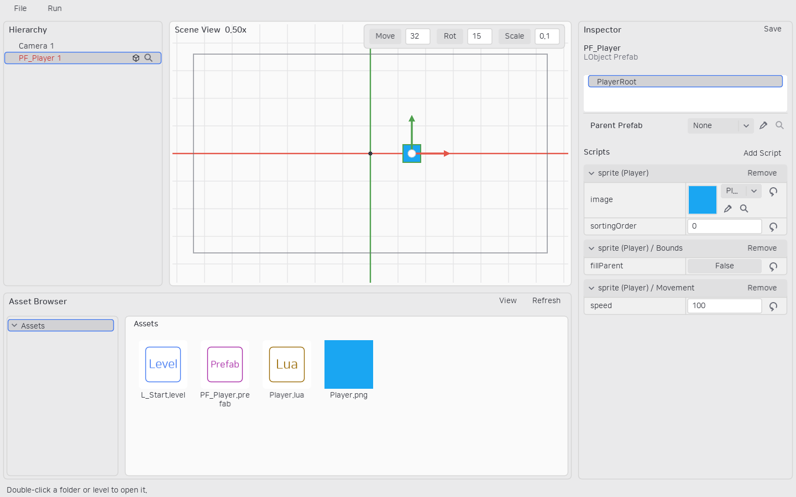

# 스크립트와 Prefab

**Lua 스크립트는 행동 정의**, **Prefab은 오브젝트 계층과 부착 구성의 저장 에셋**, **인스턴스는 레벨에 배치한 실체**입니다. LObject에는 여러 스크립트를 부착할 수 있습니다.

1. File → New → Lua Class에서 부모 Script 또는 편의 스크립트를 고릅니다. 경로는 모두 Assets 안입니다.
2. Lua 파일에 [프로퍼티와 선택적 콜백](lua-api.md)을 작성합니다.
3. Prefab을 만들고 Add Script로 Lua 에셋 또는 기본 스크립트를 추가합니다.
4. 각 스크립트 그룹의 프로퍼티를 설정하고 우측 상단 Save를 누릅니다.
5. Prefab을 뷰포트나 Hierarchy에 드롭해 인스턴스를 배치합니다. Lua 스크립트 자체는 배치 대상이 아닙니다.

Prefab Inspector는 오브젝트 계층 → Parent Prefab → 선택 오브젝트의 Transform → 스크립트 그룹 순서입니다. Prefab 루트 Transform은 표시하지 않으며 자손 Transform은 편집합니다. 인스턴스는 Transform과 부착 스크립트 프로퍼티를 표시하며 부모 원본·상속한 구성은 변경하지 않으며 로컬 스크립트는 추가·제거할 수 있습니다.

계층 우클릭의 **New Object**는 빈 LObject를 바로 추가합니다. 에셋 브라우저의 New → Prefab은 빈 루트로 바로 생성하고 목록 안에서 이름을 편집합니다. Hierarchy의 오브젝트 우클릭 **Create Prefab...**은 자손·스크립트·유효 값·내부 참조를 함께 캡처합니다. 파생 Prefab은 원본의 계층·부착 구성·값을 상속하고 변경한 부분만 재정의합니다.

프로퍼티의 재설정 기호는 상속값으로 복구합니다. Save 전에도 Play와 Export는 초안을 사용합니다. Ctrl+Shift+S는 변경 문서 목록을 보여주며 체크된 대상만 저장합니다.
