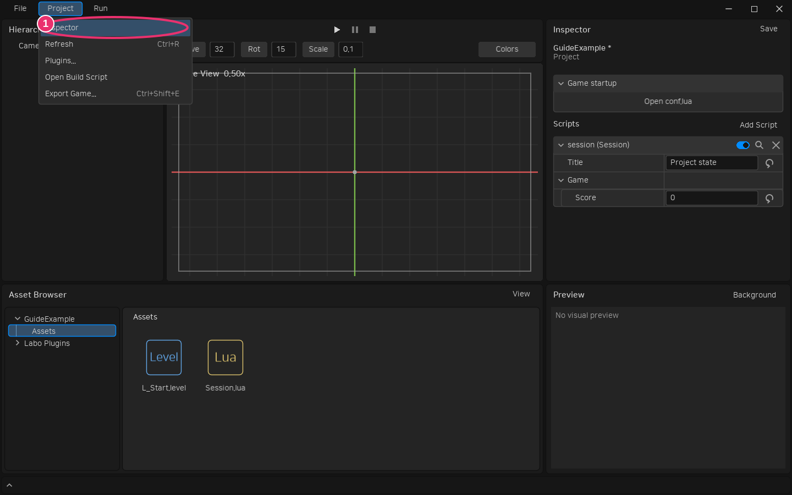
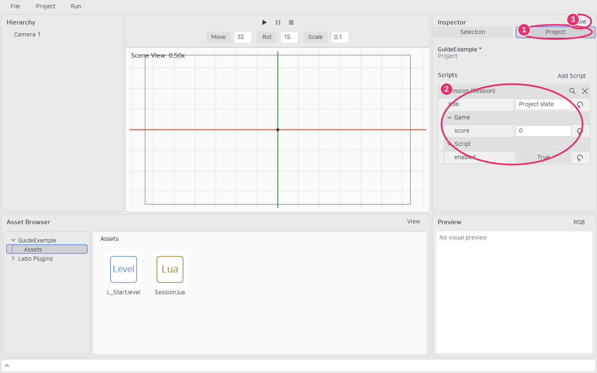
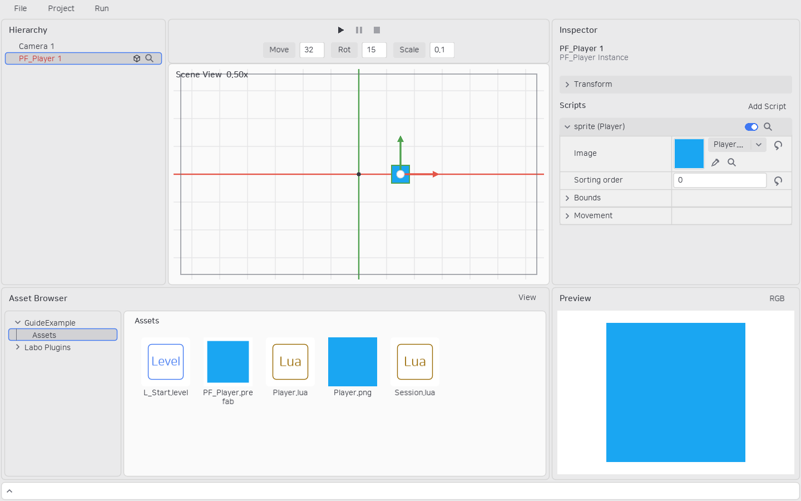
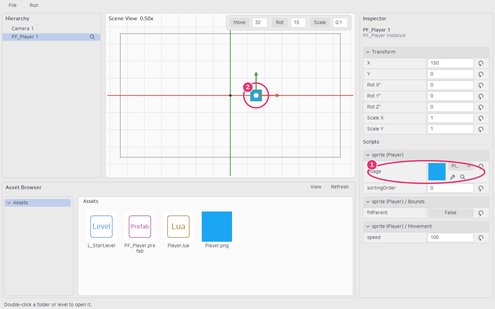
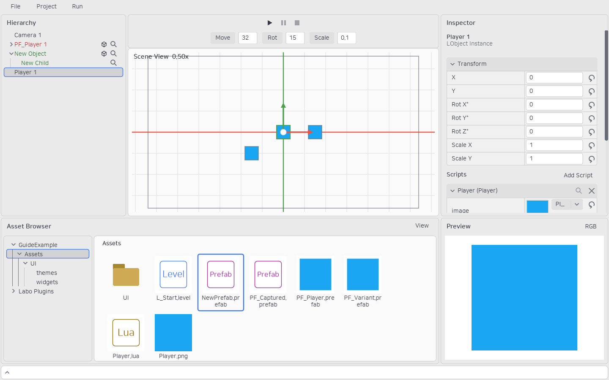
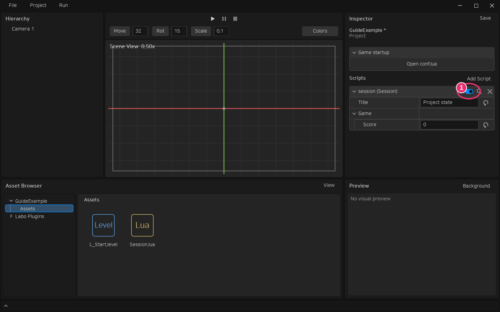
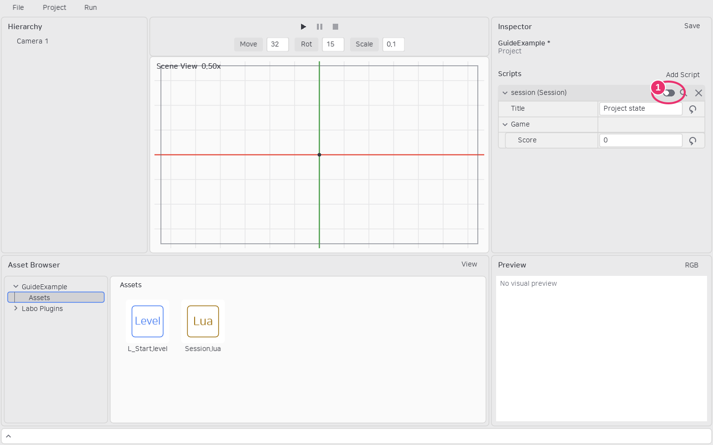

# 스크립트와 Prefab

Camera·Sprite·Pointer·RectBounds·Canvas를 사용하려면 먼저 [플러그인](plugins.md)을 활성화합니다. 새 프로젝트에서는 모두 꺼져 있습니다.

**Lua 스크립트는 행동 정의**, **Prefab은 오브젝트 계층과 부착 구성의 저장 에셋**, **인스턴스는 레벨에 배치한 실체**입니다. LObject에는 여러 스크립트를 부착할 수 있습니다.

## Inspector 대상과 Script 그룹

1. Object·Prefab·레벨 에셋을 선택하면 단일 Inspector에 해당 설정이 표시됩니다. 레벨은 한 번 선택해 부착을 편집하고, 더블클릭하면 Scene View에서 엽니다.
2. 빈 공간을 선택하거나 **Project → Inspector**를 누르면 프로젝트 설정이 표시됩니다. 메뉴로 열면 기존 Scene 선택은 유지합니다. Add Script로 프로젝트 전체 Script를 부착하고 Save로 프로젝트 설정을 저장합니다. 레벨·Project 초안은 Save All과 Undo/Redo에 포함됩니다.
3. 빈 공간 클릭은 선택을 해제하고 Project Inspector를 표시합니다. 레벨 설정을 보려면 레벨 에셋을 명시적으로 선택합니다.

표시한 **Project → Inspector**는 현재 선택을 유지하면서 프로젝트 설정을 엽니다.

이미지의 1은 프로젝트 이름, 2는 부착 헤더와 내부 프로퍼티 그룹, 3은 해당 설정의 Save입니다. Project Script는 레벨을 바꿔도 같은 실행 인스턴스를 유지합니다.

Script는 `sprite (Player)`처럼 **부착 이름 (타입)** 헤더 하나로 표시합니다. 그 안의 Bounds·Movement는 프로퍼티 분류이며 추가 부착이 아닙니다. 공통 enabled는 헤더 토글에 표시합니다. 순서 설정이 있으면 Script 그룹을 맨 위에 두고, 그룹 없는 필드는 그 아래 스크립트 타입 이름의 그룹으로 구분합니다. 순서 설정이 없으면 기존처럼 부착 헤더 바로 아래에 표시합니다. 원본 돋보기·부착 제거와 우클릭의 Rename·Copy ID·Move Up/Down은 상위 부착 헤더에서 사용합니다.

스크립트 내부 프로퍼티 그룹은 **기본으로 접혀 있습니다**. 그룹 없는 필드를 담는 스크립트 타입 이름의 그룹은 기본으로 펼쳐집니다. 그룹 이름이나 화살표를 눌러 펼치세요. 펼친 상태는 에디터 세션에서 유지하며 프로퍼티 위치 찾기는 해당 그룹을 자동으로 엽니다. Script 헤더와 Transform의 초기 열림 상태는 그대로입니다. 아래 두 이미지는 기본 접힘 상태와 수동으로 펼친 상태입니다.

이미지의 1은 실제 부착, 2는 맨 위의 공통 Script 그룹입니다. Bounds·Movement 등은 그 아래의 프로퍼티 그룹입니다. 상위 부착을 접으면 내부 그룹 전체가 숨겨집니다. 돋보기는 프로젝트 Lua와 플러그인 Lua 모두 원본 에셋 위치를 표시합니다.

오브젝트의 Transform 같은 기본 설정 섹션과 부착 Script 헤더는 같은 박스 모양을 사용합니다. 기본 설정의 프로퍼티 이름에는 내부 그룹용 추가 들여쓰기를 적용하지 않습니다. Script 안의 프로퍼티 그룹 헤더만 일반 프로퍼티와 같은 행 모양이며 이름 앞의 화살표로 열고 닫습니다. 헤더 자체는 들여쓰지 않습니다. 펼친 그룹은 내부 프로퍼티 행을 하나의 라운딩 박스로 감쌉니다. 박스의 왼쪽 경계와 이름 영역만 안으로 들어가며, 오른쪽 값 입력칸과 재설정 버튼은 그룹 없는 행과 같은 위치·크기를 유지합니다. 프로퍼티가 두 개면 두 행, 이미지처럼 원래 두 행 높이가 필요한 필드는 그 높이를 합산해 박스 공간을 확보합니다.

그룹 헤더의 밑줄은 왼쪽부터 전체 폭으로 이어집니다. 내부 프로퍼티 박스의 왼쪽 세로 경계는 위·아래 모서리에서 둥글게 연결합니다.

이름과 값의 사용 가능한 너비는 소스의 `src/editor/ui/PropertyLayout.lua`에서 `NAME_COLUMN_RATIO`로 조절합니다. `0.5`는 50:50, `0.4`는 이름 40%·값 60%이며 재설정 버튼·공통 패딩은 비율 계산에서 제외합니다. 그룹의 왼쪽 여백은 같은 파일의 `GROUP_INDENT`를 사용합니다.

다른 레벨 에셋의 설정을 편집해도 현재 Scene은 바뀌지 않습니다. 그 레벨의 객체·스크립트 참조를 선택할 때는 해당 레벨 안의 후보 목록을 사용합니다. 현재 열린 레벨을 선택하면 같은 미저장 문서를 편집합니다.

레벨을 이동하거나 이름을 바꾸면 Inspector에서 보관 중인 초안도 같은 에셋 ID를 따라갑니다. Save·Save All은 현재 위치에 저장하며, 이동 Undo/Redo 후에도 이전 위치에 파일을 다시 만들지 않습니다. 저장된 레벨을 CLI나 외부 도구로 수정한 뒤 다시 선택하거나 열면 최신 내용을 읽습니다. 이때 이전 문서 Undo 기록은 초기화합니다. 미저장 초안은 외부 파일로 교체하지 않고 유지합니다.

## Object와 Prefab 작성

1. File → New → Lua Class에서 부모 Script 또는 편의 스크립트를 고릅니다. 경로는 모두 Assets 안입니다.
2. Lua 파일에 [프로퍼티와 선택적 콜백](lua-api.md)을 작성합니다.
3. Prefab을 만들고 Add Script로 Lua 에셋 또는 기본 스크립트를 추가합니다.

Lua **오브젝트 스크립트**를 에셋 브라우저에서 Scene View 또는 Hierarchy로 드래그해도 됩니다. 빈 LObject에 그 스크립트 하나를 부착하며 이름은 `스크립트이름 1`, `스크립트이름 2`처럼 생성합니다. Hierarchy의 오브젝트 위에 놓으면 자손이 됩니다. Level 스크립트는 이 방법으로 배치하지 않습니다. 다중 드롭과 Undo/Redo도 지원합니다.

4. 각 스크립트 그룹의 프로퍼티를 설정하고 우측 상단 Save를 누릅니다.
5. Prefab을 뷰포트나 Hierarchy에 드롭해 인스턴스를 배치합니다. Lua 스크립트 자체는 배치 대상이 아닙니다.

Prefab Inspector는 오브젝트 계층 → Parent Prefab → 선택 오브젝트의 Transform → 스크립트 그룹 순서입니다. Prefab 루트 Transform은 표시하지 않으며 자손 Transform은 편집합니다. 인스턴스는 Transform과 부착 스크립트 프로퍼티를 표시하며 부모 원본·상속한 구성은 변경하지 않으며 로컬 스크립트는 추가·제거할 수 있습니다.

계층 우클릭의 **New Object**는 빈 LObject를 바로 추가합니다. 에셋 브라우저의 New → Prefab은 빈 루트로 바로 생성하고 목록 안에서 이름을 편집합니다. Hierarchy의 오브젝트 우클릭 **Create Prefab...**은 자손·스크립트·유효 값·내부 참조를 함께 캡처합니다. 파생 Prefab은 원본의 계층·부착 구성·값을 상속하고 변경한 부분만 재정의합니다.

프로퍼티의 재설정 기호는 상속값으로 복구합니다. Save 전에도 Play와 Export는 초안을 사용합니다. Ctrl+Shift+S는 변경 문서 목록을 보여주며 체크된 대상만 저장합니다.

## 스크립트 활성 토글과 프로퍼티 표시 이름

Project·Level·Object·Prefab의 부착 스크립트는 모두 헤더의 **돋보기 왼쪽 토글**로 활성 상태를 설정합니다. ① 오른쪽에 있는 색 있는 손잡이는 켜짐, 왼쪽에 있는 회색 손잡이는 꺼짐입니다. 헤더를 접어도 토글을 사용할 수 있으며, 상태를 바꿔도 그룹이 접히거나 원본 찾기가 실행되지 않습니다. 읽기 전용 대상에서는 변경할 수 없습니다.

꺼진 스크립트는 update·draw·입력 콜백을 건너뜁니다. load·unload는 초기화와 정리를 위해 실행하며, 다시 켜면 기존 상태에서 재개합니다. 설정은 기존 enabled 재정의로 저장되어 Undo/Redo·Prefab 상속·CLI·런타임 코드와 공유합니다. 별도의 Script → enabled 행은 표시하지 않습니다.

공통 **Script** 그룹은 스크립트 내부의 다른 프로퍼티 그룹보다 항상 먼저 표시합니다. update가 있으면 **Update order**, draw가 있으면 **Draw order**를 표시합니다. 둘 다 기본 0이며 음수·양수를 입력할 수 있습니다. 작은 값부터 실행하고 같은 값은 기존 순서를 유지합니다. 순서 설정도 일반 프로퍼티처럼 재정의·재설정·Undo/Redo할 수 있습니다.

① 부착 헤더와 ② Script 그룹의 Draw order입니다. Script 그룹이 있으면 그룹을 지정하지 않은 프로퍼티도 스크립트 타입 이름의 그룹으로 구분합니다.

프로퍼티 이름은 화면에서만 읽기 쉽게 표시합니다.

| 코드·저장 키 | Inspector 표시 |
|---|---|
| sortingOrder / sorting_order / sorting_Order | Sorting order |
| viewWidth | View width |
| cameraSource | Camera source |
| cameraID | Camera ID |

첫 단어만 대문자로 시작하고 약어는 유지합니다. 원래 키는 이름의 툴팁에서 확인할 수 있습니다. 코드·CLI·저장 데이터는 표시 이름으로 바꾸지 않습니다. 그룹명과 부착 이름은 사용자가 정한 이름을 유지합니다.
