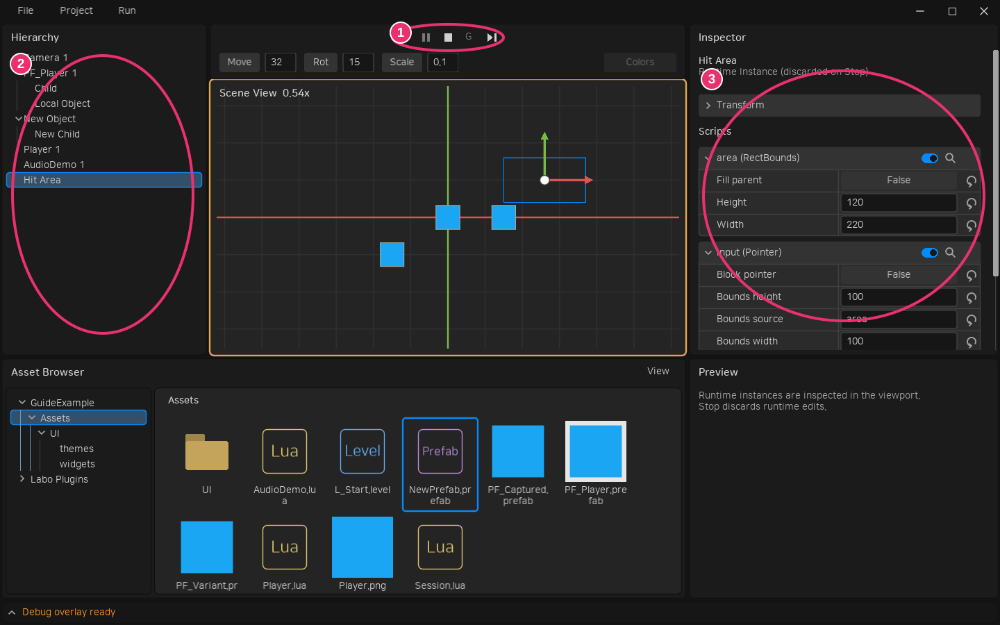

# PIE 편집

## 런타임 탐색과 편집

Play는 미저장 편집을 포함한 별도의 런타임을 만듭니다. 실행 툴바의 **E / G** 또는 **F8**로 게임 조작과 자유 탐색을 전환합니다. 자유 탐색은 현재 게임 출력의 중심·배율에서 시작하며 월드 축을 기준으로 팬·줌합니다. 게임 카메라 값은 바꾸지 않습니다.

| 상태 | 게임 Update | 뷰포트 조작 |
|---|---|---|
| 게임 조작 | 진행 | 게임 입력과 게임 화면 |
| 자유 탐색 | 진행 | 중간 버튼 팬·휠 줌·선택·기즈모 |
| Pause | 정지 | 자유 탐색과 인스턴스 편집 |

1. ① **Pause / F6**는 자유 탐색으로 전환합니다. **Step / F7**은 1/60초 Update를 한 번 실행합니다. **Play / F5**로 재개해도 자유 탐색을 유지합니다. 게임 조작으로 돌아갈 때 **G / F8**을 누릅니다.
2. ② Hierarchy 또는 뷰포트에서 실행 중 생성된 객체까지 선택합니다. 중간 버튼으로 이동하고 휠로 확대하며 **F**로 선택 대상을 화면에 맞춥니다.
3. ③ Inspector의 현재 Transform·선언된 Script 프로퍼티·활성 상태를 바꿉니다. 객체·Script 참조는 스포이드로 선택합니다. 실행 중 게임 로직이 값을 다시 쓰면 다음 프레임에 바뀔 수 있습니다.
4. 자유 탐색·Pause에서는 에셋 브라우저의 Prefab을 뷰포트나 Hierarchy에 드롭해 생성합니다. Delete는 선택 객체와 자손을 제거합니다. 런타임 Script 부착 구성·객체 복제·계층 재정렬은 지원하지 않습니다.

**Stop하면 런타임 편집을 모두 버리고 기존 편집 문서·선택·시점으로 돌아갑니다.** 런타임 변경은 문서 Undo나 복구 사본에 기록하지 않습니다. PIE 중 에셋을 선택해도 Inspector는 런타임 선택을 유지하며 원본 Prefab을 편집하지 않습니다. 기존 파일을 직접 쓰는 사용자 Lua의 부작용은 되돌리지 않습니다.

PIE 중에는 에셋 파일의 생성·이동·삭제와 편집용 열기를 차단합니다. 에셋 브라우저의 탐색과 Prefab 런타임 배치는 계속 사용할 수 있습니다.

게임은 기존 `love.mouse.setVisible`, `setRelativeMode`, `setGrabbed`, `setCursor`를 사용할 수 있습니다. 자유 탐색·Pause·에디터 UI 포커스·팝업에서는 호스트가 커서를 표시하고 상대 모드·가두기를 해제합니다. 게임이 이때 요청한 설정은 기억했다가 게임 조작에 복귀할 때 적용합니다. 게임 입력 조회는 해제 상태를 반환하며 이미 전달한 키·버튼 누름에는 해제 이벤트를 보냅니다. OS 포커스를 잃으면 자유 탐색으로 전환합니다.

입력 모드를 바꿀 때 Pointer 영역의 캡처는 클릭 없이 취소합니다. 게임의 LÖVE 마우스·터치 해제 콜백에는 누름 당시 위치 대신 현재 위치를 전달합니다.

Pause에서도 화면은 다시 그립니다. `draw`에서 변경하는 값과 독립적인 오디오·스레드까지 멈추지는 않습니다. 자유 탐색은 게임의 화면 공간 UI 대신 월드와 편집용 영역을 확인하는 화면입니다.

## 검수 예제

테스트 프로젝트의 `Assets/L_ApiExamples.level`을 열어 Play한 뒤 Pause하고 **Motion and Property References**의 `motion.speed`와 Transform을 변경합니다. Step으로 진행하고 재개한 뒤 F8로 게임 화면에 복귀합니다. `Assets/Examples/PF_Spawned.prefab`을 드롭해 생성하고 Delete로 제거합니다. Stop 후 편집 원본이 유지되는지 확인합니다. 예제 코드·Prefab·이미지는 `Assets/Examples`에 있습니다.
