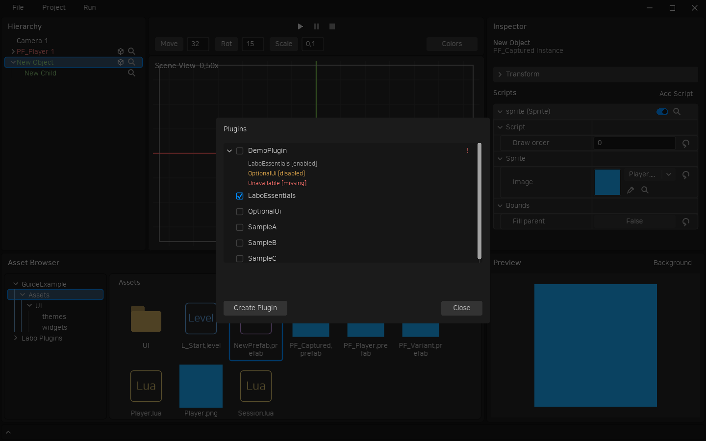
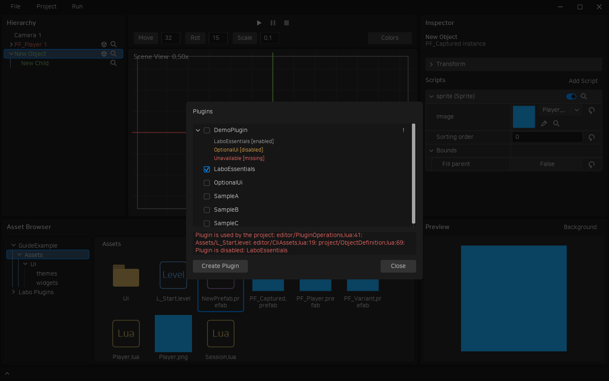

# 플러그인

새 프로젝트에는 활성 플러그인이 없습니다. LObject와 스크립트 실행·공간 API만 제공하며 **LaboEssentials**를 켜면 Camera·View·Sprite·Pointer·RectBounds·Canvas·RectLayout·Text를 함께 사용할 수 있습니다. 필요한 스크립트만 오브젝트에 부착합니다.

1. 상단 **Project → Plugins...**를 엽니다.
2. 체크박스로 활성화합니다. 필요한 플러그인이 꺼져 있으면 함께 켤 목록을 확인합니다.
3. 의존 플러그인은 먼저 켜집니다. 누락된 플러그인이나 순환 의존성은 오류로 안내합니다.



흰색 목록 패널에서 스크롤로 플러그인을 탐색합니다. 기본적으로 이름만 표시하며 왼쪽 화살표로 의존성을 펼칩니다. 의존성이 없는 항목은 화살표가 없습니다. 펼친 의존성은 **회색: 활성**, **주황색: 비활성**, **빨간색: 미설치**입니다. 오른쪽 **주황색 !**는 비활성 의존성, **빨간색 !**는 누락·순환으로 사용할 수 없는 의존성을 뜻합니다. 비활성화할 때는 함께 꺼야 하는 플러그인 목록을 확인합니다. 현재 에셋이나 레벨에서 사용하는 플러그인은 참조를 먼저 정리해야 끌 수 있습니다. Play 중에는 설정을 변경할 수 없습니다.

오류는 목록 아래의 3줄 높이 영역에 줄바꿈해서 표시하며 긴 메시지는 휠·스크롤바로 확인합니다. 오류 영역의 스크롤은 플러그인 목록과 독립적입니다.



## 에셋 탐색과 생성

활성 플러그인은 에셋 브라우저에서 다음과 같이 보입니다.

```text
Assets
Labo Plugins
└─ LaboEssentials
User Plugins
└─ MyPlugin
```

**Labo Plugins는 읽기 전용**입니다. **User Plugins에서는 일반 Assets와 같이** 폴더·Lua·Level·Prefab을 생성하고 이미지 등 파일을 추가할 수 있습니다. 이름 변경과 이동도 에셋 ID를 보존합니다. 플러그인 루트 자체를 옮기거나 삭제하는 대신 관리 창에서 비활성화합니다. 비활성화해도 파일은 남습니다.

Create Plugin으로 사용자 플러그인을 만듭니다. 실제 파일은 프로젝트 `Plugins/<이름>/Assets`에 있습니다. `plugin.json`의 dependencies는 선행 플러그인 이름 목록이고 scripts는 공개 스크립트 별칭과 파일 경로입니다. ID·Lua 종류·내용 해시는 같은 폴더의 `assets.json`에서 관리합니다. 일반 추가 에셋은 scripts에 등록하지 않아도 탐색·참조·Export가 가능합니다.

탐색기와 위치 선택 창에는 프로젝트 이름 아래 Assets를 표시하고, Labo Plugins·User Plugins는 별도 루트로 표시합니다. 내부 경로 참조는 기존 `Assets/Labo Plugins/...`·`Assets/User Plugins/...`를 유지하므로 기존 에셋 ID·Prefab 참조와 CLI 경로는 바뀌지 않습니다.

플러그인은 모든 지원 에셋을 담을 수 있으며, 게임 Export에는 활성 플러그인과 그 에셋만 포함됩니다. 기존 프로젝트에서 plugins.json이 없으면 기존 편의 스크립트를 유지하는 설정으로 열립니다.

기존 Camera·Sprite·Pointer·Rect·Canvas 플러그인 활성 설정과 의존성은 LaboEssentials로 해석합니다. 에셋 ID는 유지하며 기존 `Rect` 부착·상속 이름도 계속 읽습니다. 새 부착 목록에서는 `RectBounds`를 선택합니다. 이 스크립트는 그림 대신 UI 배치·클릭 판정용 사각형 영역을 정의합니다.

## Lua 보조 모듈

플러그인 스크립트에서도 일반 프로젝트 스크립트와 같은 `require` 경로를 사용합니다. 예를 들어 `Plugins/Images/Assets/Helper.lua`는 `require("User Plugins.Images.Helper")`, 일반 `Assets/Helper.lua`는 `require("Helper")`로 읽습니다. 이 경로는 에디터와 Export 게임에서 동일하며 보조 모듈은 `plugin.json`의 scripts 목록에 등록할 필요가 없습니다.

비활성화 검사는 스크립트뿐 아니라 이미지·Prefab 등 모든 플러그인 에셋의 참조를 확인합니다. `class.set-source`는 제안한 새 소스를 검증하며 오류가 있으면 기존 파일을 유지합니다.

## CLI

| 명령 | 용도 |
|---|---|
| `plugin.list` | 제공·사용자 플러그인, 활성 상태와 의존성 조회 |
| `plugin.create` | 사용자 플러그인 생성. JSON 요청의 dependencies 배열 지원 |
| `plugin.plan` | 활성화에 필요한 플러그인 목록 조회 |
| `plugin.enable` | 활성화. 의존 플러그인을 함께 켜려면 `--confirm true` |
| `plugin.disable` | 비활성화. 활성 의존자를 함께 끄려면 `--confirm true` |

```json
{"command":"plugin.create","project":"D:/Games/MyGame","name":"MyPlugin","dependencies":["LaboEssentials"]}
```
