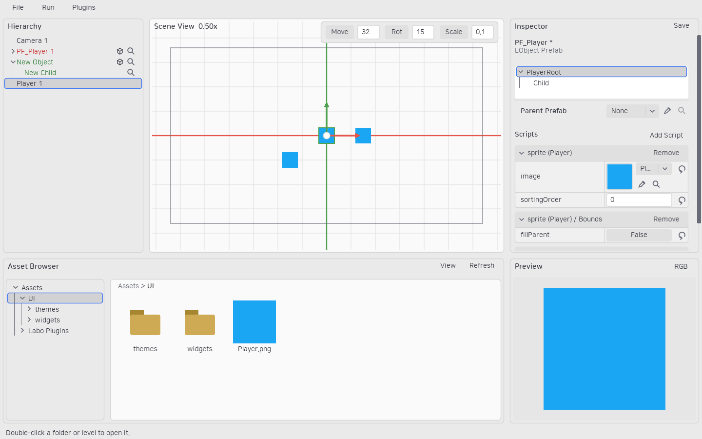
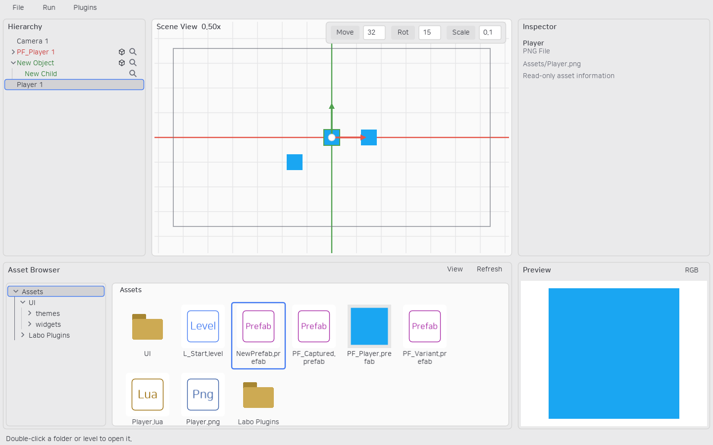
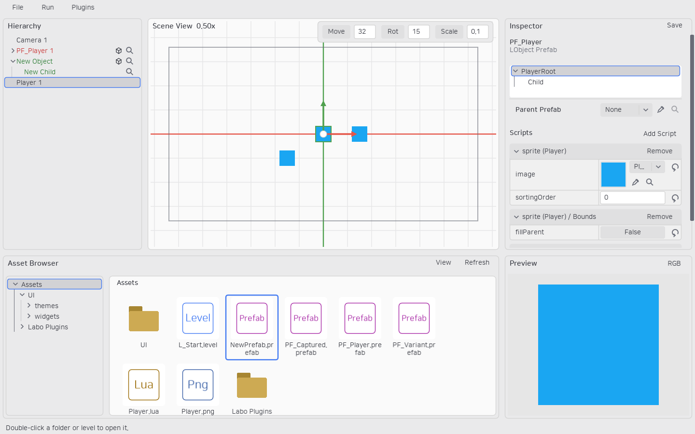

# 미리보기와 Prefab 썸네일

Inspector 하단의 **Preview**는 프로퍼티 스크롤과 분리된 영역입니다. 이미지, Prefab 계층, 선택한 인스턴스와 자손을 보여줍니다. 처음 높이는 에셋 브라우저와 같고, Inspector 프로퍼티와 Preview 사이의 경계를 드래그해 높이를 바꿉니다.



프로퍼티를 바꾸면 저장하지 않아도 바로 반영됩니다. 미리보기는 별도의 오브젝트를 만들며 `beginPlay`와 `update`를 실행하지 않습니다. 게임 초기화 상태에 의존하는 사용자 `draw`는 미리보기에서 오류가 표시될 수 있으므로 선언한 기본값으로도 그릴 수 있게 작성하세요.

**RGB** 버튼에서 배경의 R·G·B를 0–255 값으로 입력합니다. 기본은 흰색입니다. Prefab 배경은 해당 에셋의 편집 값으로 저장하며 Undo/Redo와 Save All 대상에 포함됩니다. 이미지·인스턴스 배경은 현재 미리보기의 표시 설정입니다.



## 저장 썸네일

Prefab을 저장하면 저장된 값과 배경색으로 썸네일을 생성합니다. 에셋 브라우저는 저장된 PNG를 읽으며 매 프레임 Prefab을 렌더링하지 않습니다. 미저장 편집은 Preview에만 보이고 썸네일은 마지막 저장 상태를 유지합니다.



참조한 Prefab·스크립트·이미지가 바뀌면 오래된 썸네일은 기본 아이콘으로 대체합니다. 다시 Prefab을 저장하면 갱신합니다. 시각적으로 그릴 내용이 없으면 기본 Prefab 아이콘을 사용합니다. 썸네일은 프로젝트 `.labo/Thumbnails` 캐시이며 게임 Export에 포함되지 않습니다.

## CLI

```text
asset.preview --asset Assets/PF_Player.prefab --output D:/Captures/Player.png
asset.preview --level Assets/L_Start.level --instance 3 --output D:/Captures/Instance.png
```

`--size`는 정사각형 PNG 크기이며 16–2048 범위입니다. `--background "[230,230,230]"`으로 캡처 배경을 지정합니다. CLI도 게임 초기화·업데이트 없이 같은 미리보기 렌더링을 사용합니다.
